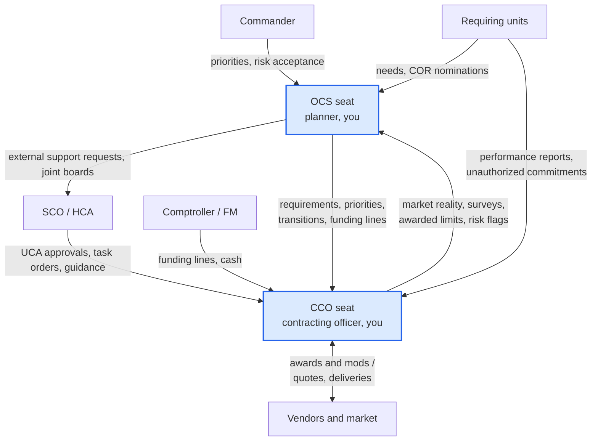
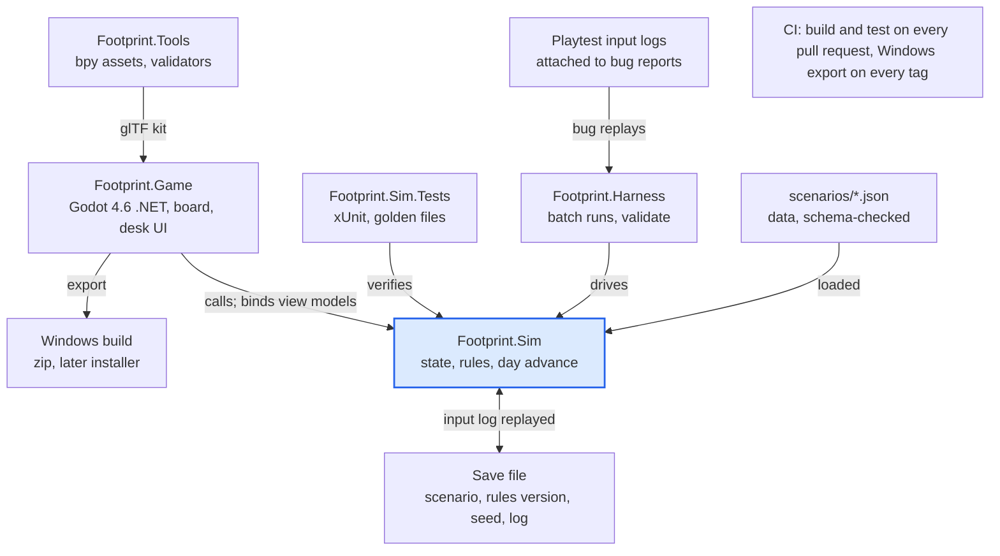
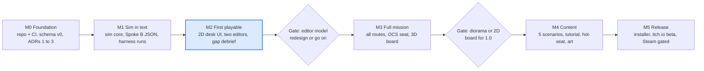

# OCS Strategy Game: Design and Implementation Specification (v0.2)

As of 7 Nov 2026 · Author: Nick Hazelett (with Fable). Source of truth for this project. The live editable copy is the Claude doc; this file is re-exported after each spec change and the version number moves with it.

**Changes in v0.2 (7 Nov 2026):** your four decisions are recorded in the bottom line; new sections 4.1 to 4.3 cover instrument tradeoffs, the pre-deployment window and the consequence model; the setting is now an island chain, which reworks the transport in the Spoke B situation; the learner focus is narrowed to the CCO.

## Bottom line

Build a single-player, turn-based (one day per turn) management strategy game, **title to be decided (it will carry "OCS" in the name; project code names below say Footprint until it is set)**, in which one player holds two seats: OCS planner and CCO for a hub-and-spoke standup and sustainment effort in a fictional theater. The game is a deterministic, seeded simulation. The player assembles requirements, support requests and contract actions from parts; the simulation judges them by what they actually deliver on the ground, not by a quiz key. Every outcome carries a cause record, so the debrief can show what happened, what the player knew at the time, and what a different call would have done.

Boundaries I recommend holding for 1.0:

- Single player, two seats, with hot-seat (same machine) as the instructor-led group mode. No network multiplayer before 1.0.
- No language model in the authoritative loop. The sim state is the only source of truth. An optional offline "advisor" that reads state and explains it is a stretch item.
- 2D "desk" interface first. The 3D tabletop is a presentation layer added once the sim is proven fun, and the data model never depends on it.
- Fictional island chain, fictional vendors, generic equipment. No Air Force marks, insignia, or named operations in content.
- Godot 4 .NET with C# throughout; the simulation is a separate class library that runs headless for tests and balance runs.
- Standalone Windows build first, shipped as a KTHQ product. The ethics question is handled before a public release, not before building.

Decisions made 7 Nov 2026 (everything else below is resolved by my judgment and recorded as an assumption):

1. **Primary learner is the CCO.** The OCS seat exists so the CCO learns why integration matters and keeps the contingency focus; it is not a co-equal game.
2. **Setting is a fictional island chain.** A hub island and spoke islands, because island hopping is the hub-and-spoke problem with transport built in.
3. **It is a KTHQ product** and is marketed as one. No ethics opinion now; that gets handled before a public release if it is needed.
4. **First playable is hub plus two spokes over 30 days.** Scenario lengths of 60, 90, 180 and 270 days come later from the same skeleton model.
5. **Every instrument has a cost as well as a speed,** and the game must make the player feel it: SF 44, GPC, purchase orders, BPAs, IDIQs, UCAs, local versus stateside sourcing, cash versus card, manual versus system-written contracts. Sections 4.1 to 4.3 carry this.

Everything that follows is written so Codex can start from it without this conversation.

## 1. Concept, learner, outcomes

This is a management strategy game in the lineage of Frostpunk, Football Manager and the better logistics sims: you run an organization under a clock, information is partial, and the thing you are managing has its own physics. Here the physics are contracted support. A deployed location needs power, water, fuel, lodging, food service, waste removal, comms backhaul and ground transport. Each of those arrives only through an arrangement someone has to build, fund, award, administer and eventually transition. The mission on the board (sortie generation, throughput, endurance) rises and falls with what the arrangements actually deliver.

Why this fits the audience and the team: it is your lane, nobody else has built it, and the content is domain knowledge you already hold. Kingfish ACE proved the audience will engage with a facilitated board game about interconnected support decisions. The gap it leaves is that contracting is a GM ruling, not a system. This game makes it the system.

**Primary learner:** the contingency contracting officer (1102 / 64P / 6C0) preparing to deploy or in their first deployment, and the junior CO who has never had to turn a vague operational need into a working arrangement under time pressure. The OCS seat is there so the CCO sees why integration matters; the CCO's contingency focus is the game.

**Secondary learner:** the OCS planner or integrator (OCSIC member, A4 staff, requiring activity lead) who writes requirements and support requests and has never seen what their omissions cost downstream.

**Tertiary:** commanders and mission partners who need to understand what contracting can and cannot do, and how fast. They play the same scenarios in "observe and debrief" mode.

**Learning outcomes.** After a few scenarios the player can:

1. Turn an operational need into a complete requirement: capability, quantity, place, start, duration, performance standard, government-furnished items, dependencies (fuel, operators, maintenance, access).
2. Choose a route to support by fit, not habit: existing BPA or IDIQ order, new award under simplified procedures, UCA, micro-purchase (SF 44 or GPC), ACSA, host nation support, or an external support contract such as AFCAP, each with its real lead time, capacity, authority and follow-on burden.
3. Separate coordination from contractual execution: who can ask, who can integrate, who can obligate, and what happens when those get blurred (unauthorized commitments and ratification).
4. Bridge and transition: run a temporary arrangement into an enduring one without a gap, with overlapping periods and a plan for the handoff.
5. Live with a UCA: get the fast start, then carry the definitization clock and the obligation ceilings until it is done.
6. Decide on the information available, invest in better information when it is worth it (site surveys, market research, reporting), and read a debrief that distinguishes bad luck from bad calls.

What the game deliberately does not teach: regulation citation recall, form completion, pricing arithmetic. Those have better homes on KTHQ. The game teaches judgment: sequencing, completeness, tradeoffs and follow-through.

## 2. Core loop, responsibilities, interaction model

One turn is one day. A mission runs 30 to 90 days. The loop each day:

1. **Morning board.** What changed overnight: deliveries, failures, reports, inbound requests, vendor notices, higher-HQ messages. Each item links to the thing it is about.
2. **Investigate.** Open sites, requirements, vendors, vehicles, the funds ledger. Order a site survey or market research. These cost staff time and take days to return, and what they return is more accurate than what you had.
3. **Act.** In the OCS seat: write or refine requirements, submit a support request, set priorities, plan a transition. In the CCO seat: build a contract action, fund it, assign a COR, modify, terminate, definitize.
4. **End day.** The sim advances: actions progress through their lead times, vendors deliver or slip, sites consume and report, disruptions play out, new information lands. Then back to the board.

A "continue until something happens" button skips quiet days so a 60-day mission takes about an hour.

**Staff capacity is the pacing resource.** The CCO seat has a small shop (two or three people's worth of work-hours per day); the OCS seat has planner hours. Every action and investigation consumes hours across one or more days. A new award under simplified procedures might take 6 shop-days of work before the vendor's lead time even starts; a BPA call takes a morning. You cannot do everything, so sequencing is the game.

**Interaction model: assemblies, not answers.** There are no multiple-choice prompts in the core loop. The player builds things from parts and the simulation judges the assembly by what it does. Three editors carry most of the play:

| Editor | Seat | What you assemble | What the sim checks |
| --- | --- | --- | --- |
| Requirement | OCS (CCO may draft, OCS owns) | Capability, quantity, site, start, duration, performance standard, government-furnished items, dependency lines (fuel, operator, maintenance, access, disposal) | Nothing is blocked. Missing lines simply do not get delivered, and the dependency checklist shows what the capability model expects |
| Contract action | CCO | Route (BPA/IDIQ order, new award, UCA, SF 44, GPC, ACSA, HNS, external support request), source, attached requirement lines, period, quantities, price basis, funding line, COR | Hard stops are legal limits (threshold exceeded, scope outside the vehicle, ordering period expired, funds expired or wrong type). Soft gaps are warnings the player can ignore (no O&M attached, no overlap with the outgoing arrangement) |
| Transition plan | both | Outgoing and incoming arrangements on a timeline with overlap, handoff conditions, who owns the gap | Highlights gaps in coverage and funding; the gap becomes real if left there |

**Scope without paperwork: requirement cards.** Scope is the part of OCS planning that matters most and reads most like homework, so it is never typed. Every requirement in the game is a card from a catalog seeded by the 41 base-standup requirements in the OCS Requirements Planner: power, water, latrines, billeting, dining, waste, fuel, MHE, and so on. A card carries the default scope lines of its recommended PWS boiled down to four to eight switches (for power: generation, fuel supply, operator, maintenance, distribution, disposal of waste oil), its dependency slots, and the site-profile values the scenario fills in (population, duration, climate), the same way the Planner's site profile fills a document. An incomplete requirement from a unit is a card with lines switched off. The OCS seat's scope work is reading the card, switching lines on or accepting the gap, and deciding whether to bundle or split: all lines to one turnkey vendor (fewer vendors can do it, longer lead, one throat to choke) or split across vendors (faster, cheaper, and a coordination seam at every split that the sim treats as a dependency). That is a twenty-second decision with real stakes, and the 41-card catalog is content we already own.

**No dollar entry.** The player never types a price. Vendors quote, market research tightens the quote's error band, the player picks a quote or waits for a better one, and the UCA's NTE is chosen from quote-based suggestions. Dollars are shown everywhere and typed nowhere; the funds ledger is a gauge.

Inspection surfaces around the editors: the board (map), a site view (capabilities, population, readiness, what is covering what), the market directory (vendors with capability, capacity, lead time, reliability, price range, and a confidence level on each figure), the vehicle library (existing BPAs and IDIQs with scope text, ceilings, ordering periods, place-of-performance limits), the funds ledger (lines, amounts, type, expiration, obligations), an inbox, and performance reports that arrive with COR-driven lag and quality.

**Free text is not part of play.** The player never explains a decision to the game. The debrief explains the decision back to the player.

**Example of play, days 1 to 9, CCO seat.** Day 1: the board shows a hub open and Spoke B opening day 7 with 180 personnel. The inbox has a requirement for "6 x 60 kW generators, Spoke B, day 7." The requirement editor's dependency checklist shows fuel supply, operator and maintenance lines empty. The player orders a site survey of Spoke B (returns day 3) and queries three vendors in the market directory for generator rental. Day 3: survey returns: no grid power, no fuel point on site, one access road rated for light trucks. Vendor A quotes generators only, 4-day lead; Vendor B quotes a turnkey power package with fueling and a technician, 9-day lead, higher price; Vendor C is on an existing base operating support BPA whose scope covers equipment rental but not fuel. Day 3 decision: the player opens a BPA call to Vendor C for generators (fast, inside scope) and, in the OCS seat, sends the requirement back with fuel and O&M lines added, flagging it for an enduring solution. Day 4: a UCA is approved for Vendor B's turnkey package as the bridge-to-enduring arrangement, NTE set, 50% obligation limit recorded, definitization clock started. Day 7: Spoke B opens on Vendor C's generators with fuel from the hub's own trucks (a coordination the player arranged with the LRS card). Day 9: Vendor B's package arrives; the transition planner shows two days of overlap; the BPA call is closed at the end of its period. The player now carries a definitization task due in 180 days, which will cost shop-hours later, and 50% of the UCA's NTE is the most that can be obligated until then.

## 3. The two layers

Both seats share one clock and one world state. The OCS seat is not a separate game; it is a different set of verbs on the same objects, and it demands attention in bursts rather than daily. Recommended starting approach: one player, two seats, with the OCS seat used in a pre-deployment planning window (untimed, day 0) and whenever the board flags a planner decision (new requirement from a unit, a support request to answer, a transition to plan, a priority call when capacity is short, a joint arrival that needs a board).



The two highlighted boxes are the player's seats; everything else is simulated. Only the CCO seat has an arrow to vendors, and only the SCO channel sends approvals and task orders.

The two accented boxes are the player's seats; everything else is simulated. Only the CCO seat has an arrow to vendors, and only higher HQ can send approvals and task orders.

**OCS seat to CCO seat:** requirements (complete or not), priorities when the shop cannot cover everything, external support requests (a theater-level request for an external support contract, which goes up with an approval lag and comes back as a task order the shop administers or an external office awards), transition plans, and the allocation of funding lines among requirements. The planner does not control the comptroller; funding lines arrive from an FM actor on their own schedule, and the planner decides which requirements they are pointed at.

**CCO seat to OCS seat:** market reality (what exists, lead times, prices, capacity), site survey findings, the arrangements that actually got awarded and their limits (period, ceiling, scope), performance reports, and risk flags: definitization coming due, an ordering period ending, a ceiling nearly reached, an unauthorized commitment reported by a unit.

**Authority boundaries the sim enforces:**

| Actor | Can | Cannot |
| --- | --- | --- |
| OCS planner (player) | Define and refine requirements, set priorities, coordinate across units, request external support, ask the SCO for joint structures (JRRB, JCSB, lead service), plan transitions, point funding lines at requirements | Obligate funds, direct a vendor, award or modify anything |
| CCO (player) | Award, modify, terminate and definitize within warrant, thresholds and vehicle scope; obligate certified funds; appoint CORs; order surveys and market research | Create requirements or funds; approve their own UCA (HCA approval is a request with lag); exceed thresholds or scope; accept performance on the unit's behalf |
| Requiring unit (NPC) | Submit needs, nominate CORs, report performance, make coordination arrangements with other units | Direct vendors (if it does, an unauthorized commitment lands in the CCO inbox for ratification work) |
| Comptroller / FM (NPC) | Certify and release funding lines, pay, replenish cash for SF 44 | Decide what gets bought |
| Commander (NPC) | Set mission priorities, accept risk, approve the planner's priority list | Bypass contracting authority |
| SCO, with the HCA behind them (NPC; a channel the CCO opens, see 4.4) | Approve or condition UCAs, ratifications, threshold determinations and warrant changes; guide terminations; return reach-back on vehicles, vendors and capacity; push a requirement back to the planner; forward external support requests | Build anything; answer instantly (1 to 5 day lag, seeded) |

Coordination versus contractual execution is modeled as two different object types. A **coordination** (borrowing the hub's fuel truck, a host nation handshake, a mission partner sharing water) is cheap and fast, has no contract behind it, and can be withdrawn by the other party when their own priorities change. A **contractual arrangement** has a period, a ceiling, a scope and an enforceable standard, costs more to create, and holds. Players learn the difference by relying on a coordination too long.

**Why not cooperative multiplayer first.** Networked co-op doubles the engineering (state sync, lobbies, desync debugging) and still needs the solo game to exist underneath. Hot-seat on one machine gives an instructor the group mode for free: the instructor runs the OCS seat (or injects), students run the CCO seat, the whole room sees the board. A later, cheap step is a **handoff file**: the OCS seat exports its plan as a scenario state, and a different person plays the CCO seat from it. That mirrors how the real handoff works and needs no netcode.

## 4. Simulation systems

The simulation is a deterministic state machine advanced one day at a time from a seed. Same scenario, same seed, same player inputs: same result, always. That property drives testing, instruction and the counterfactual debrief.

**Core objects:** Site, CapabilityDemand, Arrangement (coordination or contract), Vendor, Vehicle, FundingLine, Requirement, WorkItem (anything the shop is spending hours on), Event, and CauseRecord. Every change to state is written with a CauseRecord pointing at what caused it.

**Causal model, in three steps:**

1. **Coverage.** Each site has a daily demand per capability (power, water, fuel, lodging, food service, waste, comms backhaul, ground transport, MHE) driven by population and tempo. Each arrangement supplies capacity for one or more capabilities at a site, with a reliability figure and dependencies. A generator arrangement's effective supply is its rated supply times the worst of its dependency coverages (fuel, maintenance health, operator presence). Coverage = effective supply / demand.
2. **Condition.** Each site keeps a buffer per capability (fuel on hand, water stored, days of billeting slack). Coverage under 1.0 drains the buffer; over 1.0 refills it. A one-day hiccup costs buffer; a sustained gap empties it and the capability goes down. Buffers are what make the model forgiving on day 1 and unforgiving on day 10.
3. **Mission effect.** Four observable outputs: sortie generation (needs power, fuel, transport, comms), throughput (cargo and passengers handled: transport, MHE, power), endurance (a slow-moving personnel health and morale figure fed by life support), and resilience (how many independent sources back each critical capability, which decides how far a disruption propagates). The scenario weights them; score is mission output over time. Money is a constraint through the funds ledger and a secondary efficiency figure, never the headline score.

All of that is an educational abstraction and the scenario file says so in a visible "model assumptions" panel: linear demand, fixed buffer sizes, reliability as a daily failure probability, no weather effect on consumption, and so on.

**Uncertainty.** Every fact has an information tier: assumed, estimated, surveyed, observed. Site facts start assumed and become surveyed when a survey returns. Vendor figures carry a confidence level; the true value is drawn once per game from a seeded distribution around the stated value, wider when confidence is low, and market research narrows it. Performance reports arrive with lag and fidelity set by COR quality; with no COR, problems surface as mission effects instead of reports. The information-tier log is what lets the debrief say whether a gap was avoidable.

**Disruptions** are authored event chains with preconditions, seeded for reproducibility, never bare penalties. Examples: a storm closes the one light-truck road for three days, so deliveries slip, so fuel buffers at the spoke drain; a vendor's reliability roll fails, a cure notice goes out, and the player chooses between waiting, re-sourcing or terminating; a host nation customs hold delays imported equipment; a spoke's population jumps 40% on short notice; a security incident closes a site to vendor access until escorts are arranged; a funding line expires at fiscal year end and its replacement is late; the COR rotates home and report quality drops; higher HQ declines to extend an ordering period.

**Contracting routes as modeled.** Thresholds default to the deployed, outside-the-U.S. contingency values effective 1 Oct 2025: micro-purchase $40,000, simplified acquisition $2,000,000 ([FAR threshold rule, 90 FR 41872](https://www.federalregister.gov/documents/2025/08/27/2025-16412/federal-acquisition-regulation-inflation-adjustment-of-acquisition-related-thresholds)). Thresholds live in scenario data, not code.

| Route | Start lag | Capacity and reach | Real constraint modeled | Deliberate simplification |
| --- | --- | --- | --- | --- |
| SF 44 cash / GPC | Same day | Small, local, one-off | Per-purchase limit at the micro-purchase threshold; paying agent cash on hand with replenishment lag; GPC single and monthly limits | No split-purchase detection beyond a flag |
| BPA call | 1 shop-day | Whatever the BPA scope allows | Scope text, call limit, ordering period, place of performance | Scope match is a tag check, not legal interpretation |
| IDIQ order | 2 to 4 shop-days | Larger, enduring | Scope, ceiling, ordering period, fair opportunity step when multiple awardees | Pricing from the vendor's catalog, no negotiation |
| New award (simplified procedures) | 4 to 8 shop-days plus vendor lead time | Anything under the SAT | Shop capacity, vendor lead time, funding in hand at award | Synopsis and posting waits waived under contingency flexibilities; evaluation abstracted |
| UCA | 1 to 3 days for approval, then start | Anything, fast | NTE price; obligations capped at 50% of NTE before definitization, 75% once a qualifying proposal is in; definitize by the earlier of 180 days or 50% obligated ([DFARS 217.7404-3 and -4](https://www.acquisition.gov/dfars/217.7404-limitations.)); definitization is a work item that costs shop-days and needs funding attached to the definitized amount | No profit or cost-risk adjustment; qualifying proposal is a vendor event with a seeded date |
| ACSA | 2 to 5 days | Logistics support, supplies and services from a partner present in the scenario | Partner stock levels; reimbursement later | No reimbursement accounting beyond a ledger line |
| Host nation support | Slow to establish, then cheap | Varies by scenario | Agreement must exist; reliability varies; withdrawable | No negotiation model |
| External support contract (AFCAP-style) | 10 to 20 days approval plus 14 to 30 days mobilization | Large, enduring, self-managed | Requested from the OCS seat, awarded by an external office, administered locally; minimum useful scope and duration | No task order competition; price as a scenario parameter |
| Coordination (not a contract) | Same day | Whatever the other unit can spare | Withdrawable when the other party's priorities change | None |

Two rules the brief asked for are hard-coded: definitization never releases funds by itself (the mod waits on a funding line that covers it), and no route ever produces support instantly (even cash buys have a pickup and delivery step).

**Compliance events** are modeled because they cost time, not as a morality meter: an unauthorized commitment creates a ratification work item; an obligation over a limit is blocked at the editor; an expired ordering period removes the vehicle from the picker.

**Debrief logic.** The debrief is generated from CauseRecords and the information-tier log, in five views:

1. **Timeline**: site condition bands per capability with events annotated.
2. **Decisions**: each player action with the snapshot of what was known at that moment and what it produced.
3. **Gaps**: every capability shortfall with its cause chain, for example: Spoke B power down days 10 to 12, because the generator fuel buffer emptied, because arrangement 12 had no fuel line, because the requirement lacked one and the CCO did not add it, and a survey that would have shown no fuel point was available from day 1. Each gap is tagged avoidable (the information existed), discoverable (it was available for a cost) or unforeseeable (no path to know).
4. **Counterfactual**: pick a decision, pick a different option, re-run from that day with the same seed, and see the difference in mission output. Deterministic simulation makes this cheap.
5. **Scorecard**: mission output over time, cost, compliance events, information investment, and transitions completed without a gap.

## 4.1 Instruments and their tradeoffs

Every instrument in the game has a speed, a cost and a failure mode, and the failure modes are what teach. The table is the design contract for `rules.json`: each row becomes parameters, not prose. Times are shop-days of work; vendor lead time is added on top.

| Instrument or action | Set-up and use | What it buys | What it costs or risks | How the consequence shows up |
| --- | --- | --- | --- | --- |
| SF 44 cash buy | Same day; needs a paying agent on site | Any vendor, including cash-only ones; no paperwork lag | Per-buy limit at the micro-purchase threshold; drains cash on hand with a replenishment lag; no written terms beyond the form, so a recurring service run on SF 44s carries an execution-confusion risk (wrong days, disputed quantities, no standard to hold anyone to) | Cash gauge drops at once; confusion events roll daily while the arrangement runs; repeat buys for one recurring need are tagged in the debrief |
| GPC | Same day if accounts exist; 10 to 20 days through home station if not | No cash to guard; fast; good for supplies | Vendor acceptance is per vendor (some islands are cash only); some vendors add a surcharge; single-purchase and monthly limits; same no-written-terms risk for services | Immediate when a vendor declines the card; monthly limit bites in week three |
| Purchase order (written, SF 1449 style) | 2 to 4 shop-days manual, 1 to 2 with a contract-writing system | Written terms, performance standard, a clean invoice path | Shop time; funding must be certified first; manual payment path has an error chance per invoice | Slower start; a payment error costs the shop a day and lowers that vendor's willingness next time |
| Establish a BPA | 2 to 3 shop-days to set up; calls take 1 | Fast repeat buying inside a known scope | Not binding: a vendor can decline a call (probability rises with market tempo and falls with reliability) or walk away with notice; no minimum guarantee; covering the risk means setting up several BPAs, each costing set-up time | A declined call is immediate; a walk-away arrives as a notice with a few days' warning |
| Establish an IDIQ | 8 to 15 shop-days single award; more for multiple awards | Binding, enforceable, enduring; ordering is quick once in place | Minimum guarantee obligates money up front; the vendor's real capacity is still finite, so demand above it produces a capacity event even with a perfect contract; ceiling and ordering period | The capacity event is the "right decision still bites" case: options are a second awardee (more set-up), a surge premium, or supplementary buys elsewhere |
| UCA | Approval 1 to 3 days, then start | The fastest route to large or complex work | NTE, 50% then 75% obligation caps, definitization due by the earlier of 180 days or 50% obligated, a definitization work item that costs shop-days and needs funding that still exists, and a negotiation event when the vendor's proposal comes in above expectation | Nothing on day one; everything from day 40 on |
| Local sourcing | Fast | Short delivery legs, especially on-island; flexible | Small vendor pool shared across spokes (one vendor serving two islands splits capacity); unknown reliability until vetted; price knowledge weak until researched; a vetting work item lowers non-performance risk | Variable: a vetted on-island vendor is the most resilient source in the game; an unvetted one is a coin toss |
| Stateside or off-island sourcing | Long: airlift queue 7 to 14 days by priority, sealift 30 to 45 | Known vendors, lower unit price, large capacity | Transport is a coordination that can be bumped by higher priority cargo; customs on arrival; nothing arrives in week one | Delayed by design; the resilience payoff lands in month two |
| ACSA / host nation | 2 to 5 days / slow to establish | Cheap, sometimes the only source | Partner stock limits; withdrawable; reimbursement later | Withdrawal events when the partner's own tempo rises |
| External support contract | Weeks | Large, enduring, self-managed | Approval and mobilization lags; minimum useful scope | Month two onward |
| Manual contract writing (no system yet) | Every written action takes 50 to 100% longer | Nothing; it is the condition you start in | Payment error chance per invoice; errors cost the shop a day each | Aggregate: a shop that stays manual bleeds days |

Two more rules fall out of the table. First, scope matters as much as speed: a cash buy or a card buy for anything with a performance standard is legal and fast and still a bad fit, and the game shows that through execution events rather than a warning. Second, the vendor pool is one resource. Every instrument draws on the same few vendors per island, so an IDIQ that locks up the best vendor's capacity for the hub is a decision about the spokes too.

## 4.2 The pre-deployment window

Day 0 is an untimed planning phase with a fixed budget of prep-days (14 in the first playable). Every choice spends prep-days and changes the conditions the CCO lands in. The player cannot do everything, which is the point.

| Prep choice | Prep-days | What it changes in the game |
| --- | --- | --- |
| Stand up GPC accounts and cardholder limits | 5 | GPC available from day 1 instead of a 10 to 20 day work item |
| Arrange cash and a paying agent with FM | 2 | SF 44 available from day 1; cash gauge starts full; replenishment lag set by the FM arrangement |
| Request contract-writing system access and the location's data setup | 3 | System online day 3 instead of day 12; manual-contract penalties end that much sooner |
| Pull existing vehicles with scope and ceilings from reach-back | 1 | Vehicle library starts at the surveyed tier instead of estimated |
| Bring vendor lists and vetting from reach-back | 2 | Market directory confidence starts higher; vetting work items shorter |
| Bring templates and a manual kit | 1 | Manual purchase orders take 2 shop-days instead of 4 |
| Request a warrant increase or threshold determination | 2 | Higher single-action limits from day 1 |
| Confirm partner agreements (ACSA, host nation) | 1 | Those routes exist from day 1 or not at all |

The window is also where the OCS seat does its first real work: reading the plan, finding the incomplete requirements before wheels up, and deciding which support requests need to go up now because their lead times are measured in weeks.

## 4.3 The consequence model

Every decision is checked against four kinds of consequence, and the debrief labels which kind it was. The game never invents a consequence to make a point.

1. **Immediate.** Hard stops and resource draws: a threshold exceeded, a scope miss, cash spent, a prep-day used, a vendor declining the card.
2. **Delayed.** Clocks the decision started: definitization due, funding expiry, an ordering period ending, an off-island delivery arriving, a barge schedule.
3. **Aggregate.** Small daily rolls that only matter over time: execution-confusion events from running services on cash buys, payment errors from manual invoicing, declined BPA calls as market tempo rises, shop hours lost to ratifications, vendor willingness eroding after late payments. These rates are front-loaded: highest in the first two weeks while systems, vendors and paying agents are new, then decaying toward a floor. The curve is a tunable in rules.json with placeholder values, set properly in playtesting, and it can produce zero events in a given game.
4. **None.** Some choices are a wash and the debrief says so. GPC versus cash for a one-off supply buy when both are set up and the vendor takes both has no effect, and the gap view shows "no effect" rather than inventing one.

**The right decision can still bite,** and the scenarios are written so that it does: an IDIQ built carefully whose vendor still hits capacity when the spoke population grows; a survey ordered on day 1 that the weather delays until day 6; GPC accounts stood up pre-deployment on an island whose vendors are cash only; a vetted local vendor who is fine until the other spoke starts drawing on them too. The debrief distinguishes a bad outcome from a bad call by replaying the information available at the time, and the counterfactual view lets the player check whether a different call would have done better under the same seed.

## 4.4 The SCO channel

The Senior Contracting Official is modeled as a channel the CCO seat can open, not as a seat the player holds and not as a gate on every action. That matches the real variance: some deployments barely need the SCO, some turn on them. The game makes knowing when to call part of the skill.

**Where the SCO sits in the model:** between the two seats and above the CCO. External support requests from the OCS seat pass through the SCO before they go higher. UCA approvals, ratifications, threshold determinations, warrant changes and termination decisions route to the SCO as the approving or concurring actor (the HCA sits behind them for the few things that need it). The SCO can also push a requirement back to the OCS seat, which is the one way the game lets anyone besides the planner touch a requirement.

**What asking costs and what it returns.** Opening the channel costs a few shop-hours and a response lag of 1 to 5 days set by a seeded SCO responsiveness parameter (the scenario can make the SCO a lifeline or a voicemail). What comes back depends on the ask:

| Ask | What the SCO can return | What it changes |
| --- | --- | --- |
| Approval (UCA, ratification, threshold determination, warrant) | Approval, approval with conditions, or a question that costs another round | Unlocks the action; conditions become constraints on it |
| Terminations | Guidance that turns a termination into a known work item: cure and show-cause steps for default, settlement handling for convenience, legal review | Shop-days to execute drop by half; probability of a claim or dispute event afterward drops sharply |
| Reach-back on vehicles and sources | Theater vehicles and vendor history the player's library did not have | Vehicle library and market directory gain entries at the surveyed tier |
| Capacity | Augmentation: a borrowed CCO for N days, or work shifted to the OL | Shop hours rise for a period; not always granted |
| Pushback on a requirement | The requirement returned to the planner with what is missing | Same effect as the dependency checklist, but it costs calendar days |

**Skipping the SCO is allowed and sometimes right.** A termination run without the channel is faster on day one and carries a higher dispute probability that resolves weeks later; the debrief shows both paths. Routine actions never need the SCO, and a player who asks about everything loses days to the lag. The gap view adds one tag for this: "SCO channel would have shortened this by N days" when the counterfactual says so.

**The joint turn: where the OCS seat pulls the SCO in.** This is the SCO as force multiplier, and it is the one place the planner seat has a lever the CCO does not. A seeded mid-mission event lands a sister-service element on a spoke island with its own contracting shop, its own requirements and its own habits. Left alone, the sim does what happens in real life:

- Both shops draw on the same handful of island vendors. Quotes rise 15 to 30% (a price-war event) and capacity splits, so an arrangement that covered the spoke no longer does.
- Duplicate requirements appear: two fuel arrangements for one site, two waste contracts, each half-used and both obligated.
- Units learn to shop between the two offices, and the other service's units start directing your vendors, which arrives as unauthorized commitments in your inbox.
- Vehicles the other service already holds in theater are invisible to you.

The OCS seat can ask the SCO to stand up joint structures: a **JRRB** (requirements review and prioritization across the services on the island), a **JCSB** (contracting deconfliction: who buys what, which vehicles are shared, one vendor pool managed instead of fought over), and a **lead service designation** that settles authority for a capability or a site. Standing them up costs 3 to 7 days depending on the SCO responsiveness parameter, and after that every new requirement takes an extra 1 to 2 days through the board. In return: duplicates merge, the price-war event stops firing, the other service's vehicles appear in the vehicle library at the surveyed tier, consolidated buys cut shop-hours per requirement, and the other service's units stop generating unauthorized commitments against your vendors.

The tradeoff is latency against coherence, and the sim is honest about it both ways. A board stood up for an operation that never goes joint is overhead the debrief tags "no effect." A joint arrival with no board is a month of events the debrief traces back to the day the planner could have asked. A good SCO (high responsiveness) offers the boards unprompted when the arrival lands, as an inbox message the player can accept; an average one waits to be asked; a poor one takes a week to answer. That spread is the real-world variance you described, built into the seed.

**Why not a third seat.** The SCO's work is judgment and approvals, not building things, and a seat with nothing to assemble is a quiz. As a channel they stay in the middle of OCS and contracting, which is where you put them.

## 5. Worked situation: power at Spoke B

This is the first authored situation and the acceptance test for the first playable. It combines three of the brief's examples: an enduring effort starting while scope is still being refined, power equipment without the support to run it, and a UCA that buys speed and sells a debt.

**Setup (what the player sees on day 1).** Hub open with 600 personnel. Spoke B opens day 7 with 180 personnel, growing to 260 by day 20 (the growth is in the plan but easy to miss). Requirement 0007 from the spoke's advance team: "6 x 60 kW generators, Spoke B, required day 7, duration 90 days." Its dependency checklist shows fuel, operator and maintenance lines empty. One existing base operating support BPA (Vendor C) covers equipment rental; scope excludes fuel delivery. Market directory lists Vendor A (generators only, 4-day lead, estimated confidence), Vendor B (turnkey power with fueling and a technician, 9-day lead, estimated confidence). Funding: one O&M line, $900,000, expires day 75. Shop capacity: two people. Hidden until surveyed: Spoke B has no grid, no fuel point, and it is reached only by a twice-weekly barge from the hub island and a light aircraft; hub-island vendors depend on the barge, the one spoke-island vendor does not. Seeded event: weather stops the barge days 16 to 18.

**Approach 1, do what the requirement says.** BPA call to Vendor C for six generators, delivered day 6. Power is up on day 7. Nobody arranged fuel. Buffers (the generators arrive with full tanks) carry the site to day 9. Day 10 power drops to zero. The unit's advance team phones a local fuel hauler and has fuel on site by day 11 without a contract: an unauthorized commitment lands in the inbox, ratification becomes a work item, the fuel keeps coming on a handshake. Days 16 to 18 the barge stops; the handshake hauler is on the hub island; power is down again. Debrief tags the day 10 gap avoidable (dependency checklist was visible day 1) and the day 16 gap discoverable (survey would have shown the barge dependency; a fuel buffer or an on-island source would have covered it).

**Approach 2, fix the requirement first, then bridge.** Day 1 the player orders a survey (returns day 3) and, in the OCS seat, adds fuel, operator and maintenance lines to requirement 0007 and flags it enduring. Day 3 the survey confirms no fuel point and the barge dependency. Day 3 BPA call to Vendor C for generators plus a coordination with the hub's fuels flight for a fuel run on each barge (cheap, withdrawable). Day 7 power is up. Day 12 the hub's fuels flight withdraws the run because hub tempo rose (a seeded event with a precondition: coordination in place for more than 4 days). The player has a two-day buffer to replace it. If a fuel contract was already in work, fine; if not, it is Approach 1 with a delay. Debrief credits the information investment and shows the coordination's withdrawal as the moment the arrangement should already have been contractual.

**Approach 3, UCA for the turnkey package.** Day 1 survey ordered; day 2 UCA request to the HCA for Vendor B's turnkey power package, NTE $480,000 for 90 days; approval returns day 4; Vendor B mobilizes 9 days, on site day 13. Spoke B still needs power days 7 to 13, so the player also runs Approach 2's bridge (BPA generators plus fuel coordination) with a two-day overlap in the transition planner. Power is continuous. The costs: $240,000 is the most that can be obligated on the UCA until definitization (50% of NTE); Vendor B's qualifying proposal arrives around day 40 (seeded), after which the cap rises to 75%; definitization is a work item that costs about 6 shop-days and must be funded from a line that still exists when it is done. If the player ignores it, by about day 60 the obligation cap is hit, the UCA cannot be modified for the day-20 population growth, and higher HQ starts asking. The funding line expiring day 75 is the trap: definitize late and the money is gone.

**Approach 4, enduring from the start through external support.** Day 1 the OCS seat submits an external support request for power at Spoke B as part of a base operating support package. Approval lag 14 days, mobilization 21 days, on site around day 36. Nothing about this helps day 7. The player who picks only this approach loses Spoke B's power for a month and learns what an external support contract is for: the enduring solution you start now so the bridge can end, not the first-week answer. The player who pairs it with Approach 2 or 3 ends the mission with a clean transition and no UCA debt.

**What the debrief shows for each.** The timeline band for Spoke B power across 90 days, the decision list with what was known, the gap list with its tags, and a counterfactual run the player chooses (for example, Approach 1 with a day 1 survey added, re-run from day 1, which shows the day 10 gap disappearing and the day 16 gap shrinking). Approach 3 and 4 together score highest on mission output and resilience; Approach 2 alone scores well on cost and poorly on resilience; Approach 1 scores worst and is what most first-time players will do, which is the point.

**Omissions and delayed effects the situation exercises:** missing dependency lines (effect at day 10), no survey (effect at day 16), coordination treated as a contract (effect at day 12), UCA debt (effect at day 60), funding expiry (effect at day 75), population growth not read in the plan (effect at day 20 when demand exceeds six generators' effective supply).

## 6. Replayability and scenario authoring

A scenario is an authored skeleton plus a seed. The skeleton fixes what the lesson needs fixed (sites, mission arc, the key situations, the pass criteria). The seed varies everything else inside ranges the author set. Same skeleton and seed is a reproducible exercise for instruction and testing; a new seed is a new game.

**What varies by seed:**

- Infrastructure: grid presence, water source, road ratings, airfield capacity, port access.
- Market: which vendors exist, their capacity, lead times, reliability, prices, and the confidence of what the directory says about them.
- Existing vehicles: which BPAs and IDIQs are in place, their scope tags, ceilings and ordering periods.
- Requirements: which arrive incomplete, when units submit them, population growth curves.
- Information quality: how wrong the starting assumptions are.
- Timing and disruptions: which authored event chains fire and when, within their windows and preconditions.
- Partners: whether an ACSA partner or host nation agreement exists.

**What never varies by seed:** the learning situations the author marked as fixed, the thresholds and rules in force, and the pass criteria.

**Scenario file format.** Plain JSON with a published schema, validated by a command-line tool in the repo. Three files per scenario so content, rules and presentation stay separate:

- `scenario.json`: sites, mission arc, requirements, vendors, vehicles, funding lines, event chains with preconditions and windows, variation ranges, fixed situations, pass criteria, model-assumption text.
- `rules.json` (shared across scenarios, versioned): thresholds, UCA limits, route lead times, buffer sizes, reliability curves. Updating thresholds for a new fiscal year is a data change.
- `theme.json`: names, map art reference, flavor text, portraits. Swapping a theme never changes play.

**Authoring workflow.** You write situations in prose (the way section 5 is written). I translate them into scenario JSON. Codex's validator checks schema, dangling references, impossible windows and unreachable situations. The headless harness then plays each scenario with scripted policies (do-nothing, greedy-cheapest, textbook) across 200 seeds and reports the outcome spread, so we know a scenario is winnable, losable and not degenerate before anyone plays it. A graphical scenario editor is a stretch item; the first authors are the two of us and a schema is enough.

**Content plan for 1.0:** a tutorial scenario (hub only, 20 days, three capabilities), the Spoke B power scenario (section 5), a sustainment scenario (everything is already running; the game is transitions, option exercise, expiring ordering periods and a vendor default), a surge scenario (population doubles and a sister-service element lands on a spoke; capacity and deconfliction are the fight, and the joint turn in 4.4 is the lesson), and a drawdown scenario (closing a spoke without stranding obligations). Five skeletons, unlimited seeds.

## 7. Visual direction and asset strategy

The honest assessment first: a polished 3D tabletop with modeled, textured, lit and animated assets is the single largest production risk in this project, and it contributes nothing to whether the game teaches. So the visual plan is staged, and the data model never knows the board is 3D.

**Recommended style: a stylized diorama.** Low-poly, flat-shaded, no textures (vertex colors and a small palette), one fixed three-quarter orthographic camera that can zoom between an operating-area view and a site view, soft shadows, one key light. This is the style of Townscaper, Mini Motorways and the Kingfish board photographed from above, and it is chosen for a reason: it is the only 3D style a two-agent team with no artist can sustain. Flat-shaded low-poly needs no UV work, no texturing and no sculpting, which is where art hours go. It also reads clearly at a glance, which is what a board for decision-making needs.

**Two surfaces, strictly separated:**

- **The board** (3D viewport): where things are and how they are doing. Sites as dioramas on a stylized terrain, routes as lines that light up with movement, capability tiles at each site colored by coverage, buffers as fill gauges, vendors as pins in towns, disruptions as visible effects (a road segment goes grey, a site tile pulses, a truck stops). It answers "what is the situation" and is the thing a room watches on a projector.
- **The desk** (2D Godot Control UI over the viewport): editors, directory, vehicle library, ledger, inbox, reports, transition planner, debrief. It answers "what am I doing about it." All information needed to play is on the desk; the board is never the only place a number lives.

**Animation needs, kept procedural.** Trucks moving along routes (tween along path), generators with a small exhaust particle when running and none when down, tents and CHUs popping in as a site stands up, lights on and off per site at the day transition, a day-night sweep as the turn advances, a camera glide between hub and spoke. No character animation, no cutscenes, no rigs. The debrief uses 2D charts and the board replays the timeline with the same procedural animation.

**Asset strategy.** A modular kit of roughly 40 to 60 low-poly pieces: tent, CHU, generator, fuel bladder, water buffalo, pallet, forklift, light truck, fuel truck, bus, guard tower, barrier set, antenna mast, airfield segments, a generic aircraft silhouette, warehouse, town block, road and route segments, terrain tiles (desert, scrub, coastal), weather effects. Codex generates these by Blender scripting (bpy) from parametric descriptions, exports as glTF, and the kit is assembled in Godot scenes. Generated concept images are reference for palette and composition, never shipped assets. Audio: a small procedural and licensed-CC0 set (ambient, UI clicks, truck, generator, alert), tracked in the provenance log like everything else.

**Where this needs a human artist or money, if the ambition holds:** a signature key-art image for the store page, UI iconography that reads at small sizes (generated icons are inconsistent), and a final lighting and color pass. None of these block any milestone. If the kit-bash results look amateurish at milestone 3, the fallback is a 2D illustrated board built from the same data, which loses no gameplay.

**Interface concepts worth prototyping early** (these are the experiments that decide the UI): the requirement editor's dependency checklist, the action editor's hard-stop versus soft-gap validation display, the transition planner's overlap bars, and the "continue until something happens" day advance with a morning board that is readable in ten seconds.

## 8. Technical architecture

**Stack: Godot 4.6 .NET with C# everywhere, and the simulation in its own class library with no Godot dependency.** Godot 4.6 shipped 27 January 2026 and is the current stable line ([release notes](https://godotengine.org/releases/4.6/)); check for a newer 4.x at kickoff and take it if it is at least one maintenance release in. Reasons for this stack over the alternatives:

- The game is a simulation with a view on it. A pure C# sim assembly runs headless in a console harness for unit tests, 200-seed balance runs and the counterfactual debrief, with no engine in the loop. GDScript cannot do that.
- C# gives agent-written code compile-time checking, real refactoring and standard test tooling (xUnit). That matters more than usual when two agents write most of the code and the human reviews behavior rather than source.
- Godot .NET exports self-contained Windows builds; the .NET SDK is a build-time dependency only. Web and mobile exports are not available for C# projects, and we do not need them.
- Godot over Unity or Unreal: no licensing exposure for a free public release, small download, fast iteration, and good enough 3D for a flat-shaded diorama. Over a custom C++ engine: we would spend the project building an engine.



Every arrow points at the sim or away from it; nothing talks to the Godot project except the asset kit and the exporter.

Every arrow points at the sim or away from it; nothing talks to the Godot project except the asset kit and the exporter.

**Projects in the solution:**

| Project | Type | Owns | Depends on |
| --- | --- | --- | --- |
| `Footprint.Sim` | .NET 8 class library | State model, rules engine, day advance, event chains, CauseRecords, scenario loading, save and replay | Nothing but the .NET base library |
| `Footprint.Sim.Tests` | xUnit | Unit, property and golden-file tests | Sim |
| `Footprint.Harness` | Console app | Batch runs: scenario x seeds x scripted policies, outcome spread reports, scenario validation | Sim |
| `Footprint.Game` | Godot 4.6 .NET project | Board, desk UI, debrief views, input handling, presentation state | Sim |
| `Footprint.Tools` | Python and Blender scripts | Asset generation (bpy), schema validation, provenance checks | None at runtime |

**Determinism rules (non-negotiable, enforced by tests):** one seeded generator per subsystem (market, events, vendor performance, reports) so adding a draw in one does not shift the others; integer or fixed-point arithmetic for any quantity that feeds an outcome (buffers, coverage, dollars in cents); a fixed order of subsystem updates within the day advance; no wall clock, no dictionary iteration order, no floating point in rules. The presentation layer may use floats freely because it never writes back to state.

**Save state and replay.** A save is the scenario id, rules version, seed, and the full input log (every player action with its day). Loading replays the log through the sim, which is fast at this scale and guarantees a save can never disagree with the rules. A snapshot of state is also written for quick resume and for the debrief's "what was known on day N" views. Autosave every day; manual save anywhere.

**Reproducibility for instruction.** A scenario plus a seed is a short code an instructor can hand a class. Every student plays the same world; the debrief compares input logs.

**Testing:**

- Unit tests on every rule (threshold checks, UCA caps and clocks, buffer arithmetic, scope matching, funding expiry).
- Property tests on invariants: buffers never negative, obligations never above caps, no capability delivered without an arrangement, every state change has a CauseRecord.
- Golden-file tests: scenario plus seed plus a recorded input log must produce a known final-state hash; any rule change that alters it is reviewed on purpose.
- Harness balance runs on every scenario change: do-nothing, greedy and textbook policies across 200 seeds; a scenario fails review if textbook loses or do-nothing wins.
- Godot side: smoke tests through a headless export that loads each scene and plays a scripted 10-day game; manual playtests by you with the input log attached to the bug report, so any bug is a replay.
- CI on GitHub Actions: build and test on every pull request; export a Windows build artifact on every tag.

**Scenario data** is the JSON described in section 6, validated by `Footprint.Harness validate` and by a JSON Schema checked into the repo. Rules carry a version and the save records it.

## 9. Scope envelope

| Tier | What it is | Sites and days | Systems in | Systems out | Presentation |
| --- | --- | --- | --- | --- | --- |
| First playable | The Spoke B power situation, playable end to end, ugly | Hub + 2 spokes, 30 days | Pre-deployment window, day loop, shop hours, requirement and action editors, 6 capabilities, 6 instruments (SF 44, GPC, purchase order, establish and call a BPA, UCA, local versus hub-island sourcing), manual-versus-system condition, 8 vendors across 3 islands, 1 funding line, 3 event chains, timeline and gap debrief with consequence labels | OCS seat beyond requirement editing, IDIQ establishment, external support, ACSA, HNS, off-island sourcing, counterfactuals, saves beyond autosave | 2D desk only, schematic board |
| Representative mission | One scenario at intended quality | Hub + 3 spokes, 60 days | All routes, OCS seat with support requests and transition planner, funding lines with expiry, COR and report fidelity, 8 event chains, full five-view debrief including counterfactual, seeded variation | Scenario editor GUI, multiplayer | 3D diorama board with procedural animation, finished desk UI, sound |
| Initial release (1.0) | Standalone Windows build people outside the team can learn from | 5 scenario skeletons, 20 to 90 days | Everything above, tutorial, hot-seat mode, instructor seed codes, save and load, settings, accessibility basics (scalable UI, colorblind-safe palette) | Networked play, advisor, Workshop | Polished, with key art |
| Stretch | After 1.0 |  | Handoff-file co-op, instructor inject console, offline advisor reading sim state, macOS and Linux builds, Steam Workshop scenarios, graphical scenario editor, additional theaters |  |  |

**Complexity drivers, in order of how much they move the schedule:**

1. **The 3D board.** Highest variance item; it is why it is deferred to the representative mission and why the 2D fallback exists.
2. **Debrief counterfactuals.** Cheap in the sim (re-run from day N) but the UI for choosing an alternative decision is a design problem that needs a prototype.
3. **OCS seat depth.** The planner seat can grow without limit; the brief's "equal layers" reading roughly doubles it. Held to requirements, priorities, external support requests and transitions.
4. **Event chain authoring.** Each chain with preconditions is cheap to code and expensive to balance. The harness carries that load.
5. **Editor UX.** The assembly model lives or dies on whether building a contract action feels like a decision or like data entry. This is the first UI experiment and may need two or three passes.

**Dependencies:** the Spoke B scenario depends on the sim core; the 3D board depends on the asset kit, which depends on Codex's Blender pipeline working with its available tools; Steam depends on an ethics opinion and a Steamworks account in your name or a label's; hot-seat depends on nothing new.

**What needs a prototype before anyone estimates it:** the action editor (one week of UI experiments decides whether the assembly model is right), the diorama look (one site rendered from the kit decides the whole visual plan), and the counterfactual picker. Everything else is ordinary engineering with known shape.

## 10. Distribution

**Standalone Windows is the path for everything through 1.0.** Godot exports a self-contained folder (executable plus a .pck); zip it, publish it on GitHub Releases with a checksum, and link from wherever you host. No installer in early versions; an installer (Inno Setup) at 1.0 so SmartScreen warnings are less alarming. Code signing is a later expense if the download scares people. The game is offline by default and writes only to the user's app-data folder, which matters for anyone who wants to run it on a work laptop.

**Steam, as verified on Valve's own pages (November 2026):**

- Steam Direct fee is $100 per product, paid with a normal Steam payment method (not wallet funds), recoupable only after $1,000 in revenue, so for a free game it is a sunk $100 ([Steam Direct](https://partner.steamgames.com/steamdirect), [fee page](https://partner.steamgames.com/doc/gettingstarted/appfee)).
- Bank, tax and identity verification takes 15 to 30 days and the account holder name must match legal ID; the Steamworks account is a person or a company, not a website.
- A 21-day waiting period between paying the fee and release; a public "coming soon" page for at least two weeks before release; store page and build review take 1 to 5 days each.
- Free games are allowed; the page describes no different process for them.
- Content survey requires an AI disclosure. Since Valve's January 2026 rewrite, AI-assisted development tools do not need disclosure, but pre-generated content players see (art, audio, text) does, and the disclosure shows on the store page ([Game Developer](https://gamedeveloper.com/business/valve-tweaks-and-clarifies-ai-disclosure-rules-for-steam)). The asset kit is generated, so we disclose it plainly. No live-generated AI content in the game means no guardrail declaration is needed.

**Pre-conditions before a Steam page exists:** an ethics opinion covering a free public release by a serving member whose official duties overlap the subject; a decision on the label it ships under; no Air Force marks, insignia or official names anywhere in the game, store page or key art; and a short public statement that the game is an unofficial training aid with no endorsement.

**Other channels worth nothing extra:** itch.io (free, no fee, no waiting periods) as a public beta channel before Steam, and the GitHub release as the canonical download for people on networks that block game storefronts.

## 11. Milestones

No calendar dates. Each milestone is defined by what you can play and what must be true before we call it done. Durations become estimable after M1, when we know how fast the three of us actually ship against this codebase.



M2 is highlighted because it is the first time the game is judged as a game; the two diamonds are the decisions that can send work backward. A milestone closes only when the harness balance run and the golden-file tests pass.

M2 is accented because it is the first time the game is judged as a game; the two diamonds are the decisions that can send work backward.

**M0, Foundation.** Repo, solution skeleton, CI, scenario schema v0, decision log, this spec checked in. Done when: `dotnet test` passes in CI on a pull request; `Footprint.Harness validate` rejects a broken scenario file; a Godot project opens, references the sim and shows an empty board.

**M1, The sim is a game in text.** Sim core for the first-playable tier; the Spoke B scenario in JSON; the harness can play it with scripted policies. Done when: all four approaches in section 5 reproduce in the harness from input logs with the expected day-10, day-12, day-16 and day-60 effects; 200-seed runs show textbook beats greedy beats do-nothing; golden-file tests exist for each approach; every state change carries a CauseRecord.

**M2, First playable.** 2D desk UI on the sim: morning board, requirement and action editors, directory, ledger, day advance, timeline and gap debrief. Done when: you play Spoke B start to finish without touching a JSON file; a new player with no briefing finishes a game in under 45 minutes; the gap view correctly tags at least the four seeded gaps; you can state in one sentence what the game taught you and it matches an intended outcome. Decision gate: does the assembly model feel like deciding? If not, redesign the editors before anything else.

**M3, Representative mission.** All routes, the OCS seat, funding expiry, COR fidelity, counterfactual debrief, seeded variation, and the 3D diorama board over the same sim. Done when: a 60-day hub-plus-three-spokes scenario plays at the intended quality; the counterfactual picker produces a re-run in under two seconds; five seeds of the same skeleton produce visibly different games; one site rendered from the kit looks like something you would put on a slide; save, load and resume work across a restart. Decision gate: diorama or 2D illustrated board for 1.0.

**M4, Content and polish.** Five scenario skeletons, tutorial, hot-seat, instructor seed codes, sound, accessibility basics, key art. Done when: three external testers (a junior CCO, an OCS planner, a commander-type) each finish the tutorial and one scenario and their input logs show them using surveys and transitions by their second game; no crash across 1,000 harness runs and 20 human games; every asset has a provenance entry.

**M5, Release.** Windows installer, GitHub release, itch.io page as public beta; Steam page only when the pre-conditions in section 10 are met. Done when: a stranger downloads it, installs it offline, plays it, and the crash and feedback channel works.

**Rule for every milestone:** the Harness balance run and the golden-file tests pass before a milestone is declared; a milestone is never declared on a feature list alone.

## 12. Collaboration plan

**Repository:** one private GitHub repo, `footprint`, with `main` protected. Nothing reaches `main` except by pull request, and you merge (or I do when you have said so on a given PR). Each agent works on its own branches: `fable/<topic>` and `codex/<topic>`. One PR per task, small enough to read.

```
footprint/
  docs/
    SPEC.md                 authoritative spec (this document, exported and kept current)
    decisions/ADR-0001.md   one file per decision: context, options, choice, consequences
    handoffs/YYYY-MM-DD-<agent>-<topic>.md
    assumptions.md          every deliberate simplification, with the real rule beside it
  backlog/
    BACKLOG.md              prioritized, each item with acceptance criteria and an owner
  src/
    Footprint.Sim/  Footprint.Sim.Tests/  Footprint.Harness/
  game/                     Godot project (Footprint.Game)
  scenarios/                scenario.json, rules.json, theme.json per scenario, plus schema/
  tools/                    bpy asset scripts, validators
  assets/
    PROVENANCE.md           every asset: origin, generator or author, prompt or source, license
  sources/                  read-only reference material; never edited, never shipped
```

**Coordination system:** the backlog file is the single queue. Each item has an id, acceptance criteria, an owner, and the file or component boundary it may touch. GitHub Issues mirror it only if you want notifications. A handoff note is written at the end of every work session by whichever agent worked, five headings, nothing else: changed, why, how it was validated, unresolved, next. Decisions that change the spec get an ADR before the code, and the ADR number goes in the commit.

**Component ownership (default; the backlog can reassign):**

| Component | Owner | Other agent's role |
| --- | --- | --- |
| Spec, ADRs, scenario design and JSON, rules data | Fable | Review for implementability |
| `Footprint.Sim`, `Footprint.Sim.Tests` | Fable | Review, profiling, bug fixes on assigned items |
| `Footprint.Harness` | Codex | Policy scripts for balance runs come from Fable |
| `Footprint.Game` scaffold, desk UI, board, debrief views | Codex | Fable writes the view-model contracts the UI binds to |
| Asset pipeline, bpy scripts, kit, sound | Codex | Fable reviews against the visual direction |
| CI, exports, installer, Steamworks prep | Codex |  |
| Playtesting, scenario truth, priority calls | Nick | Both agents turn his notes into backlog items |

**Boundary rule:** an agent does not edit files in the other agent's component without a backlog item that says so. Shared contracts (the view-model interfaces between Sim and Game, the scenario schema) change only by ADR.

**Expectation setting is a standing duty of both agents.** Early builds will look bad, and the person who has to stay interested through that is you. So every handoff note carries a line that says what this build is expected to look like and why, and every milestone has a written "what rough looks like here" statement before anyone opens it: M1 is text in a console and no UI at all; M2 is grey boxes and default fonts over a schematic map, judged only on whether the decisions feel like decisions; M3 is the first time it looks like a game; nothing before M4 should be shown to anyone outside the team. If a build is worse than its statement, the note says so and names the fix. If it is better, the note says that too. The agents also keep a one-line "where we are against the plan" at the top of `BACKLOG.md`, updated every session, so you never have to infer progress from a diff.

**Neither agent sees the other's conversation.** Everything either needs is in the repo: the spec, the backlog, the handoff notes, the ADRs, the tests. If a question cannot be answered from the repo, the asking agent writes it into `backlog/QUESTIONS.md` and you route it.

**Initial assignments:**

Fable (M0 and M1):

1. Export this spec to `docs/SPEC.md`; write ADR-0001 (stack), ADR-0002 (determinism rules), ADR-0003 (single-player two-seat first).
2. Scenario schema v0 and `assumptions.md`.
3. `Footprint.Sim` domain model and day-advance loop for the first-playable tier, with tests.
4. Spoke B `scenario.json` and the four approach input logs as golden files.
5. View-model contracts for the morning board and the two editors.

Codex (M0 and M1):

1. Repo scaffold, solution, GitHub Actions (build, test, Windows export on tag).
2. `Footprint.Harness`: run, validate, batch with outcome spread report.
3. Godot 4.6 .NET project referencing Sim; empty board scene; desk UI shell with the panel layout from section 7.
4. First bpy experiment: generate one site (tent, CHU, generator, fuel bladder, truck) flat-shaded, export glTF, render it in Godot; report what tools and steps worked.
5. `PROVENANCE.md` template and a check that fails CI when an asset lacks an entry.

Nick (now): the four decisions in the bottom line, and a first pass at the five scenario skeletons in prose, one paragraph each.

**Requires manual attention, outside expertise or money (none block M0 to M2):** ethics opinion; Steamworks account, $100 fee, and tax paperwork in a real person's name; a human eye on key art and iconography; code-signing certificate if SmartScreen becomes a problem; sound licensing checks; three external playtesters.

## 13. Open questions, assumptions, research

**Questions only you can answer** are the four in the bottom line. Everything else here is resolved by assumption and recorded so it can be overturned.

**Assumptions in force:**

- Fictional archipelago: a hub island and spoke islands joined by barge and light aircraft; fictional vendors, generic equipment, no real place names.
- Deployed, outside-the-U.S. contingency thresholds are the default in every scenario; home-station thresholds appear only if a scenario explicitly sets them.
- The CCO seat holds a warrant sufficient for the scenario; warrant limits are a scenario parameter, not a mechanic, until someone asks for them.
- HCA approval for a UCA is modeled as a 1 to 3 day lag with no refusal path in the first playable; refusals and conditions arrive at M3.
- Funding is O&M only; no construction funding rules, no MILCON, no color-of-money play beyond expiry and amount. This is a large simplification and it is labeled as one.
- Pricing is a vendor quote with a seeded error band; no negotiation mini-game, no cost analysis.
- Evaluation and award under simplified procedures is abstracted to shop-days; no source selection play.
- Contractor management (accountability, base access, arming) is out of scope for 1.0 except as access events.
- Scoring is mission output; dollars are a constraint and an efficiency figure.

**Research needs before the matching milestone:**

- Before M1: confirm the current UCA definitization and obligation rules against the DFARS text as published at that time (the 2025 DFARS change dates suggest churn), and confirm the contingency thresholds and SF 44 and GPC limits used in `rules.json`. The scenario carries the as-of date.
- Before M1: a short list of real external-support request steps and approval chains, generalized into the lag model, from JP 4-10 and the program guidance you have access to, with no program-specific naming in content.
- Before M3: ACSA and host nation support mechanics at the level a CCO touches them, enough to set the route's constraints honestly.
- Before M3: Godot .NET export behavior on a locked-down Windows laptop (app-data writes only, no admin, no network), tested by Codex on a fresh VM.
- Before M4: accessibility baseline for a government training audience (keyboard navigation, scalable text, colorblind-safe palette).
- Before M5: Steamworks content survey wording for the AI disclosure, and whether the label you choose changes the tax paperwork.

**Things I chose not to resolve yet because a prototype will answer them better than an argument:** whether the shop-hours pacing feels right at two people or needs three; whether the morning board should interrupt on every event or batch them; whether the counterfactual picker belongs in the debrief or is available mid-game as a "what if" sandbox; and whether a scenario should ever end early on mission failure or always run its clock so the debrief has the full story.

**Sources opened for this spec:** [FAR inflation adjustment rule, effective 1 Oct 2025](https://www.federalregister.gov/documents/2025/08/27/2025-16412/federal-acquisition-regulation-inflation-adjustment-of-acquisition-related-thresholds); [DFARS 217.7404 limitations on UCAs](https://www.acquisition.gov/dfars/217.7404-limitations.); [Steam Direct](https://partner.steamgames.com/steamdirect) and [Steam Direct fee](https://partner.steamgames.com/doc/gettingstarted/appfee); [Valve AI disclosure clarification, Game Developer](https://gamedeveloper.com/business/valve-tweaks-and-clarifies-ai-disclosure-rules-for-steam); [Godot 4.6 release](https://godotengine.org/releases/4.6/); [JP 4-10 Operational Contract Support](https://irp.fas.org/doddir/dod/jp4_10.pdf).
