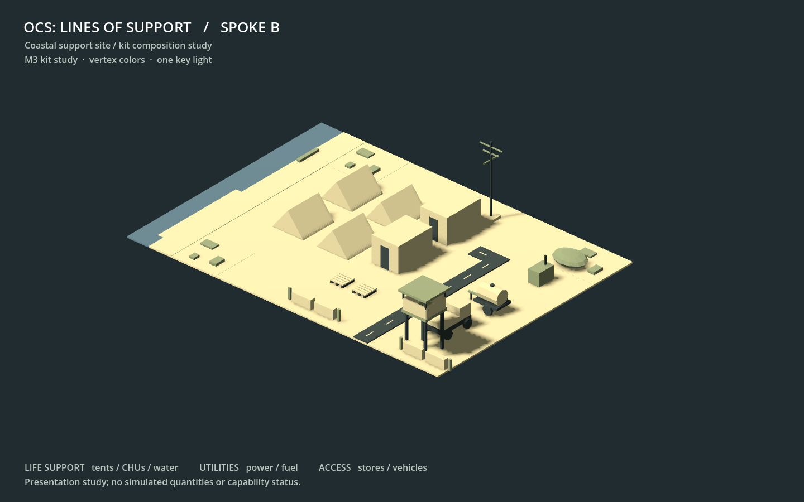

**Work session handoff**

Expected look of this build and why: the separate Spoke B preview is a small coastal support site in sand, olive and dark vertex colors: four tents, two CHUs, utilities, water, stores and a vehicle entrance. It uses the planned fixed three-quarter orthographic camera and one directional key light. This proves the M3 kit composition; the game still presents the M2 schematic board. The scene is illustrative, with no simulated quantities or coverage state.

## PRs reviewed this session

Fix pass: no open Codex PRs at the start; the only open repository PR was Fable's 78. The preceding Codex queue, including M3-08 and M3-10, is merged according to main. No CI fix, unresolved review reply, conflict repair or objection response was needed. Read CODEX-SESSION, CODEX-KICKOFF, required SPEC sections, ADR-0001 through 0003, the latest Codex/Fable handoffs, QUESTIONS, FOR-NICK and decided objection records. No unanswered question to Codex. The triggering request's five-open-PR limit takes precedence over the documents' ten.

## Changed

Claimed codex/M3-11 remotely before implementation from main 353967d. M3-11 is the highest unblocked Codex item; M3-09 remains behind the M2 gate.

Blender 4.3.2 generated all 22 kit GLBs from the existing script and shared recipe, replacing the M0 Godot primitive fallback binaries. Provenance now names the actual generator and version. The existing exporter needed no API change; its opening documentation records the proven version.

Added the presentation-only Spoke B layout, a Blender assembly script, a standalone Godot viewer, a dependency-free layout/GLB validator, and generation/render instructions. The assembled scene has 25 named kit instances and 100 colored meshes. The screenshot above is a real Godot render, visually inspected after correcting the caption scale. Every new asset and metadata file has a provenance row. Only M3-11's backlog Status cell changed; the headline is left to Fable.

The generated kit is about 263 KB, the scene GLB about 221 KB, and the screenshot about 110 KB. Scoped assets/.gitattributes rules store this small generated kit/diorama batch directly in Git. This supports publication through the connected GitHub API, which has no LFS-upload tool; other asset families retain the root LFS policy. No dangling new LFS objects are introduced.

## Why

SPEC 7 and M3-11 call for a site assembled from the kit under the planned camera and light, with a screenshot and provenance. Blender is now installed, so the formerly unverified bpy generation path can be proven. The scene tools and layout stay outside the normal game and simulation.

## Validated how

- Required solution build: .NET SDK 8.0.427, dotnet build src/LinesOfSupport.sln -m:1 --no-restore; zero warnings/errors. dotnet test src/LinesOfSupport.sln -m:1 --no-build --no-restore: 223 Sim and 116 Harness tests pass (339 total).
- Python scenario validator: 3 scenario folders, 1 rules file, zero errors. provenance.py, conflicts.py and git diff --check pass.
- Blender 4.3.2: full 22-piece generation, then GLB import/assembly/export of all 25 site instances. validate_kit.py accepts every primitive's positions, normals, vertex colors, embedded buffers and absence of textures. Blender reports that optional Draco compression is unavailable; the outputs are uncompressed and require no Draco extension.
- validate_diorama.py checks instance identities and references, finite transforms, positive scales, the five original pieces, camera/light configuration, all exported instance nodes and texture-free embedded geometry. Temporary mutations for a missing asset, duplicate id, NaN position, zero scale and missing exported node each fail as intended.
- Godot game build passes without warnings/errors. Godot 4.6.1 .NET imports the project and passes both existing kit smoke scenes: five GLBs and all 22 GLBs load with colors. Godot 4.6.3 runs the new headless scene check: 25 instances, 100 colored meshes, orthographic camera, one key light.
- Final 1440 x 900 screenshot: Godot 4.6.3 OpenGL compatibility, Mesa llvmpipe. An authenticated temporary Xorg dummy display was started and stopped in the capture process; no system package was installed. Visual inspection confirms the complete site, camera framing, shadows and readable title/footer.

Shell git pull was attempted but no GitHub credentials were available. Main 353967d was refreshed through the authorized GitHub connector and its text blobs checked locally. Publication uses the actual remote parent/tree. sources/ was not imported or changed. The six pre-existing generated UID files remain untracked; Godot import created three additional untracked UID files, also excluded from this item.

## Unresolved

No new FOR-NICK entry, question to Fable or technical objection. This scene does not bind gameplay state or replace the schematic board; those are later presentation work. The screenshot establishes a first kit composition rather than a completed M3 visual pass. Codex made no merge, push to main, force-push or shared-branch deletion.

## Next

Fable reviews the ordinary M3-11 PR and handles merges. Next Codex session: fix pass, then M3-12 (IDIQ in the existing game panels), followed by M3-13 funding and M3-14 CORs, subject to backlog order and the five-PR cap. Nick's M2 playtest remains M2-11; M3-09's new picker screen waits for that gate.
