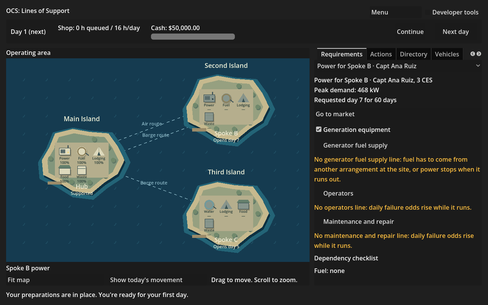

**Work session handoff**

Expected look of this build and why: the existing map and desk remain, with requirements named by what and who, contracts by supplier/support/site, and funding and vehicles by their plain names. Debrief causes use the actual evidence in indented chains with internal record links retained as metadata. The screenshot below is the real day-one requirement, with developer tools off.

## PRs reviewed this session

No open Codex PRs at the fix pass. Open Fable PRs 119, 120 and 121 are queued separately; their turnover, site-news and gate-script descriptions were read. Read CODEX-SESSION, CODEX-KICKOFF, the required SPEC sections, ADR-0001 through ADR-0003, DISSENT, decided objections 0001 through 0004, the naming dependency handoff, M2R-18 handoff and Fable's M2R-09 handoff. No waiting objection or unanswered question to Codex remains on main. Q14 is answered by M2R-07 and this game pass.

## Changed

M2R-12 uses SessionView.Card/Arrangement/Funding/Vehicle/NameOf labels and the rules' authored capability/scope labels across the requirement picker, dependencies, market controls, directory/BPA scope, vehicles, ledger, COR and arrangement actions, commitment/performance rows and debrief. Timeline, decision and cause record ids remain metadata; known-record filtering is preserved. Existing debrief, COR and funding checks now verify the internal links and named selection.

PlainNamesSmokeTest walks all nine panels, all supplier/instrument and BPA forms, every day of a representative golden for each of the four player scenarios, and expanded debrief causes. It checks text, picker items and tooltips against identifier-shaped scenario, scope, work, arrangement, vehicle and record keys. CI runs it. Only M2R-12's Status cell changed in the backlog.

## Why

The Sim naming API is merged (M2R-07/Q14), but the game's own formatting still printed req0007, om1, arrangement keys and record numbers. This completes the game-owned pass without parsing or rewriting Sim prose.

## Validated how

Solution build and test pass: 438 Sim + 121 Harness = 559 tests. Game Debug build passes. The new smoke passes 2,799 panel visits and 128,757 strings, and runs through a real rendered screenshot (158,977 bytes, plain PNG; filter/diff/merge unset). Existing Requirement, Action, Market, BPA, Debrief, COR, Funding, Ledger, Performance and OtherActions smoke tests pass; the requirement test caught a coverage-word capitalization mismatch, corrected and reverified. Final debrief/COR checks pass after adding visual indentation. Scenario validation: five folders, one rules file, zero errors. Provenance, tracked conflict markers and git diff --check pass. No Sim, scenario, rules, asset or shared-contract changes.

## Unresolved

No Nick-only or Sim-contract blocker; nothing added to FOR-NICK. Git credentials are absent in this environment, so the literal pull could not authenticate. The connector supplied main 90dc448245ceddce4850b9e4bab08d8811cd7a25; every downloaded source blob and the reconstructed tree b56f34bd7337dd21545a887761adb73ec9edcaad were hash-validated. The isolated checkout omits historical screenshot files and sources; published changes are applied to the exact remote main tree.

Automatic approval review twice denied fast-forwarding stale codex/M2R-12 to current main, describing it as a backward reset, although GitHub compare showed main ahead by 66 and behind by zero. The old branch was left unchanged. A new empty claim codex/M2R-12-names was created at main and is used for delivery. No force-push, merge, main push or shared-branch deletion occurred.

## Next

M2R-17 (people visits and tutorial) is the next unblocked Codex row. Fable's queued M2R-22 then adds the dependency-owner/J4 entry when that row is merged. Five open Codex PRs remains the session limit from the standing kickoff.
