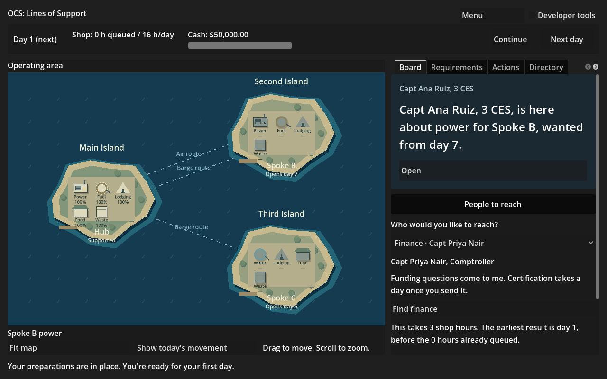
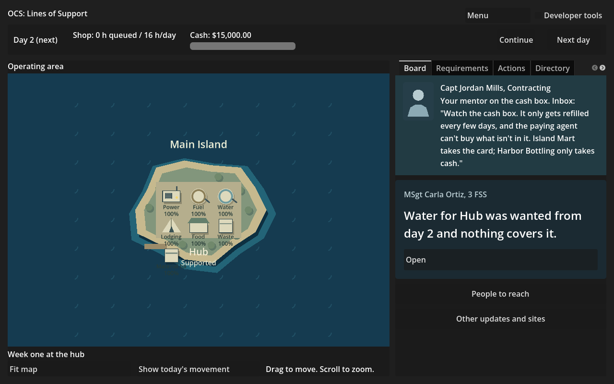

**Work session handoff**

Expected look of this build and why: the board has a collapsed People to reach control beneath the priority item. Choose finance, the staff meeting, SCO staff, the J4 or a named vendor representative; read the actual time/return preview before spending hours. Tutorial notes from Capt Jordan Mills sit above the priority item in a separate portrait card. The map remains the illustrated 2D view. Both screenshots are real rendered game frames with developer tools off.

## PRs reviewed this session

The session started with no open Codex PR. Opened PR 122 for M2R-12; all applicable CI checks are green (test, scenarios, provenance and godot-shell; export correctly skipped). Fable PRs 119 to 121 remain queued. This PR stacks on PR 122; the only new backlog Status is M2R-17. No merge, main push, force-push or shared-branch deletion.

## Changed

GameShell.Visits adds a board contact picker using the scenario cast, the real PreviewVisit results, exact FindFinanceAction, JoinStaffMeetingAction (join and leave), AskScoAction, MeetVendorAction and EngageJ4Action submissions. Visit results retain their actual prose and internal record links. Staff meeting next day and recurring hours, pending SCO questions, vendor confidence and met day come from the views. J4 site and daily quantity are editable; the stock ceiling, ready day and partner caveat come from the preview. Generated request keys stay internal and cannot reuse an in-work request's key. Quantity edits refresh only the preview so keyboard focus stays on the input.

Person-linked board news opens its contact/results. The tutorial is available through the existing normal New game flow because its data is now installed. Authored morning items from the outgoing CCO become portrait mentor cards only when Scenario.Tutorial is true. The engine records the three notes on days 1 to 3, so the board shows each after that day is played; there is no invented tutorial script or scenario guidance. Continue stops on mentor notes and returned Visit records even when no lead exists, preserving the opportunity to read them.

GoingToPeopleSmokeTest joins CI; PlainNamesSmokeTest now visits every contact form as well. No Sim, scenario, rules, asset or shared-contract change.

## Why

M2R-04 and M2R-08 are merged, unblocking M2R-17. Before this pass the player could hear about finance and the J4 but had no board control for reaching them, and tutorial mentor notes were ordinary collapsed board news. The work binds the delivered interfaces rather than copying costs, stock checks or response-lag rules into Game.

## Validated how

Solution build and all 559 tests pass (438 Sim, 121 Harness). Game Debug build passes. The new native smoke proves the cold tutorial flow, all three exact mentor notes and their named speaker, departure after day 3, pure previews, exact action/state hashes, duplicate/pending gating, finance completion, recurring meeting and leave, SCO lag and factual scenario answer, vendor confidence, real J4 stock refusal and ACSA support, quantity focus, person navigation, both new Continue stops and finished-game gating. It also passed with the actual renderer, producing plain PNGs of 149,108 and 125,958 bytes. A fixture initially assumed vendorD had a representative; corrected to use an actual cast member. The final naming smoke passes 2,979 panel visits and 145,171 strings. Existing Lead, FrontDoor, People and OtherActions smoke tests pass. validate.py: five folders/one rules file/zero errors. Provenance, tracked conflict markers, actionlint and git diff --check pass.

## Unresolved

Nothing added to FOR-NICK. No Sim-contract blocker. Git transport still lacks credentials; the same authenticated, hash-validated connector snapshot and publication path as PR 122 is used. The fresh empty claim codex/M2R-17-people starts at PR 122's head; the old codex/M2R-17 branch is untouched. Screenshots are plain PNGs, excluded from LFS.

The queued M2R-22 acceptance in Fable PR 121 additionally wants UsualOwner/OwnerEngaged on each dependency and a J4 entry from an uncovered fuel line. This pass supplies the general board J4 action; that separate checklist entry remains next once its row lands. M3 UI/depth rows stay paused pending M2R. No milestone is declared ready by this handoff.

## Next

Fable reviews PR 122, then this stacked PR, and the queued gate/checklist rows. Codex's next session starts with the fix pass, then M2R-22 when available on main. Nick's playtest remains the gate. Two open Codex PRs, below the standing five-PR limit.
