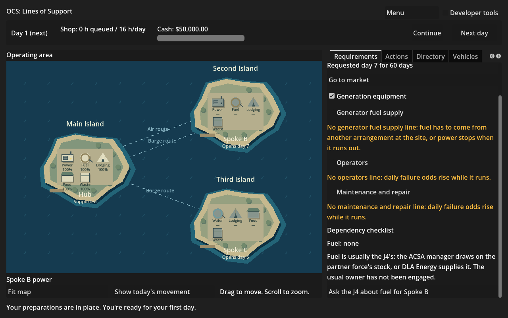
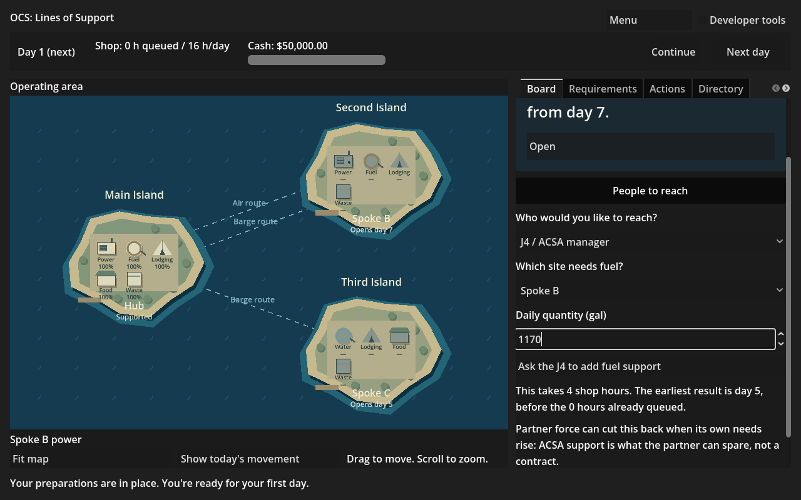

**Work session handoff**

Expected look of this build and why: the requirement's fuel checklist now says who normally owns fuel and whether that owner is engaged. An uncovered line offers “Ask the J4 about fuel for Spoke B.” It opens the board's existing J4 form, already set to Spoke B and its peak daily fuel demand, with the actual hours, ready day, stock limit and partner caveat before the player asks. Both frames come from the ordinary New game flow with developer tools off.

## PRs reviewed this session

Fix pass: #122 and #123 are green and mergeable, with no unresolved inline threads. Fable reviewed both as ready to merge. #123's nonblocking map and preview findings have their own assigned M2R-25 row; Fable's event-text finding is implemented in #124. Read the kickoff/session workflow, SPEC kickoff sections, ADR-0001 to 0003, opening-and-guidance, QUESTIONS, FOR-NICK and the latest Codex/Fable handoffs. No pending Codex objection or unanswered question found. The explicit session request sets the five-open-PR limit, overriding the documents' ten.

## Changed

RequirementDependency.UsualOwner and OwnerEngaged are shown verbatim/in prose. Uncovered fuel offers a shortcut only where an ACSA partner exists and the owner is not already engaged. Opening it resets the J4 site and quantity to this requirement's site and its fuel peak, scrolls the form into view and moves keyboard focus to quantity. Submission uses the existing PreviewVisit/EngageJ4Action and shows ActionResult as before. Pending work and real ACSA support refresh the checklist from Sim. Finished games cannot submit.

J4DependencySmokeTest runs in CI. M2R-22's existing Fable-authored row is carried from queued PR #124 with only its Status changed; the Fable-owned headline and other rows stay untouched. This PR stacks on #123 (which contains #122).

## Why

M2R-22 is the highest remaining unblocked Codex M2R item. The gate's fuel-ownership consequence needs the usual owner and a reachable action at the uncovered dependency. The board J4 form from M2R-17 already supplies the rule binding, so this pass adds navigation and checklist facts without a second implementation of the action.

## Validated how

Solution build passes with -m:1; all 559 solution tests pass (438 Sim, 121 Harness). Game build passes. New native regression passes headlessly and with the renderer: ordinary cold opening, exact usual owner/engaged status, prior form defaults reset, exact site's peak fuel quantity, pure navigation and preview, keyboard focus, exact submitted action/state hash and ActionResult, queued and completed support, included fuel, no-partner scenario and finished gating. Existing PlainNames (2,979 visits / 145,675 strings), GoingToPeople and Requirement smoke checks pass. Scenario validation reports zero errors; provenance, tracked conflicts, actionlint and git diff --check pass. Two plain PNG screenshots are below 400 KB and visually checked.

The environment's default godot executable is a non-.NET build; native checks use the installed Godot 4.6.1 .NET matching CI. The first parallel solution build returned an empty failure; the serial build passed. Existing Sim nullable warnings are outside this change.

## Unresolved

Nothing added to FOR-NICK. Git shell transport has no credentials, so the authenticated connector is used. Current main's tree b56f34b matches the local snapshot, and PR #123's tree ab64817 matches the starting checkout. Publication preserves the actual remote parent and checks the resulting tree against the tested local tree. No merges, main pushes, force-pushes or shared-branch deletions.

## Next

M2R-25: keep seven map capabilities within their site card, and quiet visit/award preview queue wording. Fable's #124 carries the mentor text repair. Fable repeats the pre-gate walk after these game PRs; Nick's M2R-23 playtest remains the gate. No milestone readiness claim.
