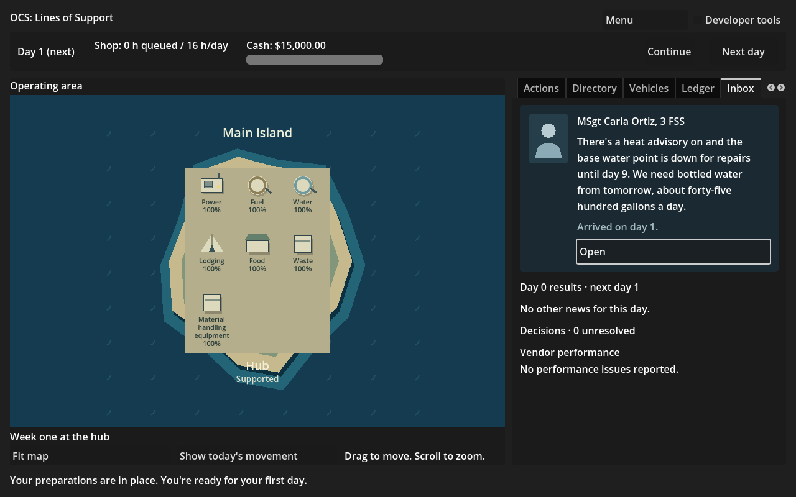
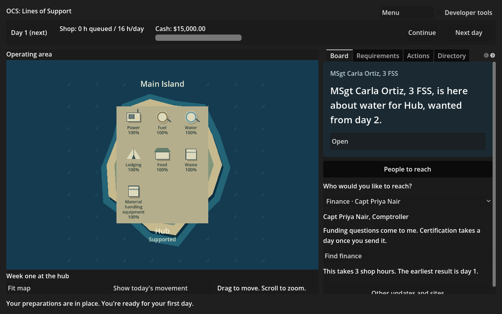

**Work session handoff**

Expected look of this build and why: the tutorial hub's seven capabilities all sit inside one site card. “Material handling equipment” wraps in full over three lines above its percentage. The site name, status and island title move outside the complete card; the island grows with it. Visit and award previews mention queued work only when there is some, using “not counting the N hours already queued.” The two plain frames below are the ordinary tutorial opening and a finance visit, with developer tools off.

## PRs reviewed this session

Fix pass: #122 and #123 green, mergeable and reviewed ready by Fable, with no unresolved inline threads or objection. #123's two assigned Codex follow-ups are M2R-25, implemented here. Its event-text follow-up belongs to Fable and is in #124. This session also opened #125 (M2R-22); CI is green and it is mergeable. This PR stacks on #125, which contains #123 and #122. No merges, main pushes, force-pushes or shared-branch deletions.

## Changed

SchematicMap.Layout computes the actual card and tile rectangles from row count and measured label widths. Complete labels wrap at word boundaries with space reserved for equipment and percentages; the drawing uses those same rectangles. The card, selection outline, site name/status and island extent share that layout. Existing short Food/Waste/Transport map labels remain. Camera controls and MapDay movement bindings remain the same.

DeskUi.QueueClause supplies the requested optional phrase to both visit and award previews. Their numbers, ready windows, stops and gaps still come from the same Sim previews. MapLayoutSmokeTest joins CI; MarketSmokeTest now checks the visible queue wording at zero and after submitting work. M2R-25's Fable-authored row is carried from queued #124 with only its Status updated; no other row or the headline is edited.

## Why

Fable's #123 review found the seventh tutorial tile spilling into the sea with a clipped dark label, plus formulaic “before the 0 hours already queued” wording. This completes both assigned acceptance points, preserving full labels and simulation facts.

## Validated how

Solution build (-m:1) and all 559 tests pass (438 Sim, 121 Harness); game build passes. Native MapLayout smoke passes headlessly and with the renderer: the cold tutorial has seven tiles, the complete card and site status fit the viewport, every label fits its DrawString width, no tiles overlap or leave their card, synthetic inventories of 8 to 15 tiles also fit their cards, and all actual scenarios are checked. Layout and preview reads leave the simulation hash unchanged. Zero/nonzero visit queue phrases use the exact pending hours; the market smoke covers the same cases for awards and still submits the exact previewed action.

Existing Map, J4Dependency, GoingToPeople, PlainNames and Market smoke tests pass. Existing map play also passes rendered through deliveries, closures and day-ten failure; its Spoke B day-one frame was visually checked for spacing. Scenario validation: zero errors. Provenance, tracked conflicts, actionlint and diff checks pass. Both committed PNGs were visually checked at 1280 by 800 and are under 400 KB (about 124 and 125 KB). The first visit capture stayed on the customer Inbox; corrected the test to open Board before capturing, and reran the rendered regression.

## Unresolved

Nothing added to FOR-NICK; no new question or objection. Git shell transport still lacks credentials; authenticated connector publication preserves the actual remote parent and compares the uploaded tree to the tested local tree. #124's event prose is separate and is not duplicated in Game.

## Next

Fable reviews #125 and this stacked PR, then repeats the pre-gate walk from fresh screenshots with its #124 text changes. Nick's M2R-23 playtest remains the gate. There is no further unimplemented, unblocked Codex M2R row; the other Codex backlog rows are paused until M2R. Four open Codex PRs after this publication, below the explicit five-PR limit. No milestone readiness claim.
