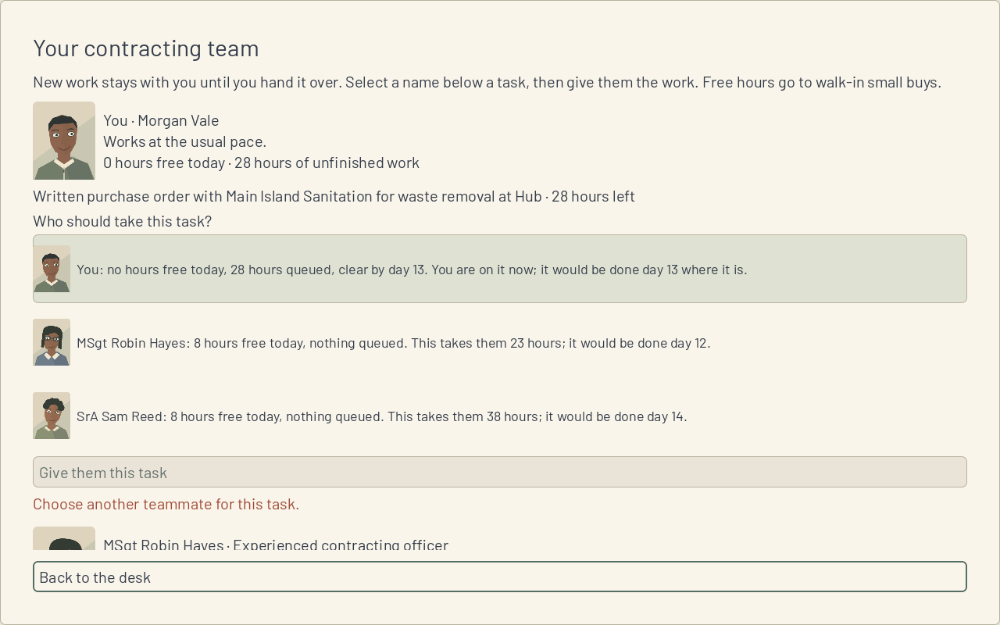
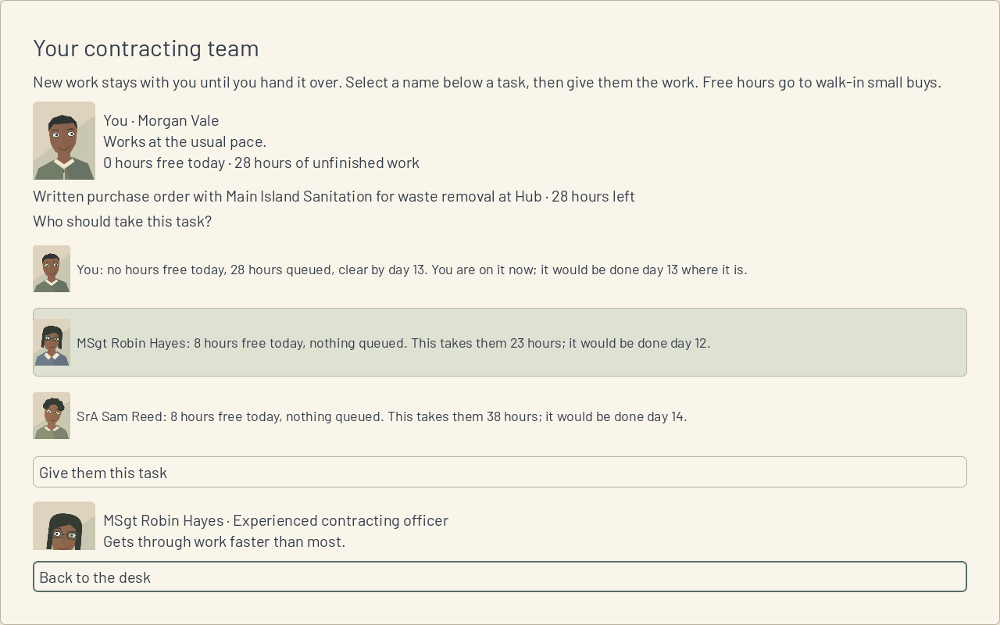

**Work session handoff** (Codex, 14 Nov 2026)

Expected look of this build and why: handing a task over shows three readable choices with faces, each person's free and queued hours, when their queue clears and when this task would finish. The selected person has a filled card. The current holder is identified and cannot receive the same task again. Quotes now say their dates are after already queued work.

## PRs reviewed this session

Live GitHub inventory at start: zero open PRs, so no fix pass changes. Read current main, the session/kickoff instructions, SPEC and initial ADRs, latest Codex and Fable handoffs, questions, FOR-NICK and decided objections. Q23 is answered by DESK-50. The active request's five-open limit takes precedence over the repository's older ten-open wording.

## Changed

DESK-43 on codex/DESK-43, based on main 1aa778a. Every work handoff binds to SessionView.AssigneeChoices(AssignAction), including the current holder's existing queue position. Each choice uses Sim's exact sentence and portrait. Sim's PreviewAny gates the transfer; stale controls cannot send another action after the state changes. New work continues to stay with the player until handed over, as the existing team workflow specifies. No new assignment workflow, queue simulation or Sim edit.

All existing shared quote clauses now say "after the N hours already queued". The existing CI-run TeamSmokeTest exercises free and overloaded queues, exact read forecasts, current-holder gating, selection without mutation, real handoff, stale controls and completion on the quoted day. Existing market and map-layout quote assertions follow the corrected meaning. Only DESK-43's backlog Status cell changes.

## Why

D17 makes overload visible at the decision, rather than requiring the player to remember the top strip or inspect another pane. DESK-37 and DESK-50 now own all queue and pace arithmetic; Game only presents the result.

## Validated how

- Release solution build passes (11 existing warnings, zero errors); all 805 .NET tests pass: 684 Sim, 121 Harness. No Sim, scenario, rules or golden changes.
- Game Debug build and Godot 4.6.1 .NET import pass. Expanded TeamSmokeTest passes both headless and native. MarketSmokeTest and MapLayoutSmokeTest pass; these two still print ObjectDB warnings after PASS and exit zero.
- Scenario validation: five folders, one rules file, zero errors. Provenance, tracked conflict markers and whitespace checks pass.
- Both native 1280 by 800 screenshots below were visually inspected; each is a plain PNG below 400 KB. The overloaded player holds 28 hours and would finish day 13; the free experienced teammate would finish day 12 at their actual pace.
- An unauthenticated TCP Xorg attempt was rejected by automatic approval review because it exposed an unauthenticated display. It did not execute. Owner-message history was checked; that operation was not retried. Unix-only sockets were unavailable. A safer display with mandatory private cookie authentication succeeded; the capture process shut it down and removed its credential. No approval blocker remains.

## Unresolved

Fable review and hosted CI remain required. Native rendering uses Mesa llvmpipe; Windows execution and laptop performance were not tested. No new FOR-NICK entry or objection.

## Next

DESK-44, why every shortfall is short, using the merged DESK-38 projection. Then the remaining replay-screen rows in backlog order. Fable reviews and merges on its own schedule; Codex never merges.
