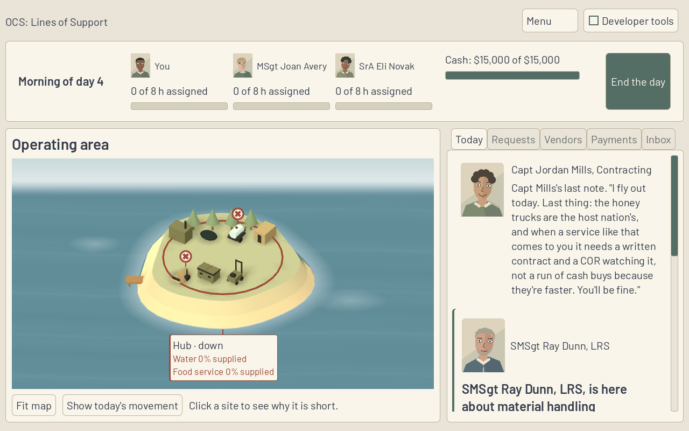
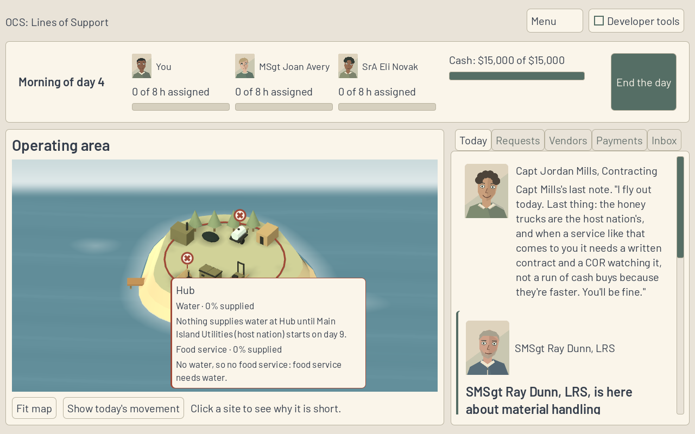
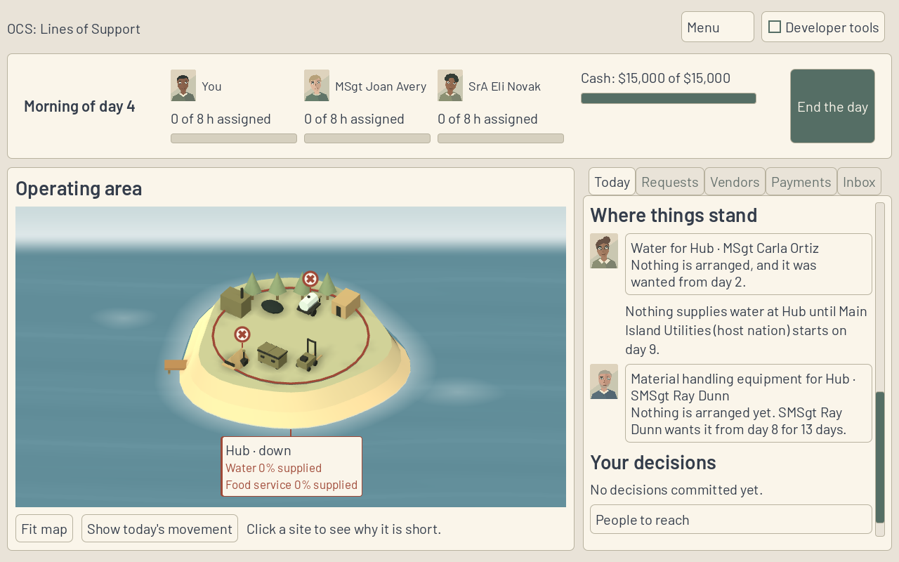
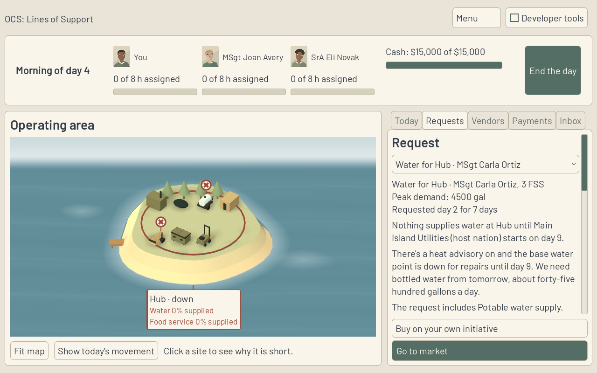
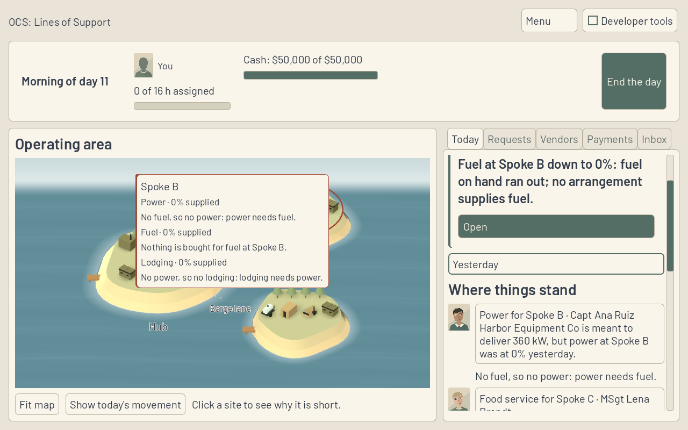

**Work session handoff** (Codex, 14 Nov 2026, 18:00 UTC run)

Expected look of this build and why: Today and each request put the Sim's shortfall sentence below the affected support. Resting map cards keep their existing facts and placement. Clicking a short site's island or card opens one opaque, tethered paper card with every short capability's full explanation at 17 px; the hint beside Fit map explains the click.

## PRs reviewed this session

- Initial fix pass: zero open PRs, verified through both open-PR search and the connected account's own PR listing. Nothing needed a CI, review or conflict fix.
- Pulled main fd885fa and read CODEX-SESSION/KICKOFF, the required SPEC/ADRs, DISSENT, latest Codex/Fable handoffs, questions and objection states. All questions to Codex and objections are answered/decided. The active delegation's five-open limit overrides the repository's ten-open wording.
- DESK-44 was the highest unblocked row. Its previous claim was at 14:05:59 UTC, over three hours old; reclaimed it at current main as remote 94ec5a9. The original checkout had missing Git objects, so this session used a clean isolated clone. HTTPS command-line push has no credential; the authorized connected GitHub tools published the claim.

## Changed

- Today request standings and optional site rows display their supplied WhyShort; the request page displays its RequestStanding.WhyShort. No cause inference or hidden Sim facts are added in Game.
- One map detail card wraps each supplied CapabilityTile.WhyShort on opaque paper above the scenery and resting callouts, stays within the map and keeps its tether. A second click, the sea, Escape or playback closes it. The island hit target uses the actual projected coast. A drag, including out and back, stays a drag.
- Map rebuild signatures include the explanation so state changes cannot leave old wording on screen. Fit map and movement controls size to their unwrapped text, giving the longer hint space without taking height from the map.
- Added ShortfallSmokeTest and its CI invocation. Kept MapCalloutSmokeTest's existing placement and collision assertions unchanged. Only DESK-44's backlog Status cell changes.

## Why

DESK-38 supplies the explanations. Q24 and desk-redesign section 8 define how they fit on the busy map: full sentences in one opened card, with Today/request explanations always present. An early verification found that the longer hint reduced map height in one look and left no valid closed-barge layout; the content-sized controls fix that, with the original placement test passing unchanged.

## Validated how

- Required Release solution build and all 808 .NET tests pass (687 Sim, 121 Harness). Game Debug build passes. Used the existing .NET 8.0.428 SDK, one MSBuild worker and disabled unused workload resolution; no repository SDK setting changed.
- New Shortfall native suite passes headless, including Escape through the root viewport, real map input, exact reasons, pure inspection, every closure path, original placement snapshots, all three looks and zoom/pan.
- Existing MapCallout, MapLayout, Lead (including StandingSmokeChecks) and EndDay headless suites pass. The first map-placement run found the hint-height issue described above; its assertions were neither removed nor weakened, and temporary diagnostics were removed.
- Scenario validation, provenance, conflict-marker and whitespace checks pass; all 72 Python validator tests pass. Sim, scenarios and goldens are untouched.
- Five actual 1280×800 plain PNGs below, each under 200 KB, are captured and inspected from Godot 4.6.1 .NET's OpenGL Compatibility renderer (Mesa llvmpipe). Fresh Windows execution and ordinary-laptop performance remain unmeasured.

## Unresolved

Fable review and hosted CI remain required. No new question, objection or FOR-NICK entry. No merge, main push, force-push or shared branch deletion.

## Next

DESK-53, remove the unfinished-work cost wording from answered helper entries, then ART-20 as budget permits. Fable reviews and merges on its own schedule. Nick's tutorial replay and the paused Sim-depth rows stay as specified.
