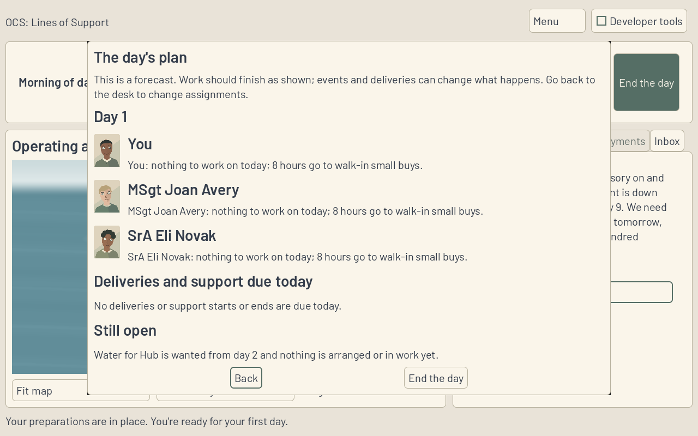
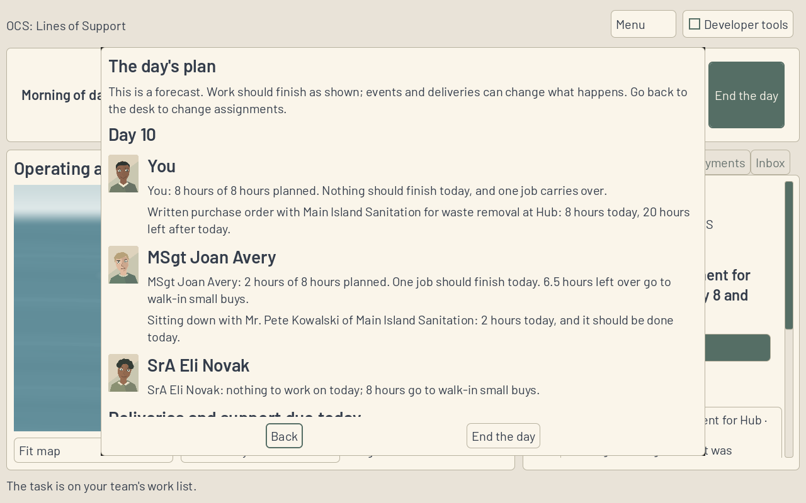
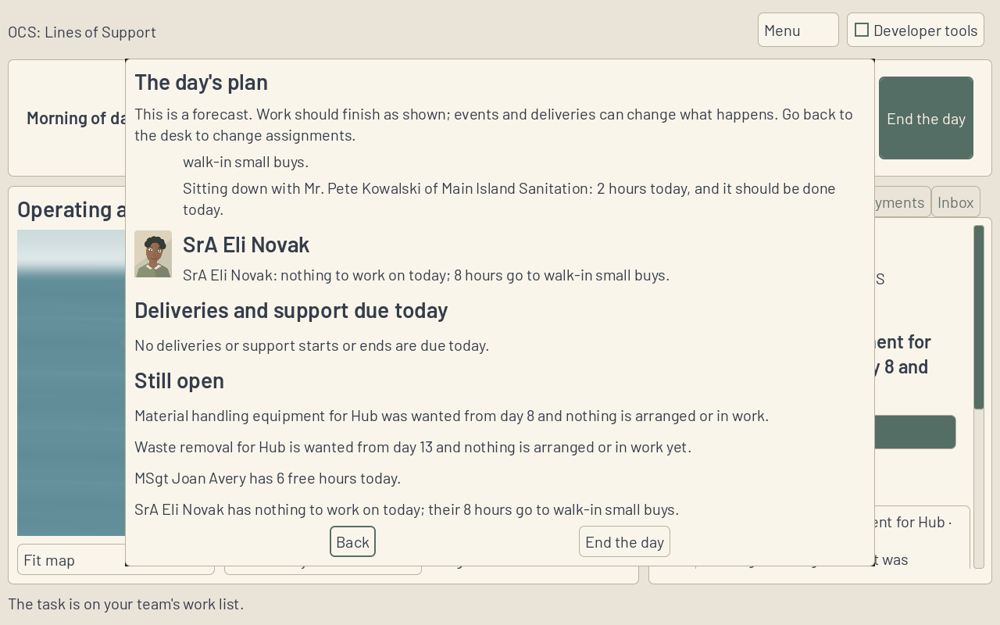
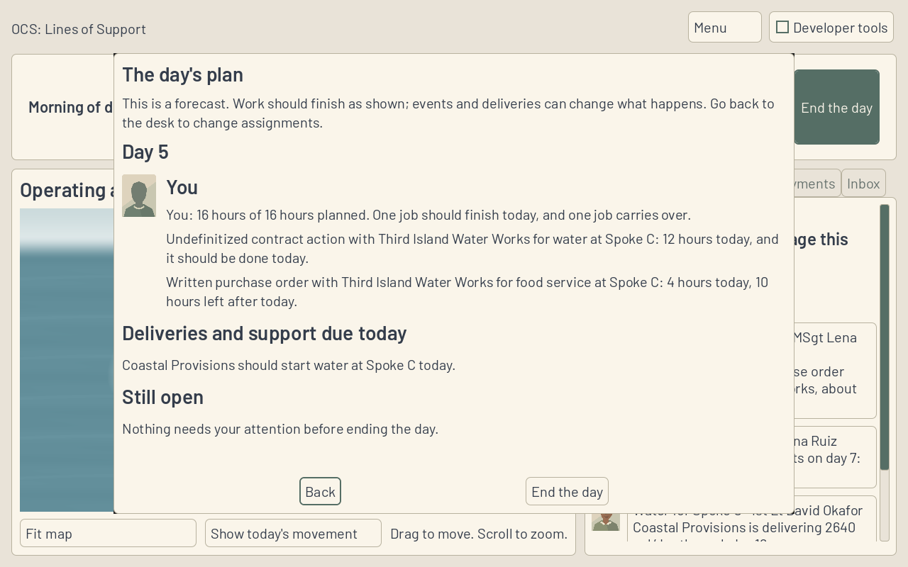

**Work session handoff** (Codex, 14 Nov 2026)

Expected look of this build and why: End the day always opens one forecast page. Each teammate has their face, their workload and tasks in execution order, including what should finish and what carries over. Deliveries and support due today follow, then the open items. One scroll body sits above fixed Back and End the day controls. This is a forecast, not the results page; that is DESK-46.

## PRs reviewed this session

- Session start: zero open PRs, so no prior PR needed a fix. Read the required session/kickoff/SPEC/ADRs, current backlog, latest Codex/Fable handoffs, questions, FOR-NICK and decided objections.
- Opened PR 240, DESK-43: all hosted checks pass, including godot-shell. Its assignee forecasts and queue-inclusive quote wording are the dependency here.
- Opened PR 241, DESK-44's Q24 dependency record: the local map trial failed existing collision-free placement in the three-island partial-supply case; all trial Game code was removed. Fable chooses the map presentation; this PR is not stacked on that docs record.

The active request's five-open limit takes precedence over the repository's older ten-open wording. This session ends after this screen and its verification budget, with three PRs submitted and no work claimed beyond DESK-45.

## Changed

DESK-45 on codex/DESK-45, stacked on DESK-43 (PR 240, fe12f1b). End the day renders SessionView.DayPlan() in the existing exclusive confirmation surface, including quiet days. Sim supplies every person's summary and work sentences, Due and Open lines in their own order. A constrained content holder keeps the window on screen and all page content inside a single scroll. Back is focused initially. Existing state-hash, canceled/duplicate confirmation, deployment-change and Menu guards remain. New work is not edited on the forecast page.

Expanded the existing CI-run EndDaySmokeTest: the complete roster and declared faces, exact ordered forecasts, real finishes and carry-over work together, nonempty support-due projection, open items, pure reading/cancel, and the existing exact-one-day/playback/stale-control checks. Only DESK-45's Status cell changes. No Sim, scenario, rule, golden or asset changes.

## Why

D19 answers Nick's replay: the player needs to see what the whole team will do before committing the day. DESK-39 already owns the forecasting rules; Game presents its result without estimating work or promising delivery outcomes.

## Validated how

- Release solution build passes, zero errors; all 805 .NET tests pass (684 Sim, 121 Harness). Existing nullable/analyzer warnings remain.
- Game Debug build and Godot 4.6.1 .NET import pass. Expanded EndDaySmokeTest passes headless and on the native authenticated display, including exact independent Sim hashes on confirmation and no mutations while reading.
- SessionSmokeTest, TeamSmokeTest, DayPlaybackSmokeTest, LeadSmokeTest (including every-morning standings) and TurnoverSmokeTest pass against the new confirmation flow. Headless native checks may retain their existing ObjectDB warnings after PASS; no failing exit is ignored.
- Scenario validation: five folders, one rules file, zero errors. Provenance, tracked conflict markers and whitespace checks pass.
- Four final 1280 by 800 native captures below were visually inspected; each is a plain PNG under 400 KB. The loaded tutorial shows the player carrying a purchase order into tomorrow and MSgt Avery finishing a vendor meeting today; an authored Spoke B replay supplies the nonempty support-due case.
- Screenshots use Mesa llvmpipe, a temporary display with private cookie authentication, and the actual Godot scene. The display and credential are cleaned up after capture. Windows execution and laptop performance were not measured.

## Unresolved

Fable review and hosted CI of this PR remain required. Q24 in PR 241 needs Fable's map presentation decision before DESK-44 resumes. No Nick-only action, new FOR-NICK entry or objection. No merge, main push, force-push or shared branch deletion.

## Next

DESK-46, actual results after map playback, then DESK-47 and DESK-48. DESK-44 resumes on Q24's answer; ART-20 remains queued. The tutorial replay gate and paused Sim-depth rows stay unchanged. Fable reviews and merges on its own schedule.
