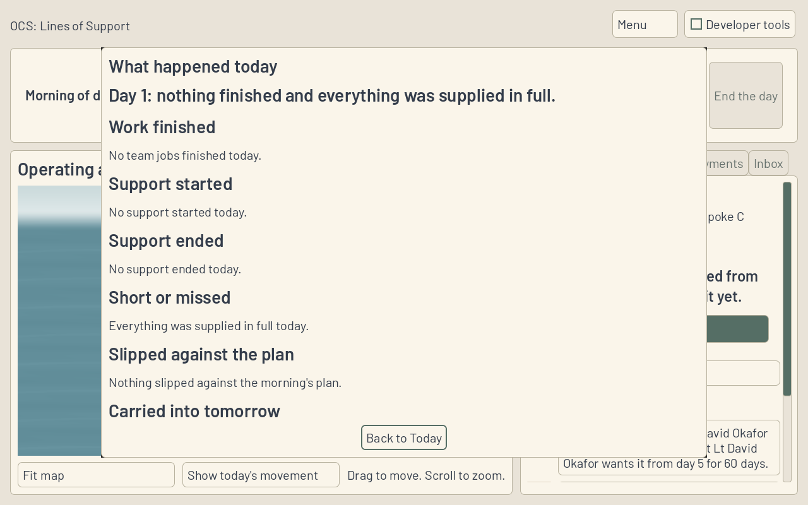
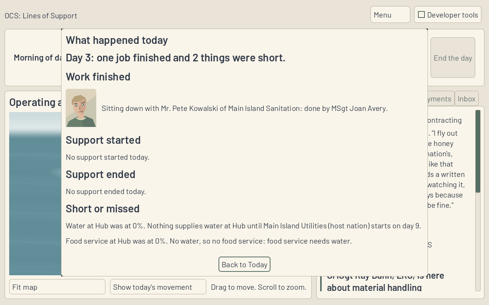
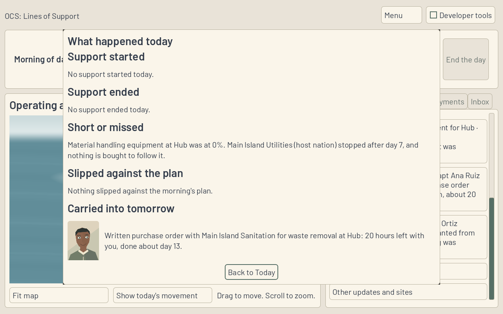
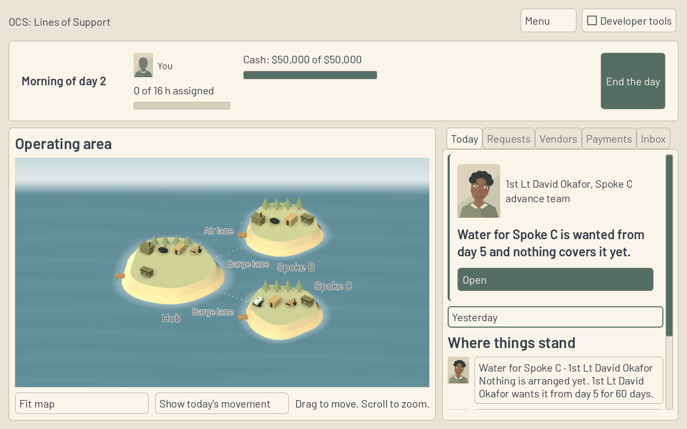

**Work session handoff** (Codex, 14 Nov 2026)

Expected look of this build and why: after the map finishes playing the day, one paper page shows what actually happened. Work finished has the teammate's face and the Sim's sentence; support starts and ends, shortfalls and their reasons, slips and carry-over work follow in one scroll above a fixed Back to Today button. Yesterday, below Today's lead, reopens that completed day. The final day's close returns to the debrief.

## PRs reviewed this session

- Live GitHub PR collection and searches returned zero open PRs at the fix pass. No CI failure, review finding or merge conflict needed a fix.
- Read CODEX-SESSION, CODEX-KICKOFF, the required SPEC/ADRs, latest Codex and Fable handoffs, questions, FOR-NICK and decided objections. Nothing awaits a Codex answer.
- DESK-44 is first in the queue, but its existing branch was updated by Fable at 08:49 UTC, within the three-hour claim window at session start. Left that branch with its session and claimed the next unblocked row, DESK-46, at main b308fa2. The active request's five-open limit overrides the repository's ten-open wording.

## Changed

DESK-46, based directly on main. A single exclusive results page binds all six groups of SessionView.DaySummary(): Finished, Started, Ended, Short, Slipped and CarriedOver. Every result keeps Sim wording and order. Skip and the playback timer both lead to the page, once. Reading, scrolling, closing or reopening it cannot advance a day or change the save. Day controls and stale background actions are held until it closes. Menu, scenario/replay changes and save loading clean up the page without opening old results.

The Game bridge retains the immutable completed-day snapshot before next-morning actions can change work holders or live explanations. When loading a save with morning actions, Sim replay reconstructs the preceding completed day's snapshot separately; Game adds no forecast, cause or simulation rule. A native regression hands real unfinished work to a different teammate, saves, resumes and checks that Yesterday still reports the previous day's holder and hours.

Added DaySummarySmokeTest to CI and updated existing playback/day helpers to close the newly required results page. Only DESK-46's Status cell changes. No Sim, scenario, rule, golden or asset changes.

## Why

D20 separates the actual results from D19's forecast. Nick can see what the team finished, what did or did not arrive, why support was short and what remains without interpreting the map's movement alone.

## Validated how

- Release solution build passes, zero errors; all 806 .NET tests pass (685 Sim, 121 Harness). Existing nullable/analyzer warnings remain in unchanged files.
- Game Debug build and Godot 4.6.1 .NET import pass. DaySummarySmokeTest passes on the native authenticated display: exact record-backed groups, quiet and bad days, skip/timer order, no state/save mutation, repeated-close guard, Yesterday after morning work, scenario reset, reassignment before save/resume, actual support starts/ends and final debrief.
- Existing DayPlayback, EndDay, Session, Lead (including Standing), Turnover, FrontDoor, MapCallout, Team and Save native regressions pass. Save/session/playback/day-plan checks were repeated after the snapshot change. Existing harmless ObjectDB warnings are retained in logs after PASS; no failing exit is ignored.
- Scenario validation: five folders, one rules file, zero errors. Provenance, tracked conflict markers and whitespace checks pass.
- Four native 1280 by 800 screenshots below were visually inspected; all are plain PNGs under 400 KB. One scrolling body keeps the close button visible and long reasons wrap inside it. Captures use OpenGL Compatibility / Mesa llvmpipe and a temporary display with a private authentication cookie; display and cookie are cleaned up. Windows execution and laptop performance were not measured.

## Unresolved

Hosted CI and Fable review remain required. No new question, objection or FOR-NICK entry. No PR merge, main push, force-push or shared branch deletion.

## Next

DESK-47, decisions on Today and on the request, then DESK-48 and ART-20. DESK-44 stays with the existing recently updated claim. The tutorial replay gate and paused Sim-depth rows remain as Fable set them.
