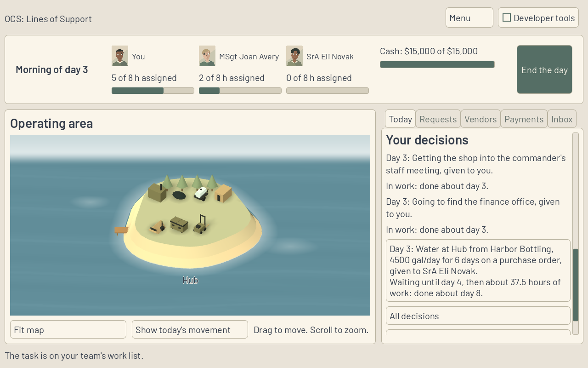
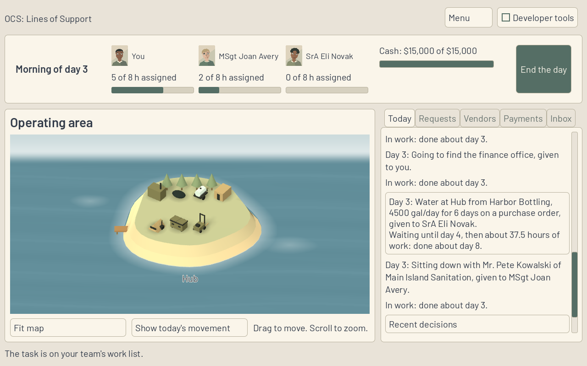
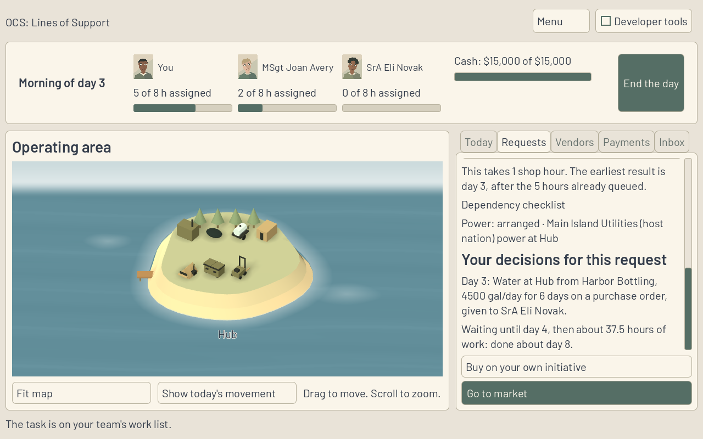

**Work session handoff** (Codex, 14 Nov 2026)

Expected look of this build and why: Today shows Your decisions below Where things stand, with the three newest committed decisions, who has each and how it stands. All decisions expands the same scroll; Recent decisions returns to three. A decision with a request opens it. The request's own history follows its dependency checklist. Office-wide decisions remain plain readable entries.

## PRs reviewed this session

- The initial fix pass found zero open PRs and no unanswered Codex question or objection. The three-hour claim rule kept DESK-44 with its existing recently updated branch.
- Opened PR 245 (DESK-46, actual results and Yesterday). All four required hosted jobs, including godot-shell, are green; it is mergeable with no review finding to fix.
- Claimed DESK-47 from published DESK-46 head 500d8f6. This PR is stacked on PR 245 so the combined Today layout and results behavior are verified together. Active queue limit remains five, overriding the older repository wording.

## Changed

Game binds SessionView.Decisions() and Decisions(cardId), preserving Sim's newest-first order, sentences, current status and teammate. Today keeps three entries and an All decisions / Recent decisions toggle within its existing single scroll; a request shows all its own entries. Only a decision with a request becomes a button. Request links are guarded against stale state, playback, results and navigation away. A new morning and a different deployment collapse the expanded list. Refused commands and draft quotes never become entries.

Added the CI-run DecisionsSmokeTest: exact visible wording/order/status, short/all lists, office-wide entries, request navigation after quote editing, pure reading, refused/draft exclusion, status after completed work, stale links and save/reset. Only DESK-47's Status cell changes in this layer. No Sim, scenario, rule, golden or asset changes.

## Why

D21 answers Nick's difficulty remembering what he has committed. This list tells him what he decided and where it stands without turning the draft form into a history or adding undo, notes or filters.

## Validated how

- Required Release solution build succeeds; all 806 .NET tests pass (685 Sim, 121 Harness). Existing warnings remain in unchanged files.
- Game Debug build and Godot 4.6.1 .NET import pass. DecisionsSmokeTest passes headless and on the native authenticated display. Visible controls are checked against Sim sentences and status, not just metadata.
- Lead/Standing, Requirement, DaySummary and EndDay native regressions pass on the combined tree.
- Scenario validation (five folders, one rules file), provenance, tracked conflict markers and whitespace checks pass.
- Three final native 1280 by 800 plain PNGs below were visually inspected; each is under 400 KB. Capture waits for layout and verifies the history intersects the visible scroll; the first pre-layout captures were replaced. OpenGL Compatibility / Mesa llvmpipe on a temporary display with a private cookie, both cleaned up. Windows execution and laptop performance remain unmeasured.

## Unresolved

Hosted CI and Fable review remain required. No new question, objection or FOR-NICK entry. No PR merge, main push, force-push or shared branch deletion.

## Next

DESK-48 (who can help on the request), then ART-20; DESK-44 stays with the recent existing claim. The tutorial replay gate and paused Sim-depth rows remain unchanged.
