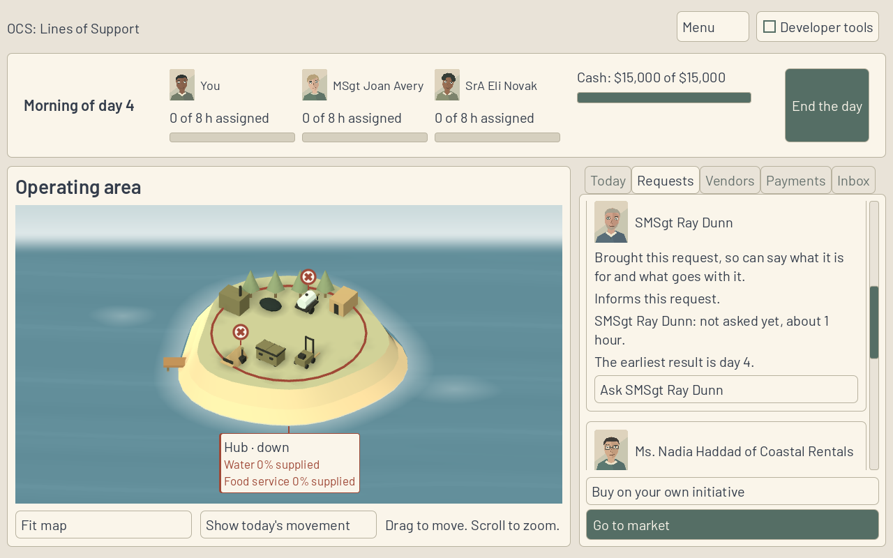
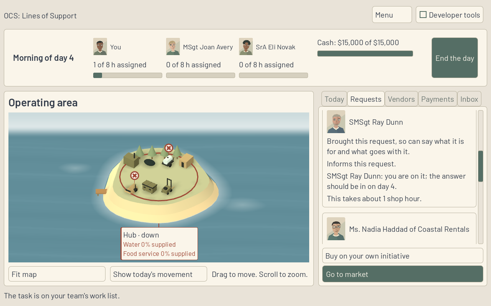
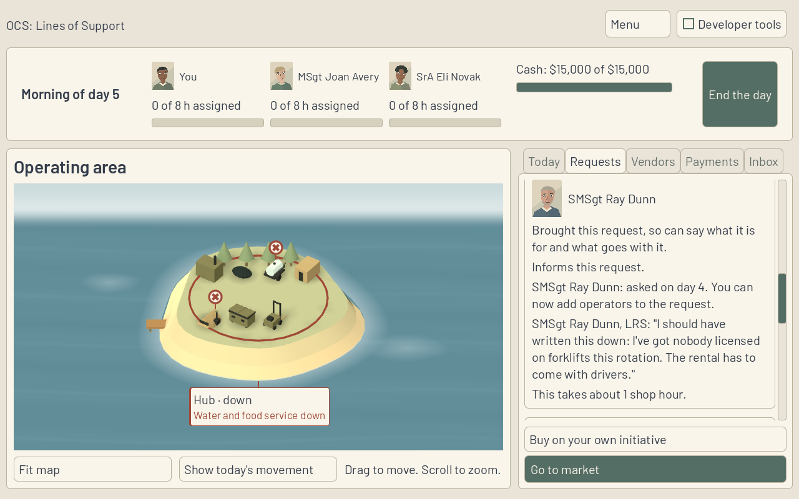

**Work session handoff** (Codex, 14 Nov 2026, 16:00 UTC run)

Expected look of this build and why: each request has framed “Who can help” entries with a face and name, what the person can do, whether it informs the request or opens an action, the hours and the exact current state. Nobody's answer is shown before the visit completes. The J4 line opens the existing support form on the capability and site supplied by Sim. The map and cast artwork are unchanged by this row.

## PRs reviewed this session

The live fix pass found zero open PRs, so no red CI, comments or merge conflicts needed repair. Read CODEX-SESSION, CODEX-KICKOFF, required SPEC/ADRs, questions, objections and the latest Codex/Fable handoffs. DESK-44 was skipped: its claim commit 1dce844 was made at 14:05:59 UTC, less than three hours before this run. Claimed the next unblocked row, DESK-48, at 87296f8, a normal fast-forward from main 7cbade8. No merge, main push, force-push or shared branch deletion.

## Changed

- Request helpers bind `RequirementEditorView.WhoCanHelp`: `Does`, `Informs`, `Hours`, `Sentence`, `State`, `Answer` and `Start`. People, vendor meetings and J4 support keep their separate supplied targets. Pending/completed entries offer no duplicate start; old callbacks and finished games cannot submit help.
- The J4 form carries `EngageJ4Action.Capability` through site, units, peak quantity, label, preview and submission, preserving the supplied action with `with`. The original fuel shortcut still opens fuel. No prose parsing, duplicated target selection, Sim change or scenario change.
- Native HelpersSmokeTest added to CI; earlier RequirementSmokeTest updated for richer helper entries while retaining independent exact Sim state, save/resume, knowledge and replay checks.
- Only DESK-48's Status cell updated. No question, objection or FOR-NICK entry added.

## Why

D22 and Q25/DESK-51 make conversations discoverable without giving away their answers or asking Game to guess the action target. The same helper line now describes and starts the same help.

## Validated how

- .NET 8.0.428 solution build and all 808 tests pass (687 Sim, 121 Harness); no golden changes. The restored SDK's workload discovery caused a silent solution restore failure; disabling the unused workload resolver and using one MSBuild worker passed without changing repo configuration or skipping tests.
- Game Debug build and Godot 4.6.1 .NET import pass. HelpersSmokeTest passes headless and with native rendering; covers exact targets for asks/vendors/J4, answer visibility, pending/completed state, duplicate/stale/finished guards, name layout and a non-fuel water target in the general J4 form.
- Existing Requirement, J4Dependency, GoingToPeople, AwardChoices and Decisions native suites pass.
- Scenario validation: five folders, one rules file, zero errors. Asset provenance and git diff whitespace check pass.
- Inspected all three real 1280×800 PNGs, each below 173 KB. The first capture exposed names wrapping one letter per line; fixed the header's available width, added a layout assertion and recaptured all states. Renderer: OpenGL Compatibility, Mesa llvmpipe. Fresh Windows execution and laptop performance remain unmeasured.

## Unresolved

Fable review and hosted CI pending at publication. DESK-44 stays with its recent claimant; DESK-52 and ART-20 remain. No Nick-only blocker.

## Next

Take DESK-52 if its remote claim has expired; otherwise take the next unclaimed item. Respect the active five-open limit and keep Fable's merge role. The tutorial replay gate and paused Sim-depth rows stay as specified.
