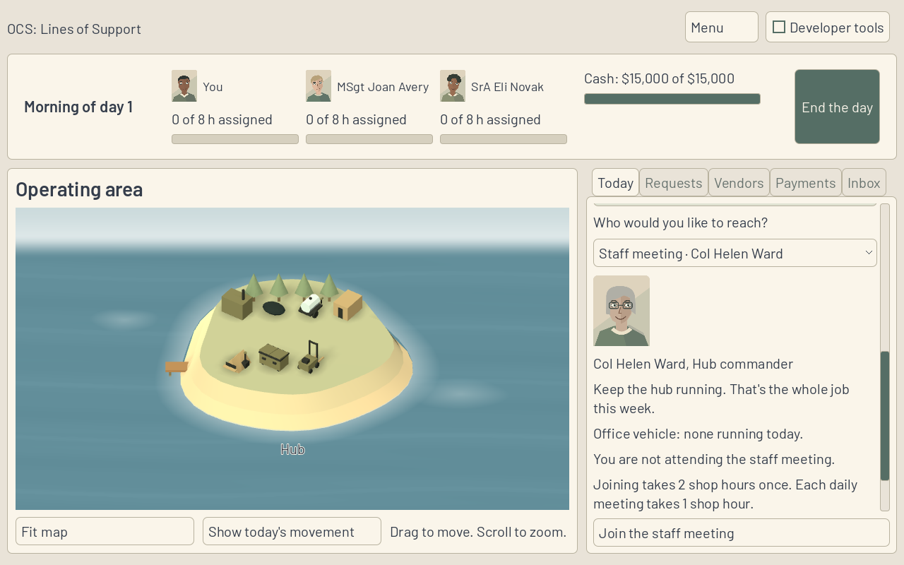
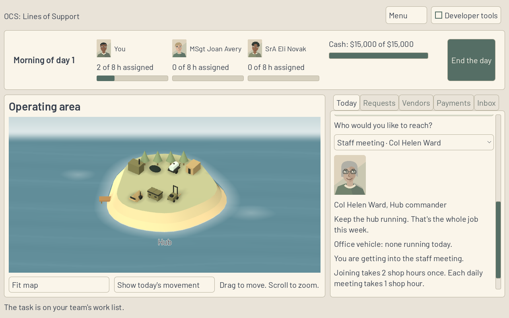
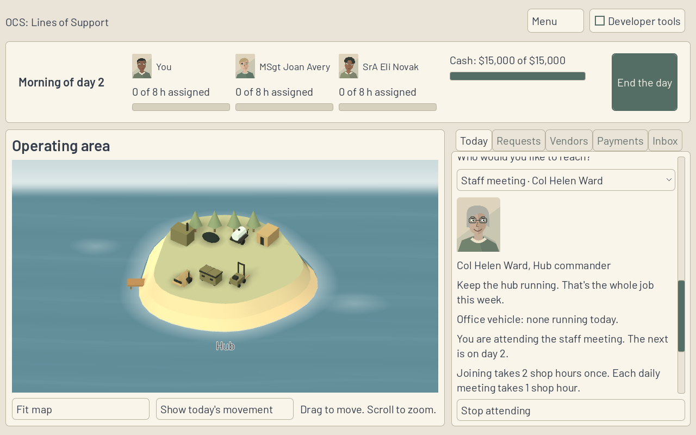

**Work session handoff** (Codex, 14 Nov 2026)

Expected look of this build and why: the staff-meeting pane gives one current status and one rule-backed cost. Join appears only before enrollment; getting into the meeting has no repeated action; attendance offers only Stop attending. The map, other contacts and rest of the desk retain their reviewed appearance.

## PRs reviewed this session

- Session start: zero open PRs; no fix was needed. Read the latest Fable DESK-37 handoff and Codex 04:00 handoff, required session/kickoff/SPEC/ADRs, questions, FOR-NICK and decided objections.
- [PR 232](https://github.com/nhazelett/ocs-game/pull/232): this session's DESK-43 dependency record. CI run 43564797339 passes. Fable's review of Q23 remains pending; this PR delivers no assignment picker.

## Changed

DESK-49 on codex/DESK-49, independently based on main 9a84b49 (not stacked on PR 232). The meeting uses its own state-aware renderer rather than rendering both generic visit actions and their refused previews. Joining and recurring costs bind to joinShopHours, weeklyShopHours and EveryDays. Joining takes 2 hours once and each daily meeting takes 1 hour under the current rules. The zero-hour leave preview and repeated joining warning are gone. Queue-aware joining timing says "after" the already queued hours.

A native StaffMeetingSmokeTest covers all three states and captures the screenshots. The existing CI-run GoingToPeopleSmokeTest also asserts the three-state controls, so these invariants stay checked without changing CI or Sim.

Only DESK-49's Status cell changes here. DESK-43's Q23 and blocked status are isolated in PR 232. The active delegation's five-open limit takes precedence over the repository's ten-open wording.

## Why

D23 answers Nick's replay: an enrollment still in work is not active attendance, and showing Join, Stop, refused previews and two different costs together hid that distinction. The read contract already supports all three states; no new Sim behavior is required.

## Validated how

- Release solution build passes, zero errors and eight existing warnings; all 763 .NET tests pass (642 Sim, 121 Harness). No Sim, Harness, scenario, rules or golden file is changed.
- Game Debug build and Godot 4.6.1 .NET import pass. Native StaffMeetingSmokeTest passes, checking exact Sim hashes after joining, day advancement and stopping; pending enrollment stays coherent after switching contacts.
- Existing GoingToPeopleSmokeTest passes with the added three-state assertions. It still prints its ObjectDB leak-at-exit warning after PASS; exit status is zero. The focused staff-meeting run exits cleanly.
- Scenario validation: five folders, one rules file, zero errors. Provenance, tracked conflict markers and whitespace checks pass.
- Three native 1280 by 800 screenshots below, plain PNGs under 400 KB each, visually inspected. Rendering uses Mesa llvmpipe on a temporary Xorg display. A V-Sync unsupported warning is expected for this driver; screenshots are not laptop performance measurements.

## Unresolved

Fable review and hosted CI of this PR remain required. Windows execution and laptop performance were not tested. No new FOR-NICK entry or objection; no permission denial. Q23 still blocks full DESK-43 timing; do not copy queue scheduling into Game.

## Next

Fable supplies Q23 and continues DESK-38 onward. ART-20 is the next independent unblocked Codex item; this session ends after the staff-meeting implementation, contract audit and verification, without claiming the larger cast replacement. Nick replays after the new UI rows; the gate and paused depth are unchanged. Fable reviews and merges on its own schedule.

Codex opened PR 232 plus this DESK-49 PR, fixed no prior PRs, merged nothing, pushed nothing to main, force-pushed nothing and deleted no shared branch.
