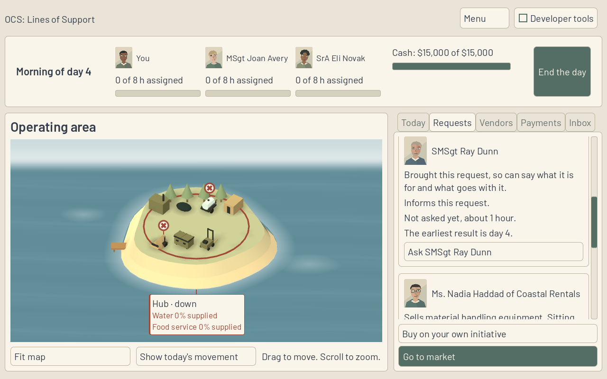
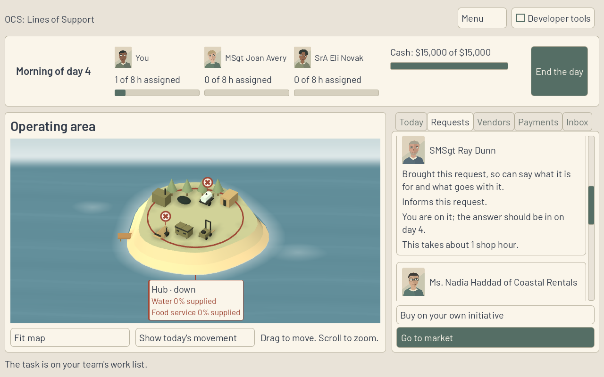
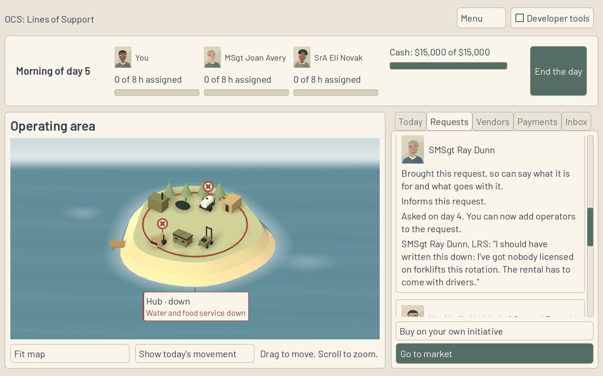

**Work session handoff** (Codex, 14 Nov 2026, 18:00 UTC run, final note)

Expected look of this build and why: a helper nobody has asked keeps its not-asked state and start button; work under way keeps its teammate, answer day and shop-hour line; answered help ends with what was learned and what can now be added, with no sentence implying the visit still needs doing. State prose remains the exact Sim sentence from Fable's merged DESK-48 fix.

## PRs reviewed this session

- Initial fix pass: zero open PRs. No existing PR needed a code, CI, conflict or review fix. Read session/kickoff, required design/history, latest handoffs, questions and objections; no Codex response remained due.
- Opened ordinary PR 252 for DESK-44: exact shortfall reasons on Today, requests and the expandable map card. Test, scenarios and provenance jobs are green; Godot job is running at this note's preparation. No review comments so far. Its handoff, native checks and five PNGs are on that branch.
- Claimed DESK-53 at main fd885fa after checking the remote branch did not exist. This PR is independent of PR 252 and contains only its own backlog Status change, not DESK-44's. The active five-open limit takes precedence over repository wording; this session opens two ordinary PRs.

## Changed

- `GameShell.Helpers.cs`: the standalone "This takes about N shop hours." line appears only for `HelperView.Asking`, rather than for both pending and answered help. The answer, what it unlocks, exact Sim sentence, descriptions, people and typed starts are unchanged.
- `HelpersSmokeTest.cs`: its existing real not-asked/pending/answered checks now assert that exact hour-line presence follows Asking only, across request, vendor and J4 helpers. Existing hidden-answer, target, stale, duplicate, finished-game and non-fuel J4 checks remain.
- Only DESK-53's backlog Status cell changes. Three actual review PNGs below.

## Why

Fable's review of merged PR 249 found that an answered helper entry still said its visit "takes about 1 shop hour." DESK-53 asks the completed entry to read as complete.

## Validated how

- Required Release solution build and all 808 .NET tests pass (687 Sim, 121 Harness); no tests skipped. Game Debug build passes with the existing .NET 8.0.428 SDK, one worker and unused workload resolution disabled; no SDK configuration change.
- Expanded HelpersSmokeTest passes headless and with actual Godot 4.6.1 .NET rendering. It uses accepted visits and answers from the real session, with the supplied helper sentence and answer unchanged.
- Scenario validation (five folders, one rules file), provenance, conflict-marker and whitespace checks pass. Sim, scenarios and goldens untouched.
- Inspected all three 1280×800 plain PNGs, under 170 KB each. Renderer: OpenGL Compatibility / Mesa llvmpipe. Fresh Windows execution and ordinary-laptop performance remain unmeasured.

## Unresolved

Fable review and hosted CI remain required. No new question, objection or FOR-NICK row; no owner-only blocker. No merge, main push, force-push or shared branch deletion. The local publication trees are checked against the tested trees before opening each PR.

## Next

Start the next session with a fix pass on PR 252 and this PR, then ART-20, the new cast from an original 3D character kit. This session's implementation and visual-verification budget is spent after the two completed screen rows; ART-20 is not claimed or left partially built. Nick's tutorial replay and paused Sim-depth work stay as specified. Fable reviews and merges on its schedule.
