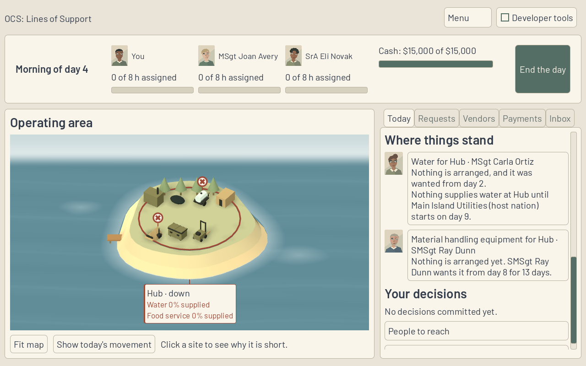
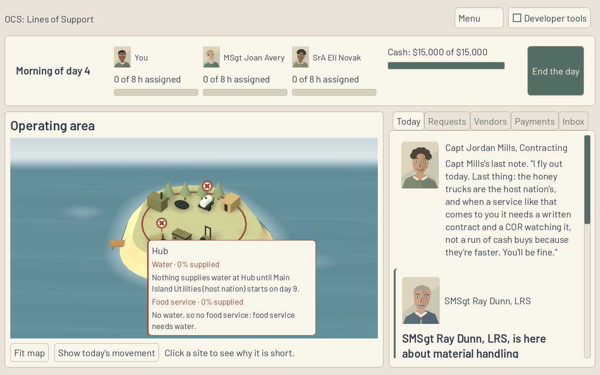
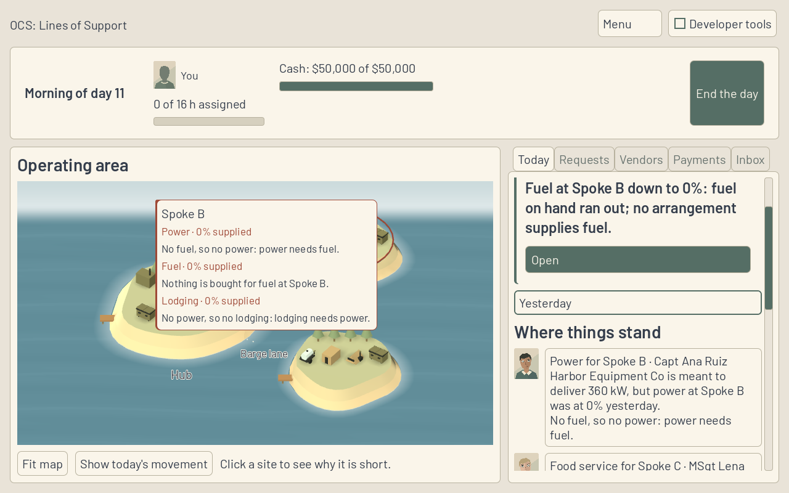
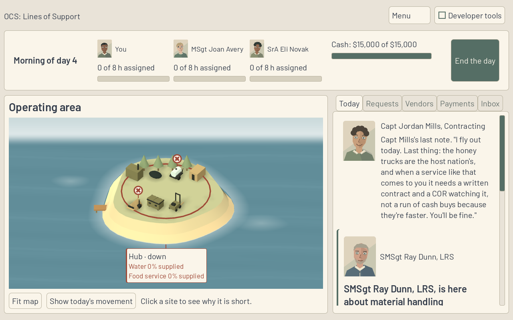
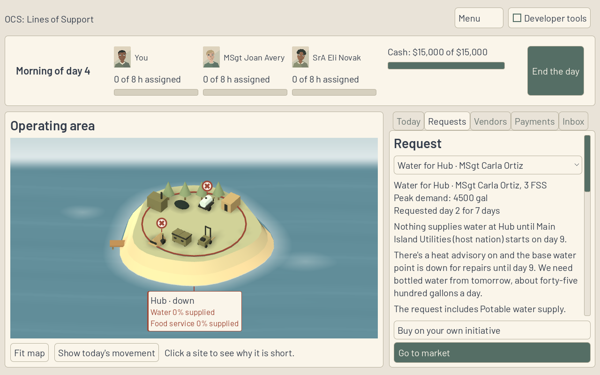

**Work session handoff** (Codex, 14 Nov 2026)

Expected look of this build and why: on Today each request is one clickable paper frame containing its title, state and complete shortfall reason. An opened map card has red short capability headings followed by the full reasons in ordinary ink; the eye can pick out each shortage first.

## PRs reviewed this session

- Initial fix pass: no open PRs. Read CODEX-SESSION, CODEX-KICKOFF, the required spec and ADRs, latest Codex/Fable handoffs, questions and decided objections; no response remained due. Reviewed Fable's findings on merged PRs 252 and 253. The active five-open limit takes precedence over the repository's ten-open wording.
- Claimed DESK-54 from main 125c279 before implementation; no previous claim existed. No existing PR needed a fix.

## Changed

- Today includes the exact WhyShort sentence inside the existing request button, immediately after its state. The whole frame retains its request destination and stale-state guard.
- Opened map cards keep short capabilities red and reasons in the ordinary ink, at the existing size and wrapping.
- Existing ShortfallSmokeTest checks the one-frame request, exact sentences, capability/reason adjacency and colors in all three looks, fit, rest placement, clicks/drag/closing and pure inspection. StandingSmokeChecks still checks every tutorial morning's exact request, state and reason and request links.
- Only DESK-54's backlog Status cell changes.

## Why

DESK-54 is Fable's visual follow-up to PR 252: the reason previously sat between request frames, while capability and explanation on an opened map card had the same color.

## Validated how

- Release solution build and all 808 .NET tests pass (687 Sim, 121 Harness, none skipped). Game Debug build passes using the existing .NET 8.0.428 SDK, one build worker and unused workload resolution disabled; no SDK configuration change.
- Godot 4.6.1 .NET ShortfallSmokeTest, LeadSmokeTest (including StandingSmokeChecks) and MapCalloutSmokeTest pass headless. ShortfallSmokeTest also passes with actual OpenGL Compatibility/Mesa llvmpipe rendering.
- Required scenario and provenance validators, conflict-marker validation and whitespace check pass. Sim/scenarios/goldens untouched.
- Inspected all five 1280×800 plain native PNGs (each under 190 KB). The sandbox does not support X11 Unix sockets; an authenticated local TCP Xorg display worked. Fresh Windows execution and ordinary-laptop performance remain unmeasured.

## Unresolved

Hosted CI and Fable review remain required. Automatic approval review initially rejected the tutorial-open screenshot blob upload to the public nhazelett/ocs-game repository, stating that trusted authorization to disclose that payload was missing. The expected blob was absent. After verifying direct owner authorization and the destination repository, one evidence-based retry of that same upload succeeded; no alternate publication tool was used. No new question, objection or FOR-NICK entry remains necessary. No merge, main push, force-push or shared branch deletion.

## Next

DESK-55: keep the action feedback from changing the map height. Then ART-20's rendered 3D cast. Nick's tutorial replay and the paused Sim-depth work stay as specified.
