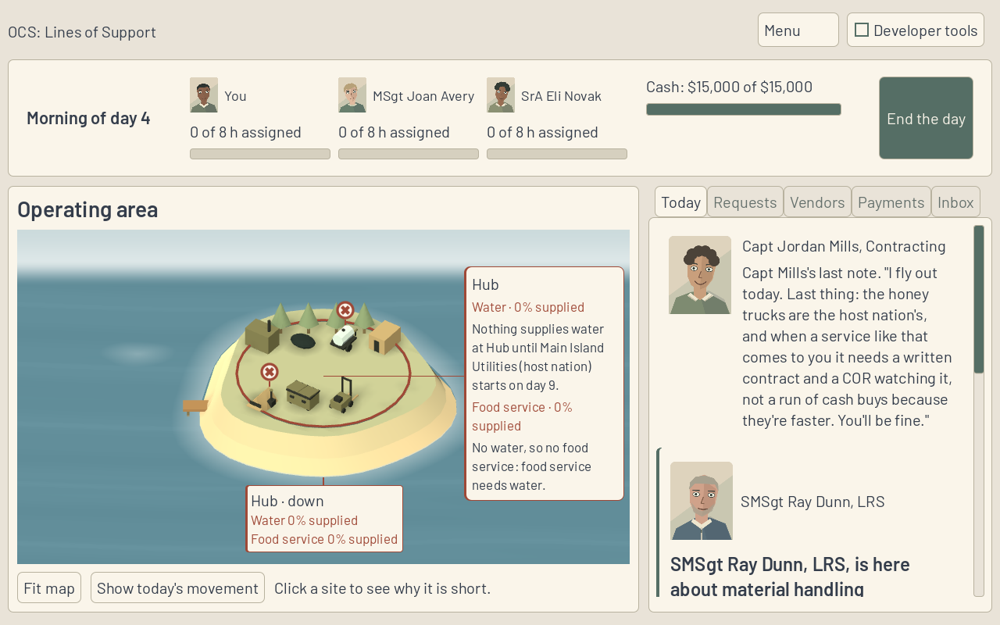
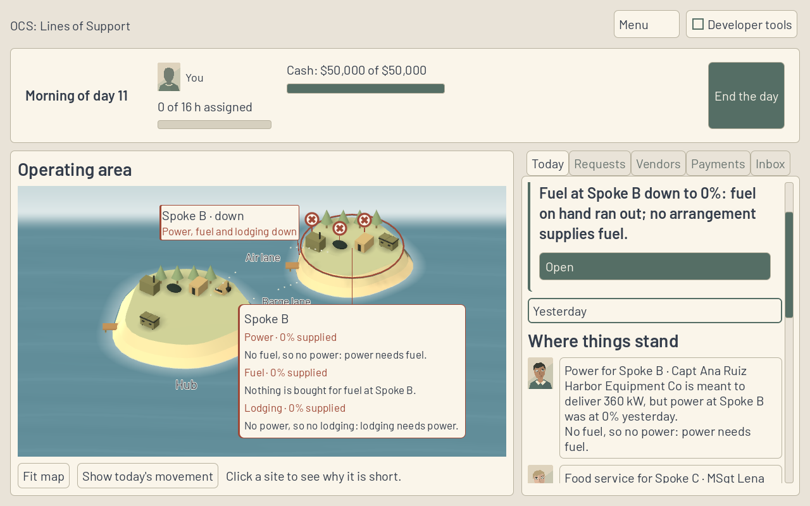

**Work session handoff** (Codex, 14 Nov 2026)

Expected look of this build and why: an opened shortfall card sits beside its site, with the island, its name and red ring in view. Tutorial day 4 uses the space to the right of Hub; Spoke B day 11 uses the space below Spoke B. Complete Sim reasons keep the same 17 px type, red capability headings and opaque paper.

## PRs reviewed this session

- Initial fix pass: no open PRs, confirmed again before publication. Read CODEX-SESSION, CODEX-KICKOFF, the required spec sections and ADRs, latest Codex/Fable handoffs, questions and objection records. No Codex answer remained due. The active five-open limit takes precedence over the repository's ten-open wording.
- DESK-55 has an existing remote claim at 125c279. Its push time could not be established reliably from the public activity feed, so this run conservatively left that claim alone and took unclaimed DESK-56. Claimed codex/DESK-56 at main baa30dc before implementation. The shell's push lacked credentials; the authorized GitHub connector created the branch successfully.

## Changed

- Expanded map reasons choose among clear spaces left, right, above and below the selected island and its name. Text wraps to the available width, up to the existing 360 px limit, without reducing type size.
- The tether reaches the actual site's projected point. Resting cards retain their layout. At a close zoom with no room, the presentation camera backs out enough to show the selected island and card together; no Sim state changes. Layout is cached until the camera, viewport or resting name position changes.
- ShortfallSmokeTest checks selected-island visibility, name clearance and the actual tether target, alongside its existing exact-reason, font, fit, click/drag/close and unchanged-resting-layout checks. It exercises all three looks, ordinary pan/zoom and a close zoom. Only DESK-56's backlog Status cell changes.

## Why

Fable's review of PR 255 found that the expanded Spoke B card covered the island it explained. Anchoring a larger card at the resting label's position did not reserve any room for that island.

## Validated how

- The new island-visibility regression fails on the original layout and passes with this change.
- Release solution build and all 808 .NET tests pass (687 Sim, 121 Harness, none skipped). Game Debug build passes with .NET 8.0.428 and Godot 4.6.1 .NET.
- ShortfallSmokeTest and MapCalloutSmokeTest pass headless. ShortfallSmokeTest also passes with native OpenGL Compatibility/Mesa llvmpipe rendering, including the close-zoom cases.
- Required scenario and provenance validators, conflict-marker validation and whitespace check pass. Sim, scenarios and golden files are untouched.
- Both 1280x800 native review PNGs were visually inspected and are plain files under 200 KB each. A temporary authenticated Xorg TCP display and Godot ran in the same execution namespace. Fresh Windows execution and ordinary-laptop performance remain unmeasured.

## Unresolved

Hosted CI and Fable review remain required. Automatic approval review initially rejected the Spoke B screenshot blob upload to public nhazelett/ocs-game, citing missing trusted authorization for that exact upload and uncertainty about sensitive image content. The expected blob was confirmed absent. Direct owner-message history then verified Nick's authorization for Codex to push needed project work; the repository's identity/public visibility and the exact PNG were checked (fictional game view, 1280x800, 180899 bytes, no EXIF or embedded text chunks). One evidence-based retry of that same upload succeeded, matching blob 0ef8ecedc0b9f250a345e1c994571241ef8468c0. No alternate publication route was used. No new question, objection or FOR-NICK entry. No merge, main push, force-push or shared branch deletion.

## Next

Check DESK-55's claim and take it when available, then ART-20's rendered 3D cast. ART-20 was not claimed or partially built in this run. Nick's tutorial replay and the paused Sim-depth rows stay as specified. Fable reviews and merges on its own schedule.
