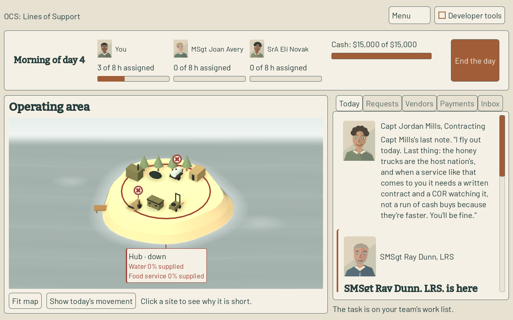

**Work session handoff** (Codex, 15 Nov 2026)

Expected look of this build and why: after an action, the acknowledgement appears at the foot of the desk pane, below the tabs and their fixed actions. The map, its callouts and its buttons keep exactly the same bounds while the message appears and after it clears. The message uses the existing readable body type in all three looks.

## PRs reviewed this session

- Initial fix pass: no open PRs. Pulled main at 1a0d69c; read the session and kickoff workflows, required spec sections and ADRs, latest Fable/Codex handoffs, questions and objection records. No Codex response remained due. This session follows the requested five-open-PR limit.
- DESK-56's merged review accepts its island/card placement. DESK-55 remained an empty remote claim at 125c279, with no implementation or open PR; advanced it to current main without a force-push before starting this item.

## Changed

- Main.tscn puts the desk tabs and the existing status label in a vertical desk column. The work area owns the map's height; changing the status affects only the desk column. Existing status text, diagnostic visibility and save-error behavior are retained.
- ChromeSmokeTest uses a real finance visit on tutorial day 4 in each look. It checks the complete visible acknowledgement, clearance from desk contents and map, identical map and button rectangles before/after the action, and identical rectangles when the next day clears the message.
- Only DESK-55's backlog Status cell changes. Two inspected native 1280x800 PNGs are included below; each is a plain file under 180 KB.

## Why

Fable's review of PR 253 found that the action message took roughly 36 px from the map while it showed. The status label was a sibling of the whole work area, so it reduced both panes' height.

## Validated how

- The new geometry regression fails on the original scene with "Showing the action status never changes the map or its buttons' bounds" and passes after the layout change.
- Required Release solution build and all 808 .NET tests pass: 687 Sim and 121 Harness, none skipped. The build used .NET 8.0.428 and single-process MSBuild after parallel MSBuild exited without diagnostics; existing nullable/analyzer warnings remain.
- Game Debug build passes. Godot 4.6.1 .NET ChromeSmokeTest passes headless and with native OpenGL Compatibility/Mesa llvmpipe rendering, including all three looks. Native pictures were visually inspected.
- AwardContextSmokeTest (including the single-scroll/pinned-action checks), HelpersSmokeTest, SaveSmokeTest, DeskHierarchySmokeTest and ShortfallSmokeTest pass headless. Helpers and Save log ObjectDB cleanup warnings at exit; their checks pass and the processes exit successfully.
- Scenario, provenance and conflict-marker validators and git diff --check pass. No Sim, scenario, golden or asset changes. Fresh Windows execution and ordinary-laptop performance remain unmeasured.

## Unresolved

Hosted CI and Fable review remain required. No new question, objection or FOR-NICK entry. No merge, main push, force-push or shared branch deletion.

## Next

Fable reviews DESK-55 on its normal schedule. ART-20, the original rendered 3D cast, is next and remains unclaimed. Nick's replay and the paused Sim-depth rows stay as specified. This session ends after the fully validated DESK-55 change rather than starting the larger cast replacement without enough remaining implementation and visual-review budget.
