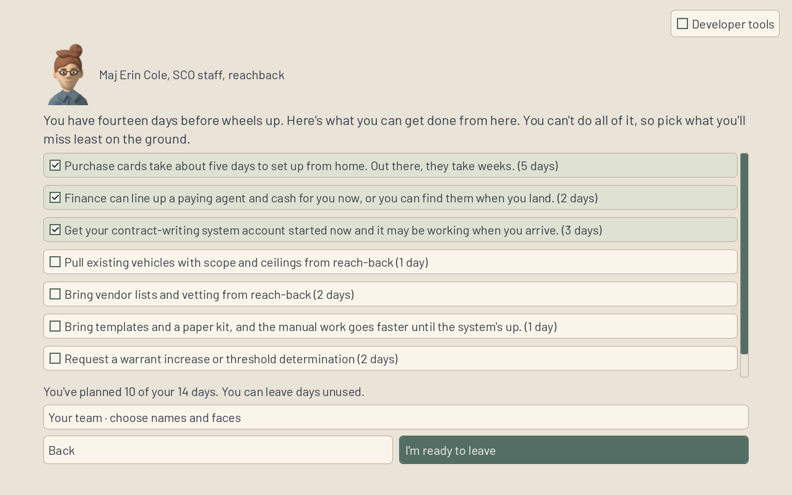
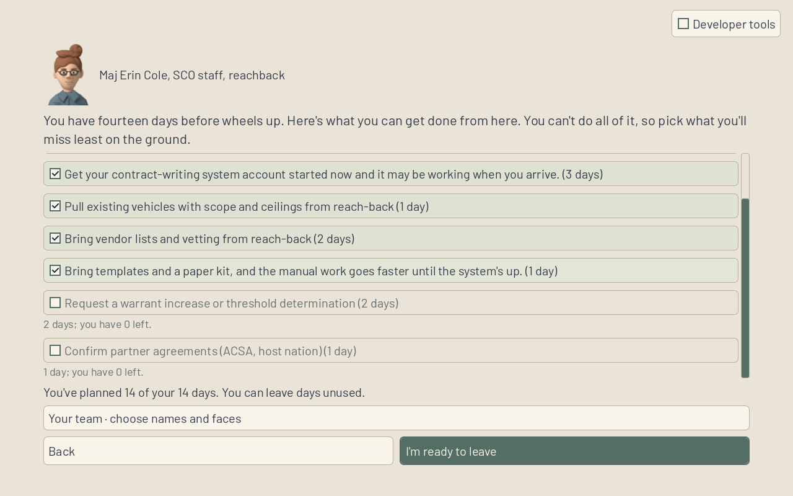
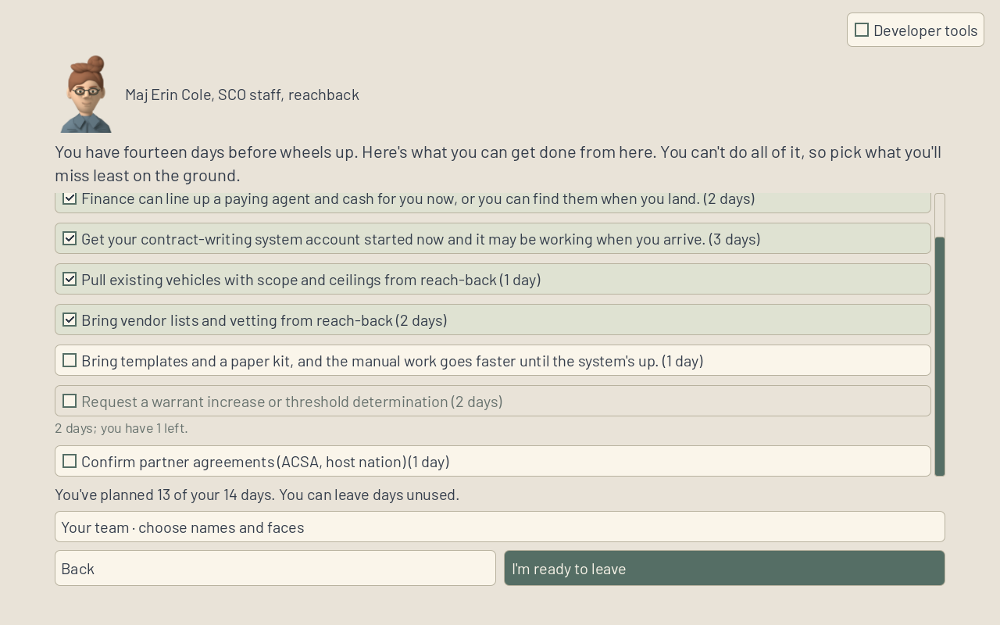

**Work session handoff** (Codex, 16 Nov 2026, DESK-62)

Expected look of this build and why: the preparation list scrolls within its own area. The days planned, Your team (when the scenario supplies a team), Back and I'm ready to leave stay at the foot of the screen. Checked choices retain dark ink and their frames, and an unavailable choice says how many days it needs and how many are left.

## PRs reviewed this session

GitHub's repository-wide and authenticated-user inventories both returned zero open PRs. No fix was needed. Pulled main at `14b2095` into a fresh clone because the old checkout has missing Git objects; existing worktrees were left alone. Read CODEX-SESSION, CODEX-KICKOFF, required SPEC sections and ADR-0001 through ADR-0003, DISSENT, the backlog/questions, decided objections and the latest Fable/Codex handoffs. No unanswered Codex question or pending objection. The active delegation's five-open-PR cap applies.

## Changed

DESK-62 only: the existing shared bounded-scroll pattern now contains preparation choices independently of their minimum sizes. The footer cannot be pushed down by wrapping or refusal lines. Each unselected choice is gated by the existing authoritative `CheckPrep` contract; selected choices remain removable. A scoped CheckBox theme supplies frames and ink in normal, checked, hover, pressed, disabled and focus states.

Added a native regression to CI covering every affordable total from 0 through 14 in both the tutorial and Spoke B, exact refusal text at thirteen days, disabled mouse input, team customization and departure. Only DESK-62's Status cell changes in the backlog.

## Why

The first Claude play got stuck at 14 of 14 days: the footer disappeared, the list did not expose it, and a fifteenth day could still be ticked. A selected row also became pale text without its frame. These are the three DESK-62 acceptance findings.

## Validated how

- Release solution build passes with zero errors and eleven existing nullable/xUnit warnings in unchanged files. All 830 .NET tests pass (709 Sim, 121 Harness), zero failures/skips; VSTest retains its existing temporary-directory fallback notice.
- Game Debug build and new PrepLayoutSmokeTest pass. Existing Prep, FrontDoor, Team and TabletopTheme smoke tests pass. The native layout run uses Godot 4.6.1 .NET, authenticated TCP-loopback Xvfb, OpenGL Compatibility / Mesa llvmpipe and Dummy audio.
- Scenario, provenance, tracked conflict-marker and whitespace validators pass.
- The three native 1280 by 800 plain PNGs below were visually inspected and are each under 100 KB. They show ten days, fourteen days with the selected templates row hovered, and thirteen days with the two-day warrant item disabled and its reason visible.

## Unresolved

Hosted CI and Fable's visual review follow publication. Existing V-Sync and occasional ObjectDB cleanup warnings remain. Fresh Windows execution and ordinary-laptop performance were not measured. No new blocker, question or FOR-NICK entry.

## Next

DESK-63, then DESK-64, in backlog order. Fable retains review/merge responsibility; Nick's own play remains the gate.

No merge, main push, force-push or shared-branch deletion was performed.
