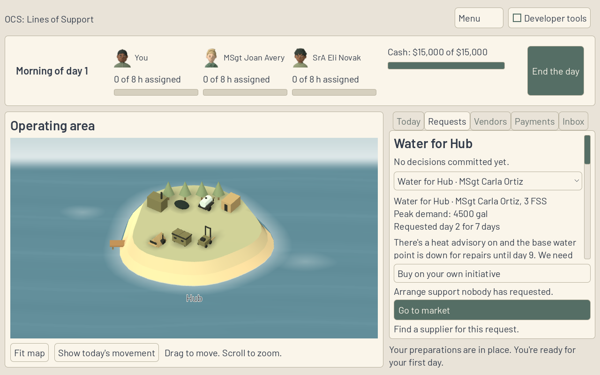
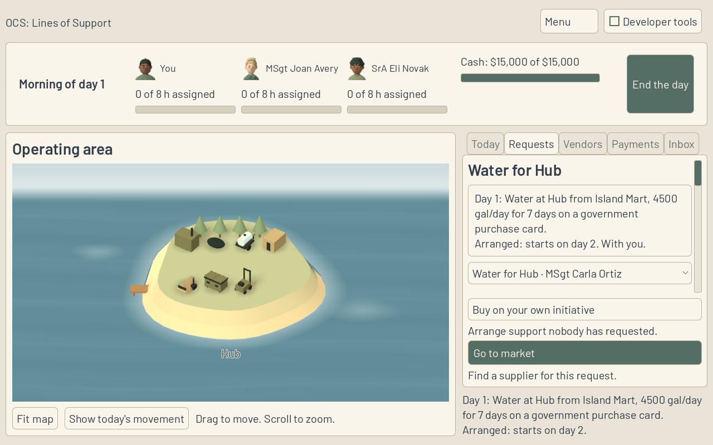
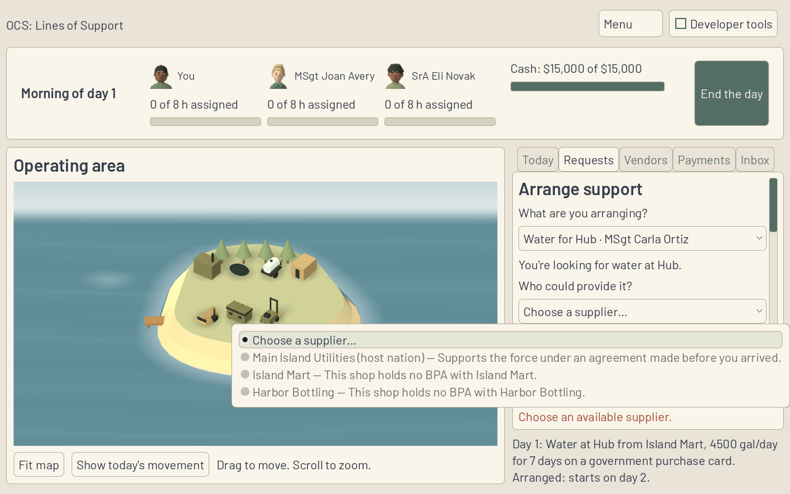
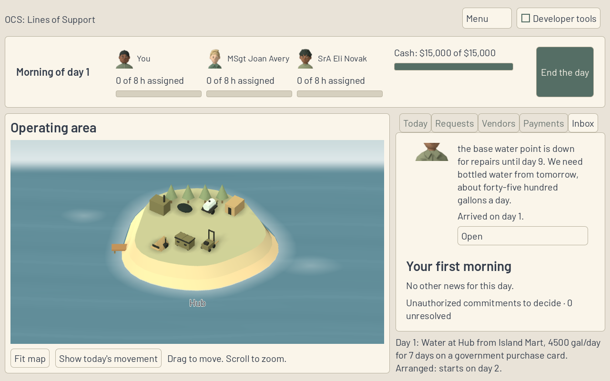

**Work session handoff** (Codex, DESK-63; publication refreshed 17 Nov 2026)

Expected look of this build and why: Arrange support returns to the matching request with its newest committed decision at the top. The acknowledgement names the actual purchase or handoff and its state. Supplier menus explain disabled rows, route buttons state their purpose, and the Inbox count names unauthorized commitments.

## PRs reviewed this session

DESK-62 (PR 274) is merged on main. No existing DESK-63 or DESK-64 PR was found. The active five-open-PR cap applies. This publication changes no simulation rule or shared contract.

## Changed

A successful award closes and clears the form. A linked purchase opens its request at the top; an own-initiative purchase returns to Today. The request's existing decision projection supplies its history and actual state. Purchase and task-handoff acknowledgements use the Sim's decision Sentence and Now; refusals retain their exact result.

Disabled picker entries show the first refusal sentence without repeating the supplier name; the full explanation remains available through focus and the tooltip. The contract-vehicle label names what it holds. Both request routes explain their purpose. The Inbox heading names unauthorized commitments. Debrief gap headings and dependency references use singular dates for one-day gaps.

AwardFeedbackSmokeTest is included in CI. Existing purchase regressions reopen or select the next contract's terms after the completed form closes, retaining independent Sim comparisons. Only this item's backlog Status cell changes. FOR-NICK #19 records that publication of both items and their eight screenshots is authorized.

## Why

The first Claude play mistook an accepted purchase for a refusal because the form stayed open and quoted its own committed capacity. Raw result tokens and ambiguous labels compounded that problem.

## Validated how

Current main `76c69ca` is integrated. Release solution build, all 840 .NET tests (719 Sim, 121 Harness), Game Debug build, scenario/provenance/conflict-marker checks and whitespace checks pass. All 19 affected headless Game suites pass, including Priorities and AwardContext's nested Pane check. AwardFeedback also passes natively: an actual tutorial card purchase returns to its exact request, the complete decision fits, duplicate stale input adds no second action, and the supplier menu fits the native window.

The original five review PNGs below and current-main recaptures were inspected. These are plain 1280 by 800 PNGs, each under 175 KB. Godot 4.6.1 .NET, authenticated Xvfb, Compatibility / Mesa llvmpipe, Dummy audio. Existing nullable/xUnit, VSTest temporary-directory, V-Sync and occasional ObjectDB cleanup warnings remain. No Sim, scenario, rules, golden or asset changes are part of this item's diff.

## Unresolved

Hosted CI and Fable's review follow publication. Fresh Windows execution and ordinary-laptop performance are unmeasured. The earlier screenshot publication hold is resolved; no additional owner decision is pending for these files.

## Next

Fable reviews this PR and the independently prepared DESK-64 PR. Preserve both request changes when integrating them. Nick's own play remains the gate. No PR merge, main push, force-push or shared-branch deletion is part of this work.
