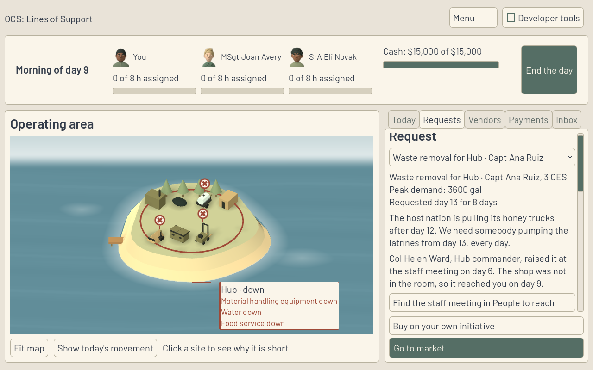
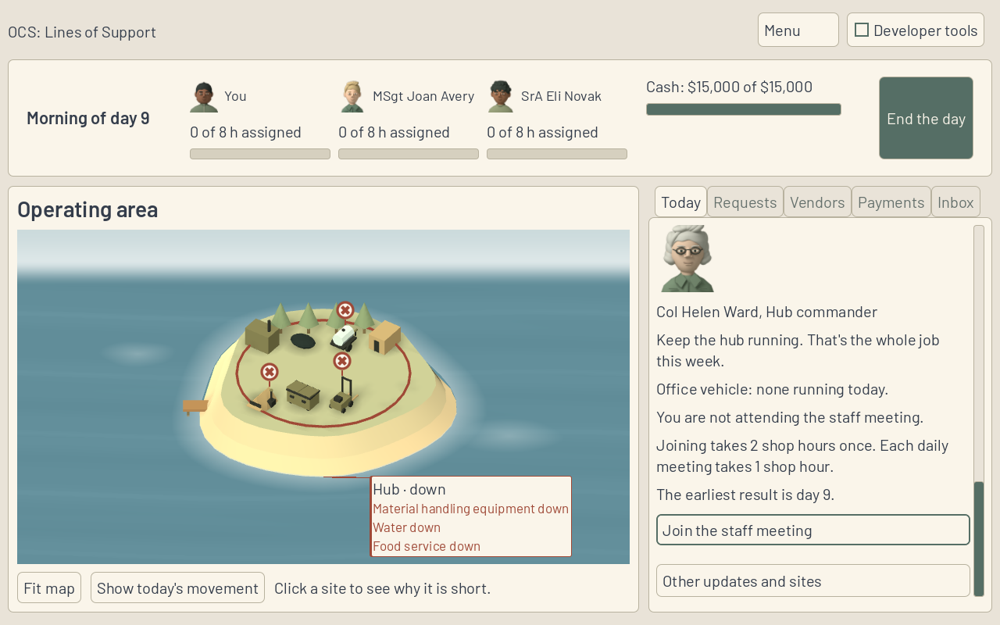
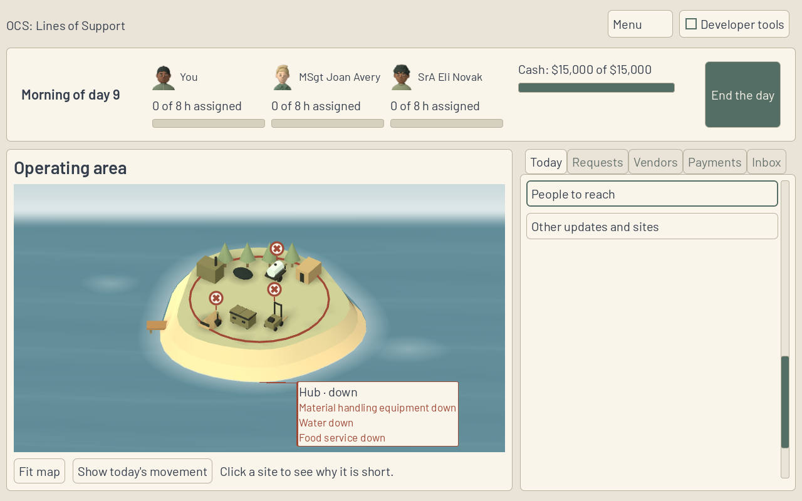

**Work session handoff** (Codex, DESK-64; publication refreshed 17 Nov 2026)

Expected look of this build and why: People to reach carries its own actions inside the Today scroll. Closing the section hides every contact action. A missed-meeting request links directly to the staff meeting and brings its actual action into view.

## PRs reviewed this session

DESK-62 (PR 274) is merged on main. No existing DESK-63 or DESK-64 PR was found. The active five-open-PR cap applies. This publication changes no simulation rule or shared contract.

## Changed

Contact action controls are children of ReachPeople, so a refresh cannot leave an action outside its closed section. The request link uses the public card's RaisedInRoomDay together with its visible HeardAt message; it does not parse prose or infer past attendance from current attendance. Navigation preserves Sim state. Focus and scrolling wait for layout, and stop if the user has changed page, contact, state or section.

PeopleSectionSmokeTest is included in CI. The existing pane regression checks that contact actions scroll within their section. This branch is independently based on main `76c69ca`; it does not contain DESK-63's implementation or screenshots. Only DESK-64's Status cell changes. FOR-NICK #19 records authorized publication of both items and their eight review screenshots.

## Why

The first Claude play saw Find finance pinned below a closed People to reach section for seventeen days and could not find the meeting mentioned by the waste request.

## Validated how

Release solution build, all 840 .NET tests (719 Sim, 121 Harness), Game Debug build, scenario/provenance/conflict-marker checks and whitespace checks pass on integrated main `76c69ca`. All nine affected headless Game suites pass, including AwardContext's nested Pane checks. PeopleSection also passes natively: every contact's action stays within its section, closing hides them across eight daily refreshes, and the day-nine missed-meeting request opens the selected meeting and fully visible join button without changing Sim.

The three original review PNGs below and current-main recaptures were inspected. They are plain 1280 by 800 PNGs, each under 192 KB. Godot 4.6.1 .NET, authenticated Xvfb, Compatibility / Mesa llvmpipe, Dummy audio. Existing nullable/xUnit, VSTest temporary-directory, V-Sync and occasional ObjectDB cleanup warnings remain. No Sim, scenario, rules, golden or asset changes are part of this item's diff.

## Unresolved

Hosted CI and Fable's review follow publication. Fresh Windows execution and ordinary-laptop performance are unmeasured. The earlier publication hold is resolved; no additional owner decision is pending for these files.

## Next

Fable reviews DESK-63 and this independent PR, preserving both request changes when integrating them. Paused Sim-depth work remains paused, and Nick's own play remains the gate. No PR merge, main push, force-push or shared-branch deletion is part of this work.
