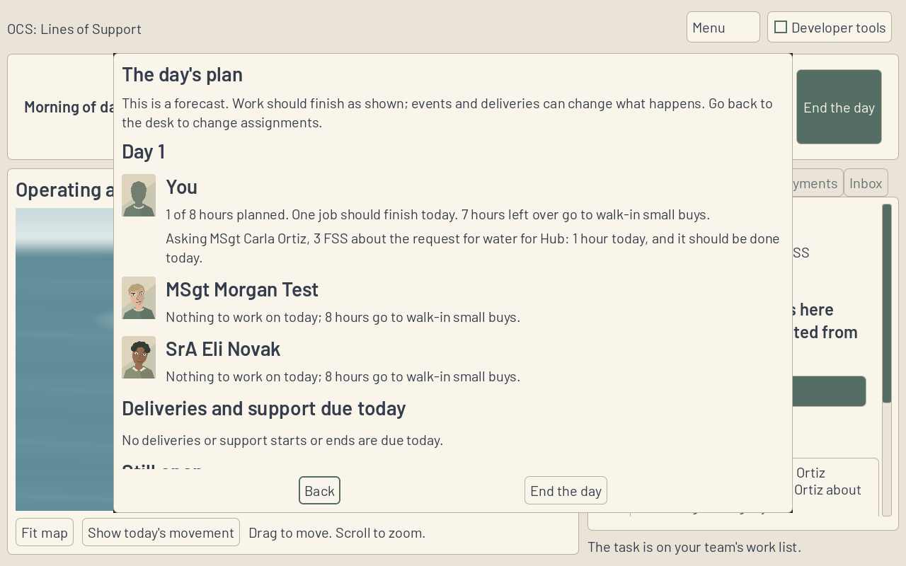
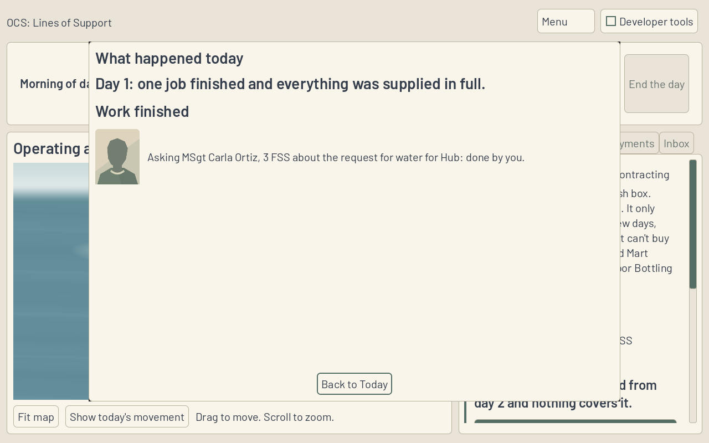

**Work session handoff** (Codex, 16 Nov 2026, PLAY-01)

Expected look of this build and why: no change to ordinary play. A native test scene starts New game through its real buttons, with Developer tools off. Each command returns the existing 1280 by 800 screen and the active panes' visible text. This PR is based on main, independently of ART-20, so these pictures retain main's flat portraits.

## PRs reviewed this session

- [PR 261, ART-20](https://github.com/nhazelett/ocs-game/pull/261), published head `3f3d613`: Fable's requested identity/hair/framing revisions and scenario sheets are already published, the PR description reflects them, [CI 43795176037](https://github.com/nhazelett/ocs-game/actions/runs/43795176037) succeeds, and GitHub reports it mergeable. No new review finding or fix was needed this session. Fable's art re-review is still required; this session does not substitute for that judgment.
- Main pulled to `f94d6bd`. Read the session/kickoff, required spec/ADRs, latest Fable/Codex handoffs, questions, decided objections and PLAYTEST-CLAUDE. No unanswered Codex question. The active delegation's five-open-PR cap overrides the workflow documents' ten; one PR was open at the start.

## Changed

- PLAY-01: `game/tests/PlayDriver.tscn`, driver and visible-screen reader. GUI input goes through Godot's normal input system, including global mouse-button state and embedded dialogs/menus. Selection is limited to current on-screen labels, with duplicate occurrences, disabled controls, missing-label feedback, typing, scrolling and Escape. Map text comes from actual rendered labels. Covered panes, hidden controls, metadata, tooltips, future events and clipped glyph lines do not become player information.
- `tools/play/start.sh` builds/imports a copied project outside the checkout and isolates settings there. `step.sh` serializes commands and prints exactly the PNG and text paths. Output includes command records and the game's own input log, copied after each screen once deployed and on exit. The requested seed is injected at session creation; ordinary games still default to seed 1. No new player seed control, Sim rule or contract.
- Native day-1 regression, command parser tests and running/storage instructions in `tools/play/README.md`. Only PLAY-01's backlog Status cell changes; no status-line, FOR-NICK or question edit.
- Two inspected plain PNGs with matching screen text (115,254 and 81,930 bytes). The regression deliberately chooses No portrait for the player and renames the second teammate Morgan Test; those are test inputs, not default cast changes. All other play screenshots and build output remain scratch-only:

[Active plan text](images/2026-11-16-codex-play01-plan.txt)

[Active results text](images/2026-11-16-codex-play01-results.txt)

## Why

PLAY-03 needs a blind player to take one action at a time through the actual game and inspect what it sees, without reading the design or authoritative state. The driver uses existing screen handlers and autosaves. Regressions caught and fixed native text insertion appending instead of replacing, popup release events choosing an item while opening, embedded-dialog event coordinates, and transcripts revealing clipped text.

## Validated how

- Release solution build and all 808 .NET tests pass (687 Sim, 121 Harness); build/test used one MSBuild worker on this host. Game Debug build passes. Scenario, provenance, tracked conflict-marker and whitespace checks pass. No Sim, scenario, rule, golden or asset changes.
- Native Godot 4.6.1 .NET `PlayDriverSmokeTest` passes on authenticated TCP-loopback Xvfb, 1280 by 800, Dummy audio, OpenGL Compatibility / Mesa llvmpipe. It opens New game normally, changes the second visible Name field, selects a real popup item, scrolls to and asks a helper, cancels and reopens the plan, confirms exactly one day, waits for normal playback, returns from results, and checks exact state equality after replaying its saved log. Additional checks cover hidden/covered/missing controls, greyed controls and their visible reasons, clipped text, numeric-field commit and native PNG size. The Sim oracle is in the test, separately from the driver.
- The scratch launcher and actual `step.sh` IPC client also completed a separate tutorial day 1. The resulting log contains seed 20261116, the chosen preparations, a day-1 ask-about action and savedDay 2. The Harness `run tutorial --log <scratch>/input-log.json` successfully replayed that log through the full scenario. Two Python command-parser tests pass.
- Existing FrontDoor, Save and Prep smoke tests pass, including normal seed/prep, restart/resume and refused-save behavior. Existing compiler nullability/xUnit warnings and native V-Sync/occasional ObjectDB cleanup warnings remain; no new runtime error in the successful driver run.
- Both committed pictures are native 1280 by 800 plain PNGs under 400 KB. The scene, build and full play captures live outside the repository; scratch copies are removed after selecting these two review images.

## Unresolved

Fable review and new hosted PR CI follow publication. The native driver test has a separate display-dependent invocation documented in tools/play/README.md; existing hosted headless smoke tests compile the driver but do not execute its screenshot test. Fresh Windows execution, ordinary-laptop performance, sound and human play judgment are unmeasured here. No blocker or addition for Nick.

## Next

Fable reviews PLAY-01, then PLAY-03 can begin after merge, following docs/PLAYTEST-CLAUDE.md and its storage limit. ART-20 still awaits Fable's art re-review. Nick's play remains the gate; paused Sim-depth rows remain paused. No merge, main push, force-push or shared-branch deletion was performed.
