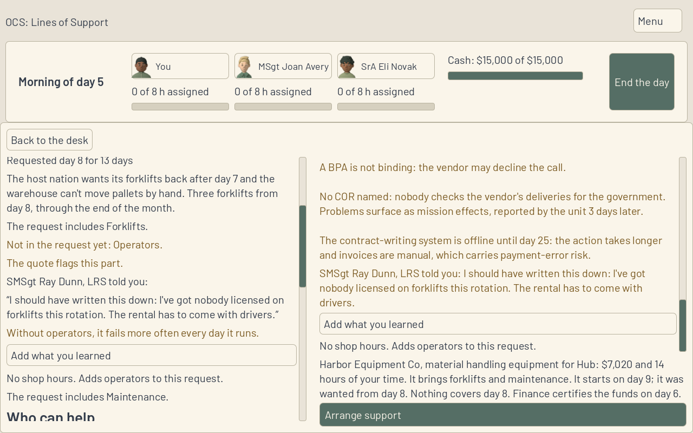
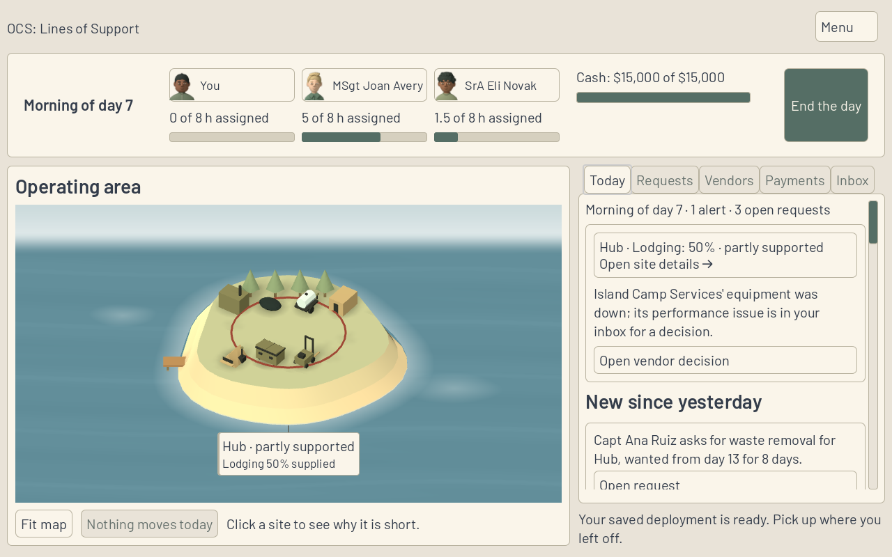
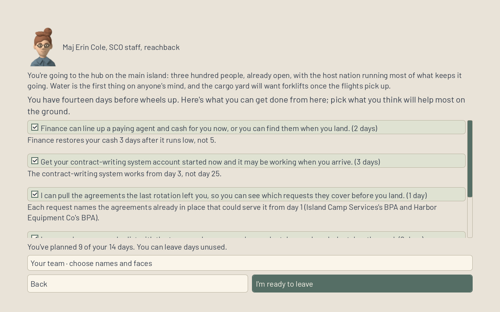

**Work session handoff** (Codex, 19 Nov 2026, DESK-113)

Expected look of this build and why: the day-five forklift quote carries Add what you learned and its no-hours cost under Dunn's warning, just as the request does. The morning's lodging alert carries Open vendor decision. Each preparation effect sits immediately under its checkbox, with the larger gap before the next choice. The vendor picker says Choose a vendor and results say which morning comes next.

## PRs reviewed this session

Pulled main to `69d48bf4bb89195a9d778ffed8b338def5c78f6d` in a fresh clone after the older checkout's missing Git objects prevented a fetch. Read CODEX-SESSION, CODEX-KICKOFF, the requested SPEC sections, ADR-0001 to ADR-0003, DISSENT, latest Codex/Fable handoffs, QUESTIONS, FOR-NICK and objection decisions. No question or objection awaits Codex. Two connected GitHub open-PR searches returned no open PRs, so no CI/review/conflict fix was needed. Applied this session's five-open-PR limit.

## Changed

- DESK-113, in game only: one shared Add what you learned action and explicit no-hours cost for both columns, guarded against stale state; removed the extra gap before the quote's learned warning.
- Each request and own-initiative target retains its own arrangement, supplier, vehicle, funding, COR, quantity, start, duration and pick-two choices while navigating during the same morning. Reopening from Today, Requests, map or decisions uses the same draft. Each restoration passes through the existing Sim choices and quote again. Switching mornings clears stored drafts; an open form continues through the existing availability reconciliation. Loading, replay and a new deployment clear all drafts; a successful buy clears its target's draft.
- A pending performance issue's existing navigation link sits on the matching shortfall alert, otherwise on its news item or the persistent vendor-problems group. It opens the same Inbox decisions without spending hours and disappears when cure work starts.
- Preparation groups have a two-pixel internal gap, reduced checkbox bottom padding and a 24-pixel gap before the next choice. Both results and Yesterday name the actual destination morning; finished games retain Back to the debrief.
- Extended existing native tests for distinct request drafts, same-day navigation, morning expiry, learned action/cost equality, exact recorded day-seven alert navigation and stale buttons, preparation geometry and results labels. The untouched-form and instrument-first fixtures now explicitly skip the helper's assembled quote instead of relying on navigation to discard it.
- Only DESK-113's backlog Status cell changed. No Sim, scenarios, shared contracts, top status line, QUESTIONS or FOR-NICK edit.

Review pictures, all native 1280×800 plain PNGs below 400 KB:

## Why

D39 and the 19 Nov play: the player spent about 28 steps looking for the learned-part fix, lost an unfinished buy on reopening its request, missed a vendor decision beside a shortfall and read preparation effects as belonging to the next box. These changes bind the existing actions and public views without changing the simulation.

## Validated how

- .NET SDK 8.0.428: solution build passed (11 existing warnings, zero errors); game build passed (one existing PrioritiesSmokeTest nullability warning, zero errors).
- All 962 .NET tests passed: 841 Sim and 121 harness, none failed or skipped. Existing VSTest artifacts-directory fallback notice remains.
- Required scenario and provenance validators passed (five scenario folders, one rules file, zero errors); conflict and whitespace checks passed.
- Godot 4.6.1 .NET: the five changed smoke suites passed headless; CommitPreview, Performance and PrepLayout also passed with actual rendering under an authenticated, temporary TCP-loopback Xvfb display. Three selected captures were visually inspected above; no image editing was applied.
- All 67 native CI invocations passed locally: 65 in the initial wider run, then AwardChoices after correcting its fixture and PlainNames on a sequential rerun within the existing 60-second timeout (1,818 panels, 201,977 strings, no unsafe-reference leaks). PlainNames had timed out under three concurrent test processes; no timeout or assertion was weakened.
- No Windows execution, hardware performance, balance batches or listening test was performed for these Game presentation changes. Hosted CI follows publication.

## Unresolved

No new blocker or Nick-only action. The terminal has no Git push credentials; the connected GitHub app carries the authorized feature branch and ordinary PR. The existing playtest and Sim-depth gates remain.

## Next

Fable reviews DESK-113 and its screenshots and CI. Codex takes DESK-114 next, then ends when no ordered Codex row is unblocked before the gate. No merge, main push, force-push or shared-branch deletion was performed.
