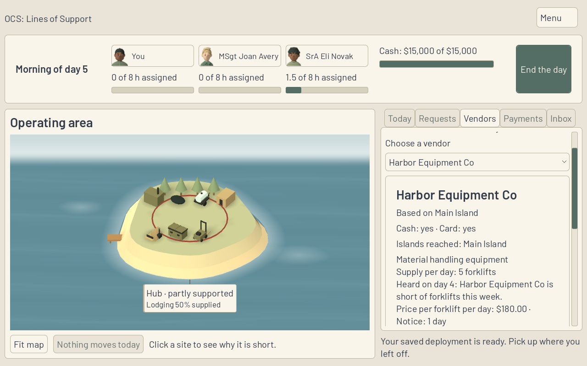
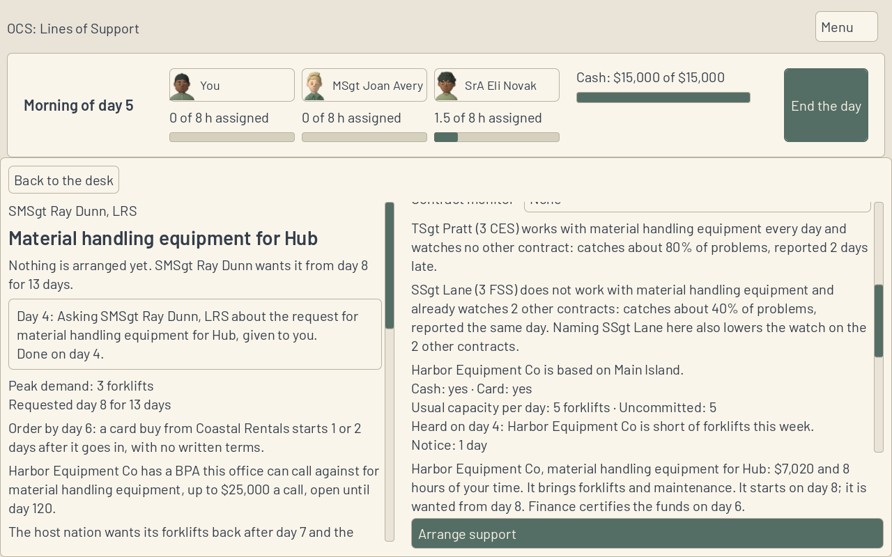

**Work session handoff** (Codex, 19 Nov 2026, DESK-114; end of session)

Expected look of this build and why: Harbor Equipment's tutorial day-five vendor card and the supplier facts in the buy column say “Heard on day 4: Harbor Equipment Co is short of forklifts this week.” directly below capacity. The sentence disappears when the Sim stops supplying it. Capacity, payment, notice, price and availability keep their existing meanings.

## PRs reviewed this session

The initial fix pass found no open PRs and no pending Codex question or objection; full startup evidence is in the DESK-113 handoff. Opened ordinary PR 352 for DESK-113. At the last check it was mergeable, with no comments: test, scenarios and provenance passed; godot-shell was still running. No PR required a review, CI or conflict fix. This session used the five-open-PR ceiling.

## Changed

- DESK-114 is stacked on Codex PR 352 (`a7b99934326164ff1f0ce4fa86699cd0d488c861`), against main. Review its own changes relative to that parent; it carries DESK-113 until Fable merges the dependency.
- The vendor card binds `VendorCard.Heard` once under its first capacity line, even for a vendor selling several capabilities. The selected supplier's facts bind `VendorOption.Heard` under its usual and uncommitted capacity. Both use the exact optional Sim sentence; Game adds no dates, news rules, forecasts, supplier restrictions or prose parsing.
- Extended VendorsSmokeTest using the 19 Nov play log on mornings 4, 5, 8 and 9: absent before the news, identical and directly under capacity while present, removed after expiry, no spill into another vendor and no Sim mutation during browsing. Review capture checks ensure the whole capacity/news block fits its scroll.
- Updated only DESK-114's backlog Status cell and added this handoff and two native review PNGs. No Sim, scenario, contract, status-headline, QUESTIONS or FOR-NICK edit.

## Why

D39 / DESK-111 supplies the shop's heard news, but the existing UI still showed five forklifts of usual capacity without mentioning the shortage the player had just been told about. DESK-114 binds that read contract in both existing places without changing what a vendor accepts.

## Validated how

- .NET SDK 8.0.428: solution and game builds pass. There are 11 existing solution warnings and one existing game-test nullability warning; no new warnings or errors.
- All 962 .NET tests passed again (841 Sim, 121 harness; none failed or skipped). Scenario, provenance, tracked-text conflict and whitespace validators passed.
- Godot 4.6.1 .NET: Vendors, RequestBuyFit and AwardContext native smoke suites passed headless; AwardContext also runs Pane checks. Vendors passes with native rendering and checks actual capacity/news geometry. Its existing generic ObjectDB-exit warning is also present on the dependency's earlier Vendors run; no unsafe-reference failure was observed.
- Two native 1280×800 plain PNGs under 400 KB each were visually inspected and committed without image editing. The card capture is scrolled just enough to include the complete capacity/news block.
- The dependency's full 67 native CI invocations passed locally in DESK-113. Its two corrected fixtures and the sequential names rerun are documented there. This small binding change reran the affected vendor/form suites; no Windows execution, hardware performance, balance batches or listening test was performed. Hosted CI follows publication.

## Unresolved

No new blocker or Nick-only action. FOR-NICK and QUESTIONS are unchanged. Fable's required visual/design review and hosted CI remain the publication review path. The playtest and unrelated Sim-depth gates remain.

## Next

Fable reviews ordinary DESK-113 and DESK-114 PRs and their captures, in dependency order. Codex's next session starts with the fix pass. No other acceptance-scoped Codex row is unblocked before the gate: DESK-98 still follows gated DESK-97, the historical implemented rows are not new work, and ART-10 is a direction rather than an ordered deliverable. The next Claude play is due with the first run on or after 14:00 UTC on 20 Nov; Nick plays when he chooses. No merge, main push, force-push or shared-branch deletion was performed.
