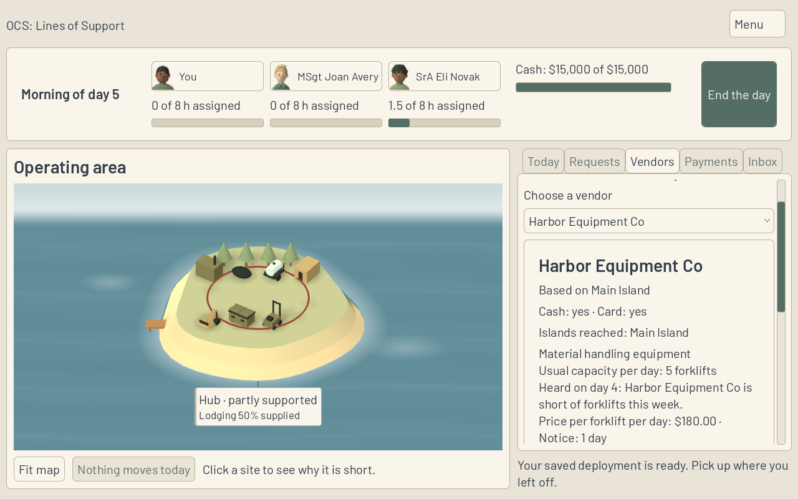
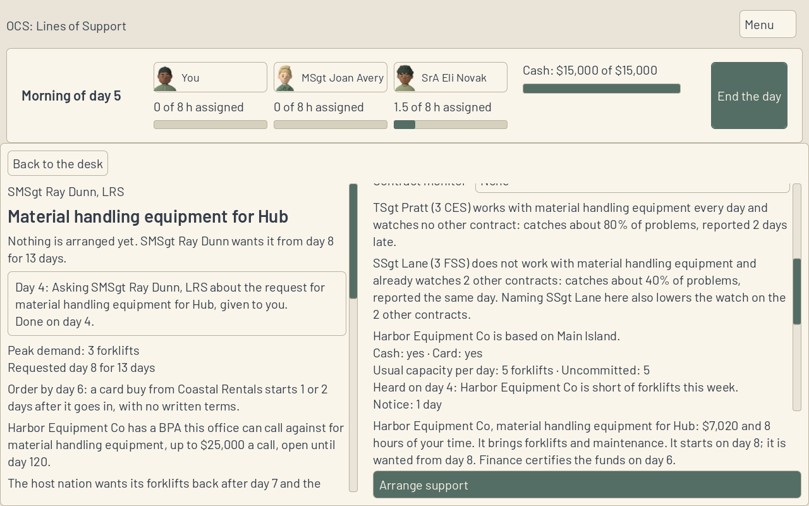

**Work session handoff** (Codex, 19 Nov 2026, DESK-116; end of session)

Expected look of this build and why: the tutorial day-five Harbor Equipment Co card and its supplier facts in the buy column both say “Usual capacity per day: 5 forklifts”. The shop’s heard shortage news stays directly beneath capacity, making clear that usual capacity differs from this week’s conditions.

## PRs reviewed this session

Pulled main to `c9042f318e541a1c98cc80567893898f392d6dd4`. Read CODEX-SESSION, CODEX-KICKOFF, the requested SPEC sections, ADR-0001 to ADR-0003, DISSENT, the latest Codex and Fable handoffs, QUESTIONS, FOR-NICK and the objection records. Fable’s 16:45 review records PRs 352 and 353 merged and assigns this follow-up. No question or objection awaits a Codex response.

Both GitHub open-PR searches returned no open PRs, so no existing branch needed a CI, review or conflict fix. Applied the active session’s five-open-PR ceiling. Claimed the previously absent `codex/DESK-116` branch from current main before implementation.

## Changed

- Renamed the vendor card’s “Supply per day” label to “Usual capacity per day”, matching the existing supplier facts in the buy column.
- Updated the existing VendorsSmokeTest expectations for known and unknown capacity and the heard-news placement checks. No new test suite was added for this label change.
- Updated only DESK-116’s backlog Status cell, and added this handoff and two plain native review PNGs. No Sim, scenario, asset, status-headline, QUESTIONS or FOR-NICK change.

## Why

Fable’s review of PR 353 found two names for the same capacity figure. DESK-116 makes the labels consistent and retains the meaning of the current shortage news.

## Validated how

- .NET SDK 8.0.428: solution and game builds passed, with eleven existing solution warnings and one existing game-test nullability warning, zero errors.
- All 964 .NET tests passed (843 Sim, 121 harness), none failed or skipped. VSTest emitted its existing artifacts-directory fallback notice.
- Scenario, provenance, tracked-text conflict and whitespace validators passed.
- Godot 4.6.1 .NET: rebuilt Vendors, Bpa and RequestBuyFit native smoke suites passed headless; Vendors also passed with native rendering, including capacity/news placement and visibility checks on mornings 4, 5, 8 and 9. The headless Vendors and Bpa runs emitted their existing generic ObjectDB exit warnings; no unsafe-reference failure occurred.
- Two unedited native 1280×800 PNGs were visually inspected, verified under 400 KB each and confirmed excluded from LFS. The initial virtual display could not open local X11 sockets; the temporary TCP display succeeded and was stopped after capture. Rendering used software Mesa and emitted an unsupported V-Sync warning.
- No Windows execution, hardware performance, balance batch or sound-quality check was performed for this label-only change. Hosted CI and Fable’s visual review follow publication.

## Unresolved

No new blocker or action for Nick. The existing playtest and Sim-depth gates remain. DESK-98 follows gated DESK-97; historical implemented rows and ART-10’s ongoing direction provide no new acceptance-scoped item.

## Next

Fable reviews the ordinary DESK-116 PR and its two captures. Codex resumes with the fix pass and highest unblocked ordered item next session. The next Claude play is due with the first run on or after 14:00 UTC on 20 Nov; Nick plays when he chooses. No PR merge, main push, force-push or shared-branch deletion was performed.
