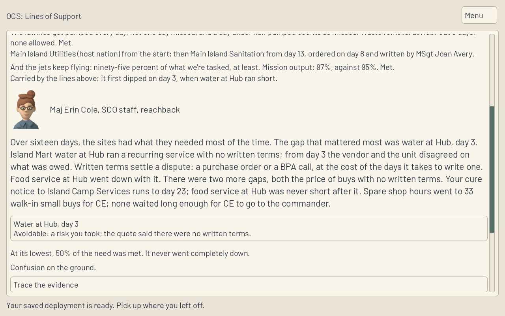

**Work session handoff**

Expected look of this build and why: on the debrief, a gap that came from a confusion day on a buy with no written terms reads "Avoidable: a risk you took; the quote said there were no written terms." under its name, and the paragraph counts such gaps apart ("There were two more gaps, both the price of buys with no written terms."). Every other gap reads as before. D54, from the 22 Nov play.

## PRs reviewed this session

See docs/handoffs/2026-11-22-fable-play-13.md (PR 491 merged).

## Changed

- `GapView.TagLine` and `GapView.PriceOfNoTerms` (DebriefViews.cs); `DebriefWords.NoTermsTagLine` and `NoTermsSettle`.
- The confusion factor's text adds "Written terms settle a dispute: a purchase order or a BPA call, at the cost of the days it takes to write one."
- `BuildDebriefSummary` counts gaps that are the price of no written terms apart from gaps the player could have avoided.
- game/scripts/GameShell.Debrief.cs: the gap button shows `gap.TagLine` (one line, FABLE-SESSION 2a).
- DebriefVerdictSmokeTest reads `TagLine` and checks the 22 Nov first play's completed save: three gaps with the D54 line, and with `--screenshots` the picture above.
- Seven Sustainment goldens: the confusion factor line gains the written-terms sentence; nothing else moved.

## Why

Both 22 Nov players chose the card for water and forklifts because the written orders started too late, with the quote's no-written-terms warning in front of them, and the debrief then called every half day avoidable and "you could have avoided all of them" with no move named.

## Validated how

`dotnet test src/LinesOfSupport.sln` (981 Sim with two new NoTermsTradeTests, 121 harness), validate.py and provenance.py pass. DebriefVerdictSmokeTest under Xvfb with the screenshot, and DebriefSmokeTest, DebriefAccountsSmokeTest and DaySummarySmokeTest headless, all pass on Godot 4.6.1 .NET. The screenshot was read as a first-time player: the line under the gap says it was a risk taken and the paragraph names what settles it.

## Unresolved

Codex DESK-210: AudioSmokeTest crashed at exit twice in a row on 22 Nov.

## Next

Fable: DESK-205 to DESK-208. Codex: DESK-209, DESK-210.
