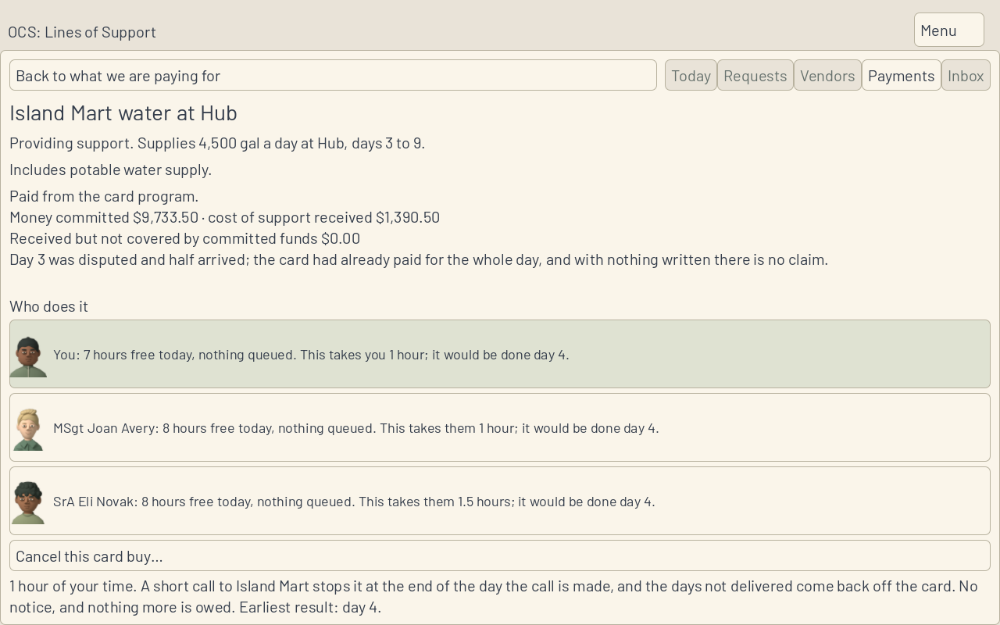

**Work session handoff**

Expected look of this build and why: a contract page for a buy with a confusion day adds one sentence under its money line, for example on day 4 of the 22 Nov second play: "Day 3 was disputed and half arrived; the card had already paid for the whole day, and with nothing written there is no claim." The Payments list and every other page read as before. Contract pages mid-game end their tabs at Inbox (Codex's DESK-209, merged this run).

## PRs reviewed this session

- PR 495 (Codex, DESK-209: hide Debrief on contract pages until the end): CI was red in godot-smoke (presentation), the AudioSmokeTest exit crash that DESK-210 fixed on main. Fable merged main into the branch (backlog-only conflict: kept this branch's DESK-209 row and main's DESK-210 row; conflict-marker check clean), reran the tests on the combined tree, read both screenshots (mid-game navigation ends at Inbox; the finished game's contract page offers Debrief), and merged on green CI.

## Changed

- `Session.BuildDisputedDaysLine` (Session.Disputed.cs) and `SessionView.DisputedDaysLine`: the buy's confusion days from its records, with who paid for the whole day (the card, the cash, or the vendor still charging a commitment made without authority). Null when there was no confusion day.
- game/scripts/GameShell.Contracts.cs: the contract page's money label adds the line (one line, FABLE-SESSION 2a). The Payments list keeps its short line.
- PaymentReportsSmokeChecks (run by ContractSmokeTest) loads the 22 Nov second play on day 4, checks the line on the water page, that the Payments row does not carry it, and that reading it changes nothing; with `--payment-report-screenshots` it saves the picture above.
- DisputedDaysTests: the day-4 sentence and money ($1,390.50, day 3 charged whole), no line on day 2, on written buys or for an unknown id; the first log's forklifts read "Days 12 and 15 ... both whole days".

## Why

Notes P1-6 and P2-10 of the 22 Nov play: after a half-delivered day the page read "cost of support received $1,390.50" with no word on why the whole day was paid.

## Validated how

`dotnet test src/LinesOfSupport.sln` (985 Sim with four new DisputedDaysTests, 121 harness), validate.py and provenance.py pass. ContractSmokeTest passes headless and under Xvfb on Godot 4.6.1 .NET with the screenshot. No golden moved: the line is a view and no report prints it. The screenshot was read as a first-time player: the sentence sits under the dollar figure it explains and says there is nothing to claim.

## Unresolved

None. Next Fable rows: DESK-206 to DESK-208, then a verification play.
