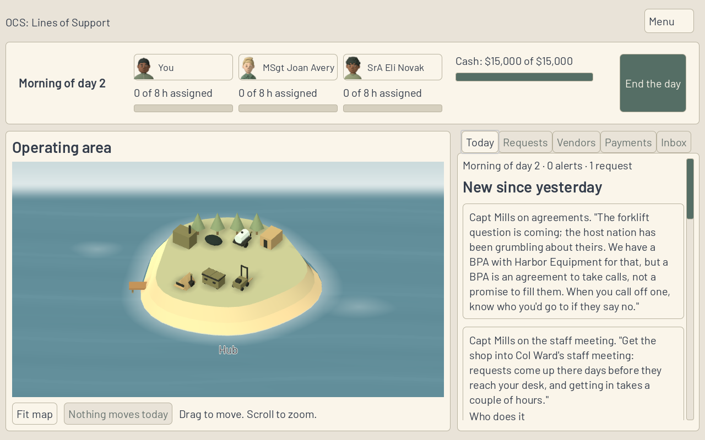

**Work session handoff**

Expected look of this build and why: on the morning of day 2 Mills's agreements note ends at the BPA, and a second note from him, "Capt Mills on the staff meeting", carries the staff meeting sentence with its Join action underneath. A shop that joined (or started joining) the staff meeting on day 1 gets only the first note. 22 Nov play, note P2-7: the advice arrived after the decision it advised on.

## PRs reviewed this session

See docs/handoffs/2026-11-22-fable-desk205.md (PR 495 merged); PR 496 (DESK-205) merged on green CI.

## Changed

- scenarios/tutorial/scenario.json: `mentorAgreements` loses its last sentence; new fixed day-1 event `mentorStaffMeeting` from Mills with precondition `shop.notInStaffMeeting`; added to fixedSituations.
- Events.cs: predicate `shop.notInStaffMeeting`; Session.People.cs: `InOrJoiningStaffMeeting` (attending, or the join visit in work).
- Tests: MillsStaffMeetingTests (the 22 Nov second log, joined on day 1, gets no note; a game with no actions gets it on day 1, once); EventTextTests and TutorialTests updated for three Mills notes; game/tests/MorningScreenFixChecks picks Mills's staff meeting note by its words (one line).
- Goldens: all five tutorial reports moved in Mills's words only. The agreements line drops "And get the shop into Col Ward's staff meeting: ...". approach1-taught, approach2-cash-for-waste, do-nothing and greedy gain the second note (none joins on day 1); textbook joins on day 1 and does not.

## Why

The second 22 Nov player joined the staff meeting on the morning of day 1 and was told that night to get the shop into it.

## Validated how

`dotnet test src/LinesOfSupport.sln` (989 Sim, 121 harness), validate.py and provenance.py pass. Tutorial batch, 200 seeds, before and after: only events.fired moves (6 to 7 for do-nothing and greedy; textbook stays 6). MorningSmokeTest, GoingToPeopleSmokeTest and PeopleSectionSmokeTest pass headless on Godot 4.6.1 .NET; the screenshot is GoingToPeopleSmokeTest's day-2 mentor capture under Xvfb, read as a first-time player: two short notes from the same person, the second with its action.

## Unresolved

None. Next Fable row: DESK-208, then a verification play.
