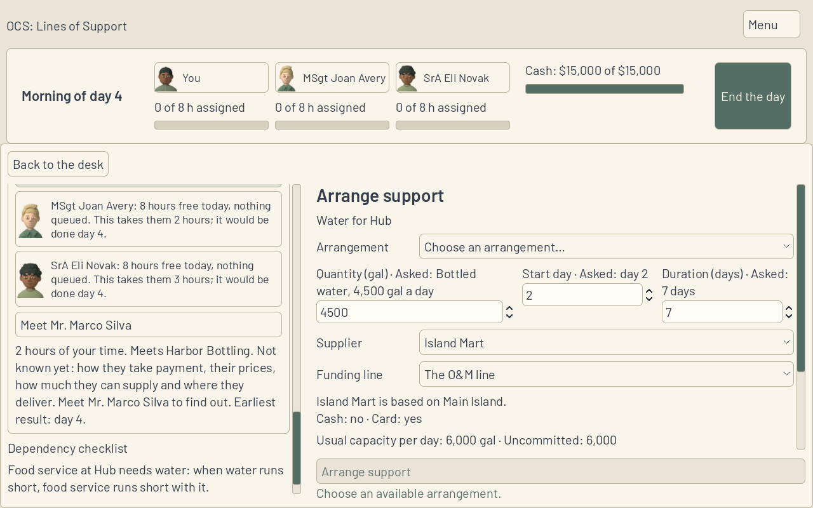

**Work session handoff**

Expected look of this build and why: a request page's dependency checklist begins with what at the site needs this capability. On the tutorial's water request: "Food service at Hub needs water: when water runs short, food service runs short with it." Requests nothing depends on (forklifts, waste) read as before. 22 Nov play, notes P1-5 and P2-9: both players saw food service drop with water on day 3, and nothing had said food service needs water.

## PRs reviewed this session

See docs/handoffs/2026-11-22-fable-desk205.md and docs/handoffs/2026-11-22-fable-desk207.md.

## Changed

- `RequirementEditorView.NeededBy` and `Session.NeededBySentence` (Session.Views.cs): the site's own capabilities whose rules depend on this one, in the site's order, as one sentence; null when none does.
- game/scripts/GameShell.Requirements.cs: the label under "Dependency checklist" (one line, FABLE-SESSION 2a).
- NeededByTests: the tutorial water request names food service; forklifts and waste name nothing; Spoke B's power request names lodging at Spoke B, Spoke C's water request food service at Spoke C.
- HelpersSmokeTest checks the label on the tutorial water request and, with `--screenshots`, saves the picture above.

## Why

The dependency was in the rules and in the debrief after the fact, never on the request where the buy is chosen.

## Validated how

`dotnet test src/LinesOfSupport.sln` (991 Sim with two new tests, 121 harness), validate.py and provenance.py pass. HelpersSmokeTest (with AssignedHelpSmokeChecks) passes headless and under Xvfb on Godot 4.6.1 .NET. No golden moved. The screenshot was read as a first-time player: the sentence sits under the checklist heading in the request column and says why water matters beyond itself.

## Unresolved

The several-users wording is untested by data: no request in the current scenarios has more than one user at its site. The 22 Nov play's rows are all built; a verification play is due once DESK-206 to DESK-208 merge.
