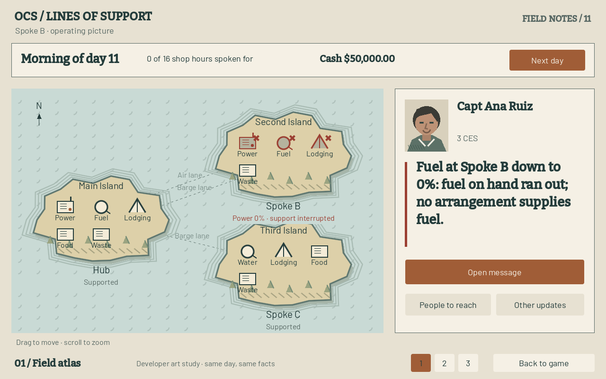
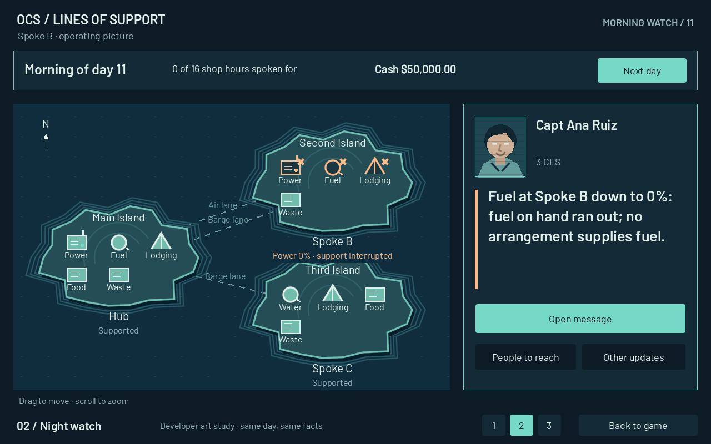
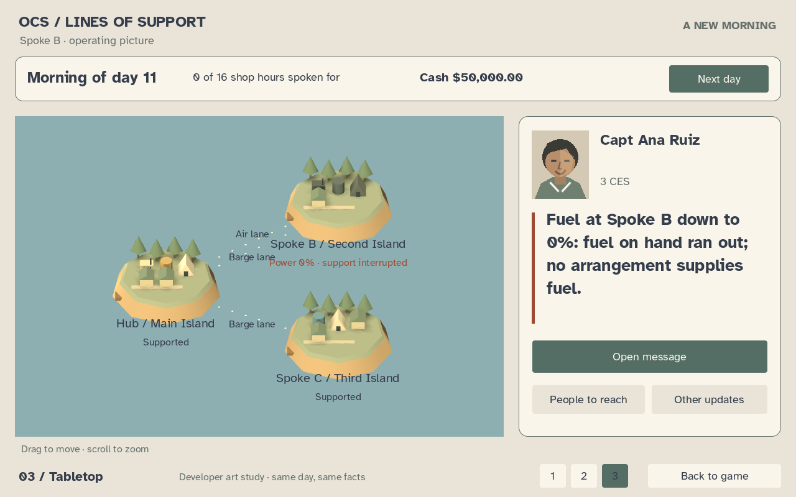

# ART-01: three directions, one morning

All three are native Godot 4.6.1 .NET renders at 1280×800 of the same real Spoke B approach-1 morning: ten days played, day 11 next, Capt Ana Ruiz's exact lead, Spoke B power at 0%, $50,000 cash and the actual shop queue. This is a developer-only, read-only comparison. It does not select a direction, replace the current game theme, implement later ART rows or advance the player's session. Geography and decorative trees are artistic layouts of the authored graph; equipment shapes represent capability states, not counted inventory. A dark generator means no power, not an invented mechanical failure.

## 1. Field atlas

The idea is a readable field atlas with the warmth of a printed strategy board: ivory paper, sage water, ochre land, pine ink and burnt-sienna interruptions. Bitter supplies the slab-serif headlines and Barlow the body; fictional people are drawn as ink-and-cut-paper portraits, while sites use outlined generators, tanks and tents on hatched coasts. A cross and the literal 0% label carry the failure alongside its color. Carrying this across every screen is the lowest-cost direction: one shared paper/ink theme, a consistent vector icon vocabulary and a cast portrait pass; the existing 2D view stays useful. It favors clarity and authored illustration over a strong 3D spectacle.



## 2. Night watch

The idea is a quiet night watch interrupted by a clear amber signal: deep navy, muted blue coastlines, sea-glass teal and warm amber. Barlow Regular and SemiBold keep the screen direct and legible; people become duotone identity illustrations, with fine scan lines, and sites use luminous equipment outlines and contour rings rather than beige cards. Crosses and plain status labels keep outages readable without color. Carrying it everywhere has medium cost: a contrast-tested dark theme, matching duotone portraits and icons, plus restrained map material/effect work; forms can reuse most existing layouts. Its tradeoff is a greater chance of feeling like an operations console, so human messages must stay prominent.



## 3. Tabletop

The idea is a small physical world on the desk: bone-colored cards, moss, sandy ochre, dusty blue water and terracotta warnings. Atkinson Hyperlegible Regular/Bold gives it a welcoming voice; the fictional portrait is a faceted color illustration, and the sites are actual Godot 3D generators, tanks, tents and huts under an orthographic camera and directional light. Spoke B's equipment is dark because the Sim says its support is down, with the same explicit 0% caption. This has the highest carry-through cost: a coherent 3D kit, lighting/material/camera work and readable overlays, alongside one matching 2D theme for every desk and opening screen. It offers the clearest path to tangible deliveries and animation after a direction is chosen; no such motion is invented here.



## Review and reproduce

In the source checkout, start the game, open Menu if already playing, enable **Developer tools**, then choose **ART-01 · compare art directions**. Buttons 1–3 swap the study; **Back to game** closes it and preserves the underlying deployment. Drag/scroll moves the maps. The illustrated game buttons show a read-only notice instead of issuing commands. The study entry is hidden with Developer tools off and in exported builds; the experiment fonts live outside `game/` and are not release dependencies.

Build the Game project, then render directly with Godot 4.6.1 .NET:

```text
Godot_v4.6.1-stable_mono_win64_console.exe --path game res://art/ArtDirections.tscn -- --art-render-dir <absolute-output-directory>
```

The command writes three unedited PNGs and prints `ART_RENDER_PASS`; every image reports the same Sim hash. Headless verification is `res://tests/ArtStudySmokeTest.tscn`. It checks developer gating, direct-Sim equivalence, full lead layout, real 3D meshes and the unchanged player session. All three committed captures are plain PNGs below 190 KB, excluded from LFS.

Fonts are unmodified upstream files pinned to Google Fonts commit `5bb28733cec313b63fbd415b574b5ae35c8aa8b8`; each family's SIL OFL 1.1 is adjacent under `assets/art-studies/fonts/`, and every file has a provenance row. Bitter's runtime variation/emboldening is a Godot font setting, not an altered font file. Map geometry, equipment, UI and fictional portrait studies are generated in `game/art/` using Godot drawing and mesh primitives, without image-generation models, real faces, unit patches, flags or vendor marks.

Nick chooses or mixes directions before ART-02 through ART-06 start. These are direction studies, not a claim that every gameplay screen already has finished art.
